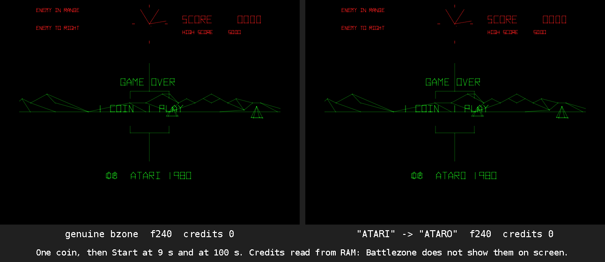
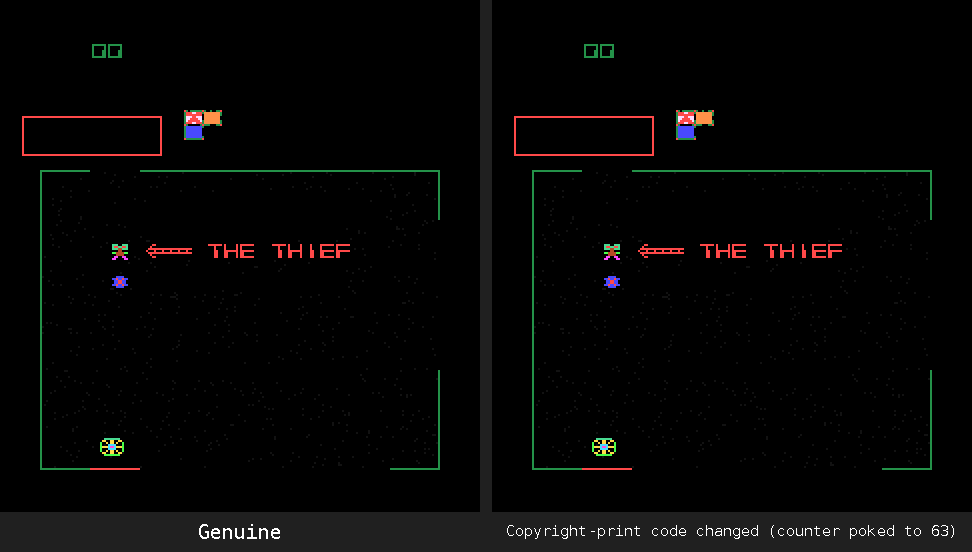
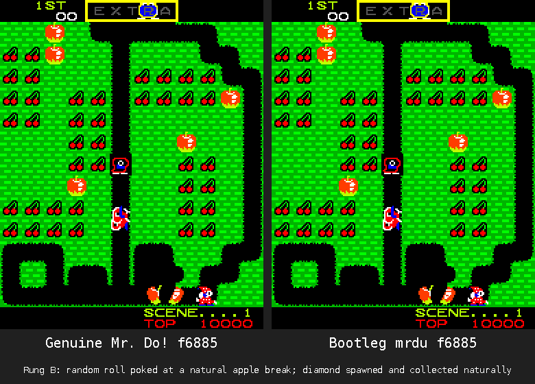
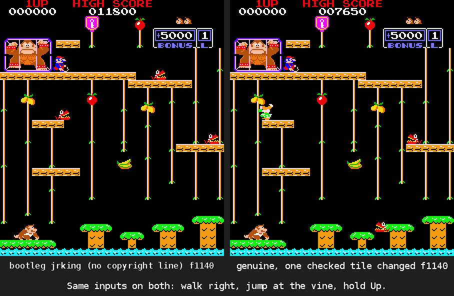
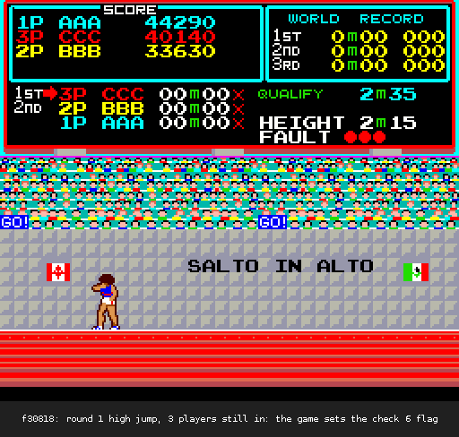
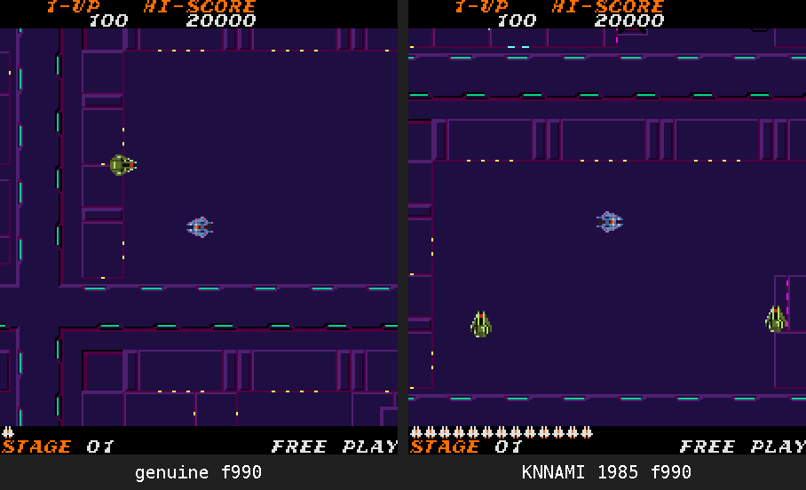

# Bootleg boards that gave away free games: hidden anti-piracy traps in 1979–84 arcade code

In the 1980s my friend Phil S was a member of Bexley Squash Club, and on Sunday afternoons we'd go there to play the arcade machines. On one of them, someone could get free games with a button trick. Forty-odd years later I went looking for it in the code.

It's real. Two Taito games from 1979, **Lunar Rescue** and **Space Invaders Part II**, contain hidden
routines that hand out free credits when you hold a secret button combination in attract mode, and
**they're designed to work only on copied boards**. On a genuine Taito machine the trap switches
itself off a few seconds after power-up. On a bootleg, it stays live.

It wasn't only Taito. Atari's **Asteroids Deluxe** (the first two revisions) quietly gives away 2 credits at
random game overs once its copyright line has been changed, and **Centipede** adds credits at every game start
on a board without a genuine POKEY sound chip. In **Battlezone**, whose checks Andy McFadden had already published, a
changed copyright makes every Start *add* 26 credits. Mostly, instead of locking up a copied board, these games make it lose
money for whoever is operating it.

Universal's **Mr. Do!** (1982) did it with a bootleg's own help. The game guards its protection chip with checksums over
the code that reads it. One real bootleg, **Mr. Du!**, put back a branch the code it copied had lost and fixed the ROM
test's sum so that its self-test passes, but in that code the branch acts on a checksum that fails: **taking the
diamond gives 41 credits instead of 1**.

Nintendo's checks mostly spoil the game quietly instead. In **Donkey Kong Jr.** (1982) a changed copyright means Jr. can't hold
the vines; **Popeye** (1982) adds three software sums to its protection device, one of which gives a random number of
lives. The bootlegs of both dodged the checks. And the "STOLEN FROM ... TAITO" message in Taito America's **Space
Dungeon** (1981) is never shown: the real protection is silent code checksums.

Konami, like Nintendo, pays nothing out. **Track & Field** (1983) locks up a board whose copyright line has
been edited, and half of its checks wait for 50, 1,500 or 4,000 games first, long after the board has been sold. One
real bootleg, **Atlant Olimpic** (1996), has tripped it. **Time Pilot '84** (1984) doesn't lock up: it takes your
lives, flips the screen, swaps the controls and prints an accusation.

> [!NOTE]
> **Not found in the sources checked** (they are listed under [Caveats](#caveats) and in each doc): the free-credit
> routines in Lunar Rescue, Space Invaders Part II and Asteroids Deluxe; Mr. Do!'s two sums over its protection code,
> and Mr. Du! tripping one of them for 41 credits; Popeye's three software checks; how Donkey Kong Jr.'s bootlegs dodged
> its check, and the E kit's broken copy of it; Space Dungeon's checksums, including the delayed one; Track & Field's hidden games-started counters and thresholds, its permanent arming in battery-backed
> RAM, and a real bootleg (Atlant Olimpic) caught by it in normal play; and Time Pilot '84's on-screen accusation.
> **Already published:** Battlezone's two checks (McFadden), Centipede's POKEY check, Mr. Do!'s protection chip, Popeye's
> protection device and Donkey Kong's copyright check. For Donkey Kong Jr.'s check, a piracy check is shown in a YouTube video ("Donkey Kong Jr. - Piracy Check") that links to TCRF; that description
> was not read. Sabotage as such, failing by crippling the game rather than
> stopping it, was already in Atari's Tempest and Millipede. Konami's copyright checks as such, including checks
> triggered by game events, many checksums and checks on how the copyright is displayed, were already in Time Pilot in
> 1982. Repairers had already spotted the reset half of Part II's board check. See [Prior art](#prior-art).

## The short version

| Game | Maker | Year | What the protection does | What the bootlegs did | GIF |
|---|---|---|---|---|---|
| [**Mr. Do!**](docs/universal-mr-do.md) | Universal | 1982 | a protection chip, plus checksums over the code that reads it; a failed diamond sum sets the credits to the wrong number | **Mr. Du! trips a sum: the diamond gives 41 credits instead of 1**; Mr. Lo! removed the protection; the rest kept the chip | [GIF](#mr-do-universal-1982) |
| [**Lunar Rescue**](docs/lunar-rescue.md) | Taito | 1979 | an altered "© TAITO CORPORATION" leaves a free-credit combo armed: 3 credits for P1 Start + Fire + Right in attract mode | three copies pay out (Destination Earth, Escape from Mars, Moon Lander set 2); Rescate Lunar patched the trap out | [GIF](#lunar-rescue-taito-1979) |
| [**Space Invaders Part II**](docs/space-invaders-part-ii.md) | Taito | 1979 | a missing ground link on the board arms a free-credit combo: 2 credits for P1 Start + P2 Start + Fire + Left | all six MAME sets (Taito's and the licensed copies) carry the trap; which real boards had the link missing is unknown | [GIF](#space-invaders-part-ii-taito-1979) |
| [**Asteroids Deluxe**](docs/asteroids-deluxe.md), revisions 1 and 2 | Atari | 1980 | an altered copyright line gives 2 credits at about 1 game over in 3 | no dumped bootleg with its copyright changed is known (simulated here) | [still](#asteroids-deluxe-atari-1980) |
| [**Centipede**](docs/centipede.md) | Atari | 1980 | no genuine POKEY sound chip: extra credits at every game start | six bootlegs without a POKEY: three removed or neutralised the check, three left it in | [still](#centipede-atari-1980) |
| [**Battlezone**](docs/atari-battlezone.md) | Atari | 1980 | a sum over the drawn copyright is the price of a game; altered, each Start adds 26 credits, and the second bonus tank stops the game (checks published by McFadden) | Desert Wars kept the copyright: unaffected | [GIF](#battlezone-atari-1980) |
| [**Space Dungeon**](docs/taito-space-dungeon.md) | Taito America | 1981 | silent checksums over code, one delayed to the 64th event; enemies or the thief drawn wrongly; the "STOLEN" message is never shown | no bootleg known in MAME | [GIF](#space-dungeon-taito-america-1981) |
| [**Donkey Kong Jr.**](docs/nintendo-donkey-kong-jr.md) | Nintendo | 1982 | a changed copyright tile breaks the vine table: Jr. can't hold a vine | all eight working bootlegs dodged it (letters blanked in the graphics ROM, or the screen address moved) | [GIF](#donkey-kong-jr-nintendo-1982) |
| [**Popeye**](docs/nintendo-popeye.md) | Nintendo | 1982 | a device decodes the level data; three software sums on top (test mode, random lives, a lost credit) | two bootlegs imitated the device with a 32-byte PROM and switched off the power-on and high-score ROM sums | [GIF](#popeye-nintendo-1982) |
| [**Track & Field**](docs/konami-track-and-field.md) | Konami | 1983 | an edited copyright line, the code that draws it or one data byte locks the board, some checks only after 50, 1,500 or 4,000 games | Atlant Olimpic (1996) trips check 6 and freezes at the attract demo | [GIF](#track--field-konami-1983) |
| [**Time Pilot '84**](docs/konami-time-pilot-84.md) | Konami | 1984 | an edited "© KONAMI" or stored message: all lives lost, screen flipped and controls swapped every frame, and an accusation printed | no bootleg known (simulated here) | [GIF](#time-pilot-84-konami-1984) |

Every Taito and Atari listing in this repo is checked against the real ROMs by `scripts/verify.py` (Taito) and
`atari/verify_atari.py` (Atari), and every free-credit trap is shown working in an emulator, with the genuine board
alongside. The games added in November 2026 (Battlezone, Space Dungeon, Mr. Do!, Donkey Kong Jr. and Popeye) were
checked in MAME 0.285 with Lua scripts: any edited ROM is a copy built from your own set and alone on the ROM path,
and every run logs the bytes MAME actually loaded.

---

## Lunar Rescue (Taito, 1979)

Each time the title screen draws "© TAITO CORPORATION", a routine reads three bytes of screen memory *inside the
letters of "TAITO"* and compares them with what they should be. If they match, the trap's "armed" flag is cleared and the trap is
dead: on a genuine board, the trap disarms itself 2.6 seconds after switch-on. But if a bootlegger changed the
copyright line, which they routinely did to sell copies under another name, the check fails, the flag stays set,
and anyone who knows the combo gets free games on the bootlegger's machine: 3 credits for P1 Start + Fire + Right
in attract mode.

| Genuine `lrescue` | Bootleg `desterth` (Destination Earth) |
|---|---|
|  |  |

*Same buttons (P1 Start + Fire + Right) held in the attract demo, then released once the credit counter changes. Genuine: nothing. Destination Earth: 3 credits. Made with `scripts/trapdemo.py --gif`.*

Full details: [docs/lunar-rescue.md](docs/lunar-rescue.md).

## Space Invaders Part II (Taito, 1979)

The trigger is the hardware, not the text: the game keeps reading two input lines (port 0, bits 1 and 3) that do
nothing else. According to the notes in MAME's driver, taken from Taito's schematic, both are **tied to ground** on
Taito's board, so the check is looking for two specific ground links. A copier who missed both got a board that
won't start; one who missed one, or wired it differently, got a board that gives free games: 2 credits for
P1 Start + P2 Start + Fire + Left in attract mode.

| Genuine wiring (port 0 = `$00`) | One line high (port 0 = `$02`) |
|---|---|
|  |  |

*`invadpt2`, P1 Start + P2 Start + Fire + Left held in the attract demo and then released: nothing with Taito's wiring, 2 credits with one of the two lines high. Made with `scripts/trapdemo.py --gif`.*

Full details, including the schematic, chip positions and the repair threads:
[docs/space-invaders-part-ii.md](docs/space-invaders-part-ii.md).

## Asteroids Deluxe (Atari, 1980)

Asteroids Deluxe keeps **two copies** of its copyright line, "© 1980 ATARI INC": it draws one on screen and never
displays the other. When a game ends with a **new top score**, it checks every byte on screen against the hidden
copy; a bootlegger who put their own name in the copyright changed only the copy that is drawn, so the two differ,
and a flag is set for good. From then on, the board gives itself 2 credits at about 1 game over in 3, on the
high-score table. So the board pays out at random, only to people who play well, and only after someone has set a
top score, which makes it far harder to notice than Lunar Rescue's combo.

| Genuine board | Copyright changed |
|---|---|
|  |  |

*Simulating a bootleg in MAME (the copyright changed to "1980 ACME INC", one coin per game, the ship left alone).
Made with `atari/astdelux_trap.lua`.*

Full details: [docs/asteroids-deluxe.md](docs/asteroids-deluxe.md).

## Centipede (Atari, 1980)

At power-up and at the start of every game, Centipede puts its POKEY sound chip into reset, which freezes the
chip's random-number register. It then reads that register twice and adds the difference to the credit count, so
a board without a genuine POKEY gets extra credits at every game start. This one is known: the commented
disassembly at [6502disassembly.com](https://6502disassembly.com/va-centipede/Centipede_rev4.html) calls it "add
credits if it's not a POKEY". What the MAME sets add is the bootleggers' side.

| Genuine POKEY | Random register not frozen |
|---|---|
|  |  |

*Straight after power-up, before any coin. Made with `atari/centipede_trap.lua`, which makes only those two
reads differ.*

Full details: [docs/centipede.md](docs/centipede.md).

## Battlezone (Atari, 1980)

Both of Battlezone's checks are published, in **Andy McFadden's commented disassembly**
([6502disassembly.com](https://6502disassembly.com/va-battlezone/)); what this section adds is only what they do when
run. The game checks the *drawing* of "© ATARI 1980": a sum and an XOR over the start of each frame's vector display
list, where the copyright's character calls sit. One of them **sets the price of a game**: Start subtracts it from the
credits. On a genuine board it is 1. With one letter changed it is −26 (`$E6`), so **each Start adds 26 credits**. The
other catches the board later: at the second bonus tank (100,000 points by default) the game **stops for good**. The
one bootleg in MAME, Desert Wars, kept Atari's copyright line, so neither check fires.



*Left: genuine `bzone`. Right: "ATARI" changed to "ATARO". One coin, then Start at 9 s and at 100 s. Genuine: 1, 0,
and the second Start is ignored. ATARO: 1, 27, 53. Battlezone doesn't show the credit count, so the captions read it
from RAM. Made with `atari/demo_bzone.sh credits`.*

Full details, including the stop at 100,000 in natural play: [docs/atari-battlezone.md](docs/atari-battlezone.md).

## Space Dungeon (Taito America, 1981)

Space Dungeon's ROM holds the message "STOLEN FROM THE GOOD BUDDY'S AT TAITO BY AN UNAUTHORIZED DO BADDER". It is
**never shown**: the only instruction naming it sits in a block of bytes that no code enters, and even with the CPU
forced there the text doesn't appear. The protection that does run is **silent**: checksums over parts of the program
whose penalty is to change how objects are drawn, so enemies, or the thief, are drawn wrongly or not at all. One of
them is **delayed**: it adds one byte of the code that prints the copyright at each of 64 game events, and only then
compares. The one sum that covers the copyright text itself is computed and then ignored (`BRN`, branch never). No
bootleg of the game is known in MAME.



*Left: genuine. Right: one byte of the code that prints the copyright changed. The check's counter was poked to 63; the
64th event, the thief taking the treasure in the attract demo, is the game's own. Genuine: nothing. Edited: from then
on the thief is drawn as a cut-down shape. No message appears. Made with `taito/demo_sdungeon.sh`.*

Full details: [docs/taito-space-dungeon.md](docs/taito-space-dungeon.md).

## Mr. Do! (Universal, 1982)

Mr. Do!'s board has a protection chip, a PAL that answers four codes; without it screens are not cleared and the EXTRA
letters stay lit. That much is published. On top of it, the game **sums the code that asks the chip**, and a failed sum
changes the game quietly rather than stopping it. One of those sums runs when the diamond gives its free credit: if it fails, the
credit count is set to the wrong sum plus 1.

And a **real bootleg trips it**. **Mr. Du!** (`mrdu`) is built on the Taito-licensed code, in which that sum no longer
matched and the branch after it had been removed. Mr. Du!'s maker put the branch back and adjusted another byte so that
the self-test's ROM sum still passes. So on Mr. Du!, **taking the diamond gives 41 credits instead of 1**. Another
bootleg, Mr. Lo!, removed the protection completely and runs with no chip.



*Left: genuine `mrdo`. Right: the bootleg `mrdu`. The same scripted game, frame for frame; one RAM write on both sides,
the random roll at the first natural chance of a diamond (1 in 512 otherwise); the spawn, the pick-up and the award are
the game's own. At frame 7491 the credits go 0 to 1 on the genuine board and 0 to 41 on Mr. Du!. The captions read the
credit count from RAM, because this screen shows at most 9 ("CREDIT 9"). Made with `universal/demo_mrdu.sh`.*

Full details, including the chip without its answers and the other bootlegs: [docs/universal-mr-do.md](docs/universal-mr-do.md).

## Donkey Kong Jr. (Nintendo, 1982)

Donkey Kong (1981) sums six letters of "NINTENDO" and freezes if they have been changed; that check is published. For
Donkey Kong Jr., a piracy check is shown in a YouTube video ("Donkey Kong Jr. - Piracy Check") that links to TCRF; that description
was not read.
**Donkey Kong Jr. has the same check at the same addresses**, pointed at seven tiles in the middle of its title-screen
copyright line. A failed sum builds the screen's vine table in the wrong place, so **Jr. can't hold a vine**: the game
doesn't freeze, it just can't be won. **No working bootleg in MAME trips it.** All eight sum the checked bytes to zero;
the five with no copyright line on screen removed it without touching those bytes: four blanked the letters in the
graphics ROM, one moved the line's screen address to `0000`. The E kit's own copy of the check is broken (Donkey Kong's
constant, never updated), so it always fails, harmlessly. How the bootlegs dodged the check, and the E kit's broken
copy, were not found in the sources checked.



*Left: the bootleg Junior King (`jrking`), copyright line blanked in the graphics ROM, checked bytes intact: it climbs.
Right: genuine `dkongjr` with one checked tile changed: it falls back. The same inputs on both: walk right, jump at the
vine, hold Up. Made with `nintendo/demo_dkjr.sh`, which also runs the unedited genuine set as a control (it climbs).*

Full details: [docs/nintendo-donkey-kong-jr.md](docs/nintendo-donkey-kong-jr.md).

## Popeye (Nintendo, 1982)

Popeye's board has a protection device that decodes the level data; without it the game resets when a game starts,
which is published. On top of it the genuine game has **three software checks**: a power-on ROM sum (test mode, the bad
chip marked "NG"), a ROM sum after a high-score name entry that **replaces the number of lives with a random 1 to 4**,
and a sum over the copyright records that **takes a credit**. Two bootlegs, `popeyebl` and `popeyeb2`, **imitated the
device with a 32-byte PROM** and **switched off the power-on and high-score ROM sums**; they passed the copyright sum by leaving
the copyright records alone. `popeyeb2` hides the copyright line by skipping the calls that draw it. What they missed
is the service-mode ROM test, which now fails. No bootleg trips a check in normal play. (MAME swapped the names
`popeyebl` and `popeyeb2` in 2018; Arcade History's "no copyright in bootleg set 1" means today's `popeyeb2`.)


*The high-score sum. Left: genuine `popeye`. Right: one unused ROM byte changed. Same inputs, the score poked so that a
top-five name entry follows the game over. After it the edited board's sum fails and its lives setting becomes 4; in
the next game Olive's house shows "=2" against "=3" reserve lives. Made with `nintendo/demo_popeye.sh`.*

Full details, including the device and the bootlegs' PROM: [docs/nintendo-popeye.md](docs/nintendo-popeye.md).

## Track & Field (Konami, 1983)

Konami's protection works the other way round from the Taito and Atari payouts: it catches pirates who **edit** the
ROMs, not straight copies, and it stops the game instead of giving credits away. **Track & Field** (Hyper Olympic in Japan)
has six checks on the "© KONAMI 1983" line, the code that draws it and one data byte. Three of them are held back
by two hidden games-started counters that the game keeps for nothing else, so they only switch on after 50, 1,500
or 4,000 games. Copyright checks as such had been done before: Konami's Time Pilot had a dense set of them in 1982 (see
[Prior art](#prior-art)); the counters, with their thresholds, and the arming are what Track & Field adds.

And it has caught a **real bootleg**. **Atlant Olimpic** (1996), an Italian bootleg of Hyper Olympic, moved the
copyright line off screen and draws "GEORGIA 1996" in its place, which fails **check 6**. In normal play, a 3- or
4-player game that reaches the round 1 high jump makes the game itself set that check's flag in battery-backed RAM,
and from then on the board freezes at the attract demo after every game and every power-on, until the RAM is cleared.
The code that sets the flag is byte for byte the same in genuine Hyper Olympic; there I had to force the flag to show
check 6 passing, because the genuine game has no continues.



*Atlant Olimpic, played by script with no RAM pokes: the round 1 high jump with three players in, where the game sets
the flag, the end of that game, then the first attract demo, frozen. Made with `konami/demo_atlantol.sh natural`
(about 20 minutes).*

The checks can also be shown on edited copies of a genuine set. Changing one letter of "KONAMI" leaves the game working
normally until the 1,500th game, after which the board resets about once a second, and still does after a power cycle,
because the armed state is kept in battery-backed RAM.

| Genuine `trackfldu` | "KONAMI" changed to "KNNAMI" |
|---|---|
|  |  |

*Games-started counter set to 1,499, then one game: the 1,500th arms the check, which runs once the game is over.
Genuine: attract mode carries on. "KNNAMI": the board resets about once a second from then on. Made with
`konami/demo.sh 2`.*

Full details, including the recovery, the watchdog and the bootleggers' own board-lock checks:
[docs/konami-track-and-field.md](docs/konami-track-and-field.md).

## Time Pilot '84 (Konami, 1984)

Time Pilot '84 checksums its copyright, "© KONAMI", and a stored message, "THIS IS AN ILLEGAL DUPLICATE OF KONAMI'S
ORIGINAL PCBOARD", which is drawn only when a check fails. When a sum is wrong the game doesn't stop: it **takes all
your lives, flips the screen and swaps the controls between the two players on every frame, and prints that
message**. There are two layers. The board's own power-on ROM test sums each ROM block, so a careless one-byte edit is
caught at power-on ("ROM2 BAD") and the board halts. The hidden checks catch the pirate who rebalanced the ROM sums,
simulated here by also changing the year. No bootleg of it is known in MAME, so the demonstration is simulated.
Checks like these were already in Konami's original Time Pilot (1982), and failing by sabotage rather than a stop was
already in Atari's Tempest and Millipede (see [Prior art](#prior-art)); what was not found in the sources checked
is the on-screen accusation.



*Left: genuine. Right: "KNNAMI 1985", with the ROM sums kept so that the power-on test passes. Every frame from 990 to
1,012: the edited board flips on alternate frames, and from frame 1,001 the message is on screen. Made with
`konami/demo_tp84.sh sumkept` and `konami/gif_pair.py`.*

Full details: [docs/konami-time-pilot-84.md](docs/konami-time-pilot-84.md).

---

## It worked on real bootlegs

Scanning the 149 Taito-family sets in a MAME 0.277 collection and running each Lunar Rescue copy in the emulator:

| Set | Made by | Trap as shipped |
|---|---|---|
| **Destination Earth** (`desterth`) | bootleg | **live: the combo gives 3 credits** |
| **Escape from Mars** (`escmars`) | bootleg | **live: the combo gives 3 credits** |
| **Moon Lander, set 2** (`mlandera`) | Leisure Time Electronics (UK) | **live: the combo gives 3 credits** |
| Moon Lander, set 1 (`mlander`) | Leisure Time Electronics (UK) | armed but blocked: patched so the controls read nothing while idle |
| Rescate Lunar (`resclunar`) | Niemer S.A. (Spain) | disabled: `RZ`→`RET` at `$47E6`, plus its own ROM checksum |
| Lunar Rescue Model Racing / Artic copies, Galaxy Rescue | various | switched off: Taito copyright left intact |

Three pirate copies pay out free games. Two others don't: Rescate Lunar patches the trap out directly, and
the other Moon Lander set ignores the controls while the game is idle, which blocks it. All six Space Invaders
Part II sets carry their trap too. Details, including the Moon Base Zeta near miss:
[docs/bootleg-results.md](docs/bootleg-results.md).

The other makers' bootlegs, each run in MAME 0.285:

| Set | Copy of | What it did with the protection | Result |
|---|---|---|---|
| **Mr. Du!** (`mrdu`) | Mr. Do! (Taito-licensed code) | put back a branch after a checksum that fails in that code, and kept the self-test's ROM sum | **tripped: the diamond gives 41 credits instead of 1** |
| Mr. Lo! (`mrlo`) | Mr. Do! | NOPped both protection-chip branches and both checksum branches | protection removed: runs with no chip |
| `mrdobl`, `mrdofabr` (Fabremar), Yankee DO! (`yankeedo`, a hack) | Mr. Do! | kept the chip reads and the checks | nothing tripped; the boards needed the chip or a copy |
| Junior King, Up Maguila, Donkey King Jr., `dkongjrb` | Donkey Kong Jr. | copyright letters blanked in the graphics ROM; checked program bytes intact | **dodged**: the check sums to zero |
| `dkongjrm` | Donkey Kong Jr. (on Moon Cresta hardware) | the copyright line's screen address set to `0000`; checked bytes intact | **dodged** |
| `dkongjr2` (MAME: possibly a bootleg), `dkongjrpb`, `dkongjrmc` | Donkey Kong Jr. | copyright line left as it was | unaffected |
| `popeyebl`, `popeyeb2` | Popeye (Japan) | device imitated by a 32-byte PROM; the power-on and high-score ROM sums switched off; `popeyeb2` also stops drawing the copyright | **dodged** in play; the service-mode ROM test now fails |
| `popeyeb3` | Popeye | `popeyeu`'s device-free code (pre-decoded level data), sum table recalculated | nothing tripped |
| **Desert Wars** (`dsrtwars`, Andra) | Battlezone | kept "ATARI 1980" and both checks | **unaffected** |
| **Atlant Olimpic** (`atlantol`, Italy, 1996) | Konami's Hyper Olympic | moved the copyright line off screen | **tripped: Track & Field's check 6 fails and the board freezes** ([details](docs/konami-track-and-field.md#atlant-olimpic-a-real-bootleg-caught-by-check-6)) |

So two bootlegs outside Taito's family tripped a check: Mr. Du!, which pays out, and Atlant Olimpic, which freezes. The
rest dodged the checks, removed them, or never touched what they guard. Interpretation: whether the dodging was
deliberate can't be told from the bytes; blanking a graphics ROM, or skipping a draw call, was also simply the easiest
way to remove a copyright line.

So what was going on at the squash club? The machine was an unmarked cocktail table: no maker's name, a very
generic cabinet. If it was a Lunar Rescue copy with the Taito name changed (*Destination Earth* or *Escape from
Mars*, or the right version of *Moon Lander*, which was a UK bootleg), holding the combo during the attract demo
gave free credits. I can't know which board it was, but the memory fits the code, and those copies were real.
The full version: [docs/bootleg-results.md](docs/bootleg-results.md#so-what-was-going-on-at-the-squash-club).

## Was this policy?

On the evidence so far, the deliberate free-credit traps were a tactic of 1979–80, when copied boards were everywhere.
Later games punished edited boards quietly or stopped them; the one later payout found, Mr. Du!'s, comes from a failed
checksum, and whether anyone meant it as a payout can't be told (see Universal below).

- **Taito:** the original 1978 Space Invaders has no trap, only an easter egg. Both 1979 games put the trap in the
  **add-on ROM at `$4000`** and tie it to an anti-copy check. Through the 1980s Taito moved to **hardware
  protection**: custom microcontrollers the game can't run without. Since checked: Balloon Bomber, Lupin III,
  Polaris, Space Chaser, Indian Battle and Steel Worker (no trap), and the Z80 games that followed: Crazy Balloon,
  Space Cruiser, Space Seeker, Alpine Ski, Wild Western, Jungle King, Front Line, Elevator Action (no trap). The
  Elevator Action bootleg had to patch nine places to run without Taito's 68705 protection chip: by 1983 the
  protection lived in hardware. Taito America's Space Dungeon (1981) has silent checksums over parts of its program that
  make objects draw wrongly, one of them delayed to the 64th event; its "STOLEN" message is never shown.
- **Atari:** Centipede (the check is in every revision checked: 1, 2, 3 and 4, and the Japanese set) and the first two revisions of Asteroids Deluxe pay out on copies; Asteroids
  Deluxe revision 3 drops it. Atari's other tricks of the time were evidence and sabotage rather than payouts:
  Centipede's hidden Morse-code signature, used in court, and checksum failures that wreck the game: Tempest's
  cripple later rounds and Millipede's run arbitrary code until it is unplayable (see [Prior art](#prior-art)).
  Battlezone (1980) does both: its copyright sum is the price of a game, so a changed copyright gives credits away, and
  a second check stops the game for good at the second bonus tank (both published by McFadden).
- **Universal:** Mr. Do! (1982) relies on a protection chip, and sums the code that reads the chip. Interpretation: the
  sums make patching that code change the game quietly (scene counters, the diamond's free credit) instead of failing
  visibly. On Universal's code the diamond sum passes and on Taito's its branch was removed; only Mr. Du!'s edit makes
  it fire, so whether a payout was ever intended can't be told.
- **Nintendo:** sabotage rather than payouts. Donkey Kong (1981) freezes if "NINTENDO" is changed; Donkey Kong Jr.
  (1982) has the same check at the same addresses and breaks the vines instead. Popeye (1982) relies on a protection
  device and adds three ROM sums: test mode at power-on, random lives after a high-score entry, and a lost credit.
  Interpretation: Donkey Kong Jr.'s routine looks like Donkey Kong's re-pointed at new bytes, and its E kit carries a
  copy that was re-pointed without its constant being updated.
- **Konami:** copyright checks rather than payouts, from 1982 to 1984. The original Time Pilot (1982) already had a
  dense set of them, with event-triggered checks, many checksums and palette checks, failing by reset, hang or garbage
  graphics ([TCRF](https://tcrf.net/Time_Pilot_(Arcade))). In 1983 Track & Field locked up edited boards instead of paying out on copies, adding hidden
  games-started counters and arming kept for good in battery-backed RAM; one of its checks has since caught a real
  1996 bootleg (Atlant Olimpic). In 1984 Time Pilot '84 failed by sabotage, as Atari's Tempest and Millipede already did, and added an on-screen
  accusation.

## How it was found

1. Disassembled the program ROMs: Intel 8080 for the Taito games, 6502 for the Atari ones. (Atari's Lunar Lander was
   checked first as a control, an unrelated 1979 game on a 6502, and is clean: see [docs/lunar-lander-clean.md](docs/lunar-lander-clean.md).)
2. Found the credit counter by inserting coins in the emulator, then traced **every** instruction that writes it.
   Anything other than "coin in" and "start pressed" is suspicious.
3. Ran the Taito ROMs in a purpose-built 8080 emulator of the Space Invaders board, held the combos, and
   simulated a bootleg by altering one letter of "TAITO". The credits appeared; on the unmodified ROM
   they don't.
4. Turned the patterns into a scanner, which finds every hidden routine above and, on the original
   Space Invaders, only the known easter egg.
5. For the Atari games, scanned every set that uses Atari's coin routine (`atari/slamscan.py`), went through every
   remaining credit write by hand, and confirmed each trap in MAME with Lua scripts that play the game unattended,
   on a genuine and a simulated bootleg board.
6. For Konami, a 6809 disassembly of Track & Field, made while checking its Hammer Throw for a missing easter egg;
   the checks turned up on the way, and were verified with Lua scripts using MAME's debugger. Comparing the checked
   bytes of every dumped Track & Field set then turned up Atlant Olimpic tripping check 6, and a scanner built on the
   Track & Field checks (not included here) found Time Pilot '84's. Both were run in MAME, Atlant Olimpic by a script
   that plays the game with no RAM pokes and Time Pilot '84 with edited copies of a genuine set.
7. For the Z80 games (Mr. Do!, Donkey Kong Jr., Popeye): disassembled with MAME's `unidasm`, from the CPU images MAME
   actually loads (Popeye's program ROMs are encrypted). Found the protection reads and every loop that sums memory,
   then confirmed each check in MAME with Lua read, write and execution taps, edited copies of a genuine set, and, for
   the protection hardware, Lua taps that change what the CPU reads without touching any ROM. Donkey Kong's published
   check was the control for Donkey Kong Jr.; Mr. Do! had no known software check to use as a control, so "nothing
   found" there is weaker.
8. Space Dungeon (6809): a disassembler checked against `unidasm`, and a decode of every byte offset of the ROM to
   look for anything that could print the message. Battlezone: Andy McFadden's disassembly first, then MAME runs.
9. One rule for the MAME runs in steps 7 and 8: an edited zip is the only folder on the ROM path, and the run logs
   the bytes MAME actually loaded. With the real ROM folder as a second path, MAME rejects the edited file on its
   checksum and silently loads the genuine one; that turned up in the Donkey Kong control runs.

Two side trails: [the "kick me for a free game" story](docs/kick-me-hunt.md), looked for and not found (that search
is what turned up Asteroids Deluxe and Centipede), and [the easter egg that travelled](docs/easter-egg-travelled.md),
Space Invaders' "TAITO COP" in other companies' games.

## Try it yourself

ROMs are not included; use your own MAME sets (the results here are from MAME 0.277 sets; Konami's and the five games
added in November 2026 from MAME 0.285, with 0.277 sets).

**Taito** (pure Python 3: a disassembler, a signature scanner and an 8080 emulator of the Space Invaders board):

```bash
python3 trapscan.py run lrescue.zip --frames 1720 --patch 4676=13 \
    --hold start1+fire+right@1600-1700 --watch 20eb     # bootleg simulation -> credits 03
```

**Atari** (MAME's Lua scripting; the scripts play by themselves and print the credit count):

```bash
mame astdelux1 -autoboot_script atari/astdelux_trap.lua              # copyright changed: +2 credits at some game overs
atari/demo_bzone.sh credits ~/roms                                   # Battlezone: genuine 1 -> 0, "ATARO" 1 -> 27 -> 53
```

**Konami** (MAME's Lua scripting and debugger; the Konami results are from MAME 0.285):

```bash
python3 konami/build_roms.py ~/roms          # one-byte edits of trackfldu, built from your own set into konami/roms/
konami/demo.sh 2 ~/roms                      # "KONAMI" -> "KNNAMI", counter at 1,499: genuine passes, edited boot-loops
konami/demo_atlantol.sh check6 ~/roms        # Atlant Olimpic against genuine Hyper Olympic, check 6 armed: genuine carries on, atlantol freezes
python3 konami/build_tp84.py ~/roms          # two edited Time Pilot '84 sets, built from your own set into konami/roms/
konami/demo_tp84.sh sumkept ~/roms           # genuine against the edit with the ROM sums kept: screen flips, controls swap, message printed
```

**Universal, Nintendo and Taito America** (MAME's Lua scripting; each script runs both sides, prints the logs and
writes the GIF. Space Dungeon's and Donkey Kong Jr.'s edits are built from your own zip into a temporary folder; Popeye's
ROM files are encrypted, so its one-byte edit is made in MAME's decrypted copy in memory, from Lua, and no zip is
changed; Mr. Do! needs no edit, as Mr. Du! is a real dump):

```bash
universal/demo_mrdu.sh ~/roms                # Mr. Do! against the bootleg Mr. Du!: the diamond gives 1 credit, or 41
nintendo/demo_dkjr.sh ~/roms                 # Junior King climbs; genuine Donkey Kong Jr. with one checked tile changed falls
nintendo/demo_popeye.sh ~/roms               # Popeye: 3 lives against 4 after the high-score sum fails
taito/demo_sdungeon.sh ~/roms                # Space Dungeon: the delayed check fires on the 64th event
```

More commands (the genuine-board runs, the MAME debugger steps, the verify scripts, Centipede, the slam-switch scan,
the whole-collection search) and full instructions: [docs/USAGE.md](docs/USAGE.md#every-maker-at-a-glance).
Sets worth collecting: [docs/ROMLIST.md](docs/ROMLIST.md).

## Caveats

- Confirmed by disassembly and emulation, **not yet on real hardware**.
- The Taito Z80 games are scanned statically (no Z80 emulator here); the Z80 games added later (Mr. Do!, Donkey Kong
  Jr., Popeye) were run in MAME.
- Which real boards had one of the Part II input lines high is unknown. MAME leaves them low (Taito's wiring),
  so the trap is off there unless you poke the flag. If you have a genuine or bootleg Part II board: are port 0
  bits 1 and 3 (both grounded on Taito's schematic) really tied low on yours, and how is that link made? Does the
  combo work? An issue on this repo with the answer would settle it.
- The Asteroids Deluxe bootleg is simulated (I don't know of a dumped bootleg of revision 1 or 2 with its copyright
  changed). Two more checks in that game, one during play and a ROM checksum, are not traced yet.
- The Centipede demonstration changes only the two reads at the check, to show its effect; a real board without a
  POKEY would differ in other ways too.
- The Track & Field edits are simulated (one byte changed in a genuine set), only checks 1 and 2 are demonstrated on
  them, and check 6 on a real bootleg, Atlant Olimpic. The other dumped bootlegs change no checked byte. Konami's
  results are from MAME 0.285, emulation only.
- Atlant Olimpic: the genuine control used a forced flag (the genuine game has no continues; the flag-setting code is
  byte for byte identical in both sets). That the real bootleg board has no working watchdog is an inference from the
  code, not from a board.
- Time Pilot '84 has no known bootleg. Its demonstration needs a two-byte edit (the copyright and the year) that keeps
  the ROM test's sum, because a one-byte edit is stopped by the ROM test first; it also uses a RAM poke to open the
  rare checks, and free play because a coin did not register in MAME. The comparison with the original Time Pilot is
  from TCRF's Time Pilot page, not from running that game.
- Battlezone: the board with "ATARO" is a simulation (no bootleg in MAME changed the copyright). The credit count is
  read from RAM, because the game doesn't show it; the 100,000-point run poked the score to 99,000, and the kill after
  it was the game's own.
- Space Dungeon: one scripted-play seed; the delayed check was shown with its counter poked to 63, the 64th event
  natural (in the attract demo).
- Mr. Do!: no known software check to test the method against. Mr. Du!'s 41 credits were shown with one RAM write,
  the random roll at the first natural chance of a diamond; the spawn, the pick-up and the award were natural (a run
  with nothing written found three diamonds in about 155 emulated hours, none usable). "With chip" means MAME's chip.
  One of the two sums (check A) is from the code only.
- Donkey Kong Jr.: scripted play reached screen 1 only; `dkingjrv` is not in the 0.277 sets.
- Popeye: the high-score and copyright triggers were poked (the score; the copyright sum's sequence state), and the
  edit was made in MAME's decrypted copy of the program, because the ROM files are encrypted.
- TCRF: TCRF does not allow automated or AI access, so its pages were read by hand for Time Pilot and Track & Field
  only. TCRF was not checked for Time Pilot '84, so "not found in the sources checked" for it rests
  on other sources only. TCRF was not checked either for the five games added in November 2026 (Battlezone, Space
  Dungeon, Mr. Do!, Donkey Kong Jr., Popeye); for Donkey Kong Jr. a YouTube video links to a TCRF description of a
  piracy check, which was not read. TCRF links in these docs are not checked by the link checker, by request.
- "Right" means bit 6 of input port 1, the standard Space Invaders wiring.
- "Not found in the sources checked" means not found online, in Computer Archeology, 6502disassembly.com or the
  arcade history databases, and, except for Time Pilot '84 and the five games added in November 2026 (see the TCRF
  note above), in TCRF. For those five, each doc lists the sources it checked: MAME's driver sources and change
  history, MAME Testers, Arcade Museum forum threads, jammarcade.net, Arcade History, Arcade Database and others. If you know otherwise, open an issue; I'd love to hear it.

## Prior art

Other anti-copying tricks from the same era that are documented:

- **Centipede (Atari, 1980)** adds credits when its POKEY isn't genuine (above), and hid a data pattern that spells
  "COPYRIGHT 1980 ATARI" in Morse code once decoded. The Morse pattern does nothing at run time; Atari used it as
  evidence in court that the bootleg *Magic Worm* was copied from its code
  ([Arcade Blogger](https://arcadeblogger.com/2019/06/29/atari-centipedes-hidden-code-trap/),
  [6502disassembly.com](https://6502disassembly.com/va-centipede/Centipede_rev4.html)).
- **Battlezone (Atari, 1980)**: **Andy McFadden's commented disassembly**
  ([6502disassembly.com](https://6502disassembly.com/va-battlezone/)) documents both of its copyright checks: the
  sum used when credits are deducted, and the check that stops the saucer sounds after 100,000 points and is never
  cleared. The measured effects above (each Start adds 26 credits; the game stops at the second bonus tank) and Desert
  Wars being unaffected are all this repo adds.
- **Donkey Kong (1981)** checks part of "NINTENDO" in its copyright line and freezes if it has been changed
  ([Super Mario Wiki](https://www.mariowiki.com/Donkey_Kong_(game)); furrykef's [dkdasm](https://github.com/furrykef/dkdasm)).
  Donkey Kong Jr.'s check above uses the same routine at the same addresses; for it, a piracy check is shown in a YouTube video ("Donkey Kong Jr. - Piracy Check") that links to TCRF; that description
  was not read.
- **Mr. Do! (Universal, 1982)**: its protection chip, the screens it leaves uncleared and the NOP bypass that Mr. Lo!
  uses were described on the [Arcade Museum forum](https://forums.arcade-museum.com/threads/mr-do-pcb.386835/) in
  2016; the EXTRA letters that stay lit are [MAME Testers 08201](https://mametesters.org/view.php?id=8201).
- **Popeye (Nintendo, 1982)**: the protection device, and the reset without it, are described at
  [jammarcade.net](https://jammarcade.net/popeye-tech-info/) (2017) and in MAME's driver.
- **Track & Field (Konami, 1983)**, above, works like Donkey Kong's check (the copyright line, and a stopped game) and
  like Time Pilot's (below), but adds hidden games-started counters with thresholds, and arming that stays for good
  in battery-backed RAM. Its hidden "©KONAMI 1983" message was published by cmonkey on UKVAC in 2016; the counters, the permanent arming
  and a bootleg tripping one of its checks were not found in the sources checked.
- **Time Pilot (Konami, 1982)** already had a dense set of copyright checks. [TCRF](https://tcrf.net/Time_Pilot_(Arcade)) lists them: two copies of the
  copyright string drawn on alternate frames, plus two more in the sprite ROM; checksums of the copyright and of many
  code ranges across six phases (boot, crosshatch, title, demo and gameplay, special checks, high-score entry);
  palette checks on the copyright line and on individual letters ("M", "K", "N"); checks triggered by game events
  (losing a life, the next stage, entering stage 5); and failures by reset, hang or garbage graphics. **So
  event-triggered checks, multiple checksums, and checks on how the copyright is displayed (in Time Pilot its palette,
  in Track & Field its screen position) were already in Time Pilot in 1982.** Time Pilot '84 and Track & Field above
  are in the same family.
- **Tempest (Atari, 1981)**: a buggy anti-piracy checksum in the first revision could award 40 free credits; Atari
  fixed it in revision 2 ([Arcade Blogger](https://arcadeblogger.com/2018/12/15/golden-age-arcade-games-bootlegs-lawsuits-litigation/),
  [MAME's `tempest.cpp` notes](https://github.com/mamedev/mame/blob/mame0285/src/mame/atari/tempest.cpp)). TCRF also says its failed checks "cripple many aspects of the game during later rounds,
  rendering further gameplay impossible" ([TCRF](https://tcrf.net/Tempest_(Arcade))). That is sabotage as such: the
  game keeps running but is wrecked.
- **Millipede (Atari, 1982)**: per TCRF, a failed copyright checksum makes the game run arbitrary code every 128
  frames until it is unplayable ([TCRF](https://tcrf.net/Millipede_(Arcade))). Again the game is wrecked rather than
  stopped.
- **Space Invaders Part II's board check:** its reset was identified by repairers in 2022, as a guard against
  ROM-swap upgrades, with the patch to remove it
  ([Arcade Museum forum](https://forums.arcade-museum.com/threads/taito-3-board-space-invaders-part-2-bad-shifter-causes-resets.504475/),
  [UKVAC](https://www.ukvac.com/forum/threads/taito-3-pcb-invaders-boardset-resetting.75648/)); MAME's driver notes
  the two lines are tied low on Taito's schematic. The credit trap behind the same check was not found in the sources checked.
- **Space Dungeon (Taito America, 1981)** has a message in its ROM, "STOLEN FROM THE GOOD BUDDY'S AT TAITO BY AN
  UNAUTHORIZED DO BADDER", quoted by
  [Arcade Database](https://adb.arcadeitalia.net/dettaglio_mame.php?game_name=sdungeon&lang=en) ("Developer messages are
  hidden in the ROM chip sd19"); [pronama.jp](https://pronama.jp/2024/05/31/space-dungeon/) (2024) says no command
  displays it. The code agrees: it is never shown (above).
- General Computer's "kick me for a free game" story, told second-hand
  ([Ned Batchelder](https://nedbatchelder.com/blog/200404/arcade_copy_protection)); not found, see above.

Not found in the sources checked: that the Lunar Rescue, Part II and Asteroids Deluxe traps actually run, that they're
tied to a copy check, and that the Lunar Rescue one pays out on real bootlegs (Destination Earth, Escape from Mars, one
version of Moon Lander). For the later games: Mr. Do!'s sums over its protection code and Mr. Du!'s 41 credits;
Popeye's three ROM sums and what its bootlegs did about them; how Donkey Kong Jr.'s bootlegs dodged its check, and the
E kit's broken copy of it; Space Dungeon's checksums. Already published: Donkey Kong's check; for Donkey Kong Jr.'s,
a piracy check is shown in a YouTube video ("Donkey Kong Jr. - Piracy Check") that links to TCRF; that description
was not read. On the Konami side, and not on TCRF's Time Pilot page: Track & Field's hidden games-started counters and
thresholds, its permanent arming in battery-backed RAM, a real bootleg (Atlant Olimpic) caught by it in normal play,
and Time Pilot '84's on-screen accusation. Wrecking the game on failure, as Time Pilot '84 does, was already in Atari's
Tempest and Millipede; only the accusation and its particular effects (lives, screen flip, control swap) are Konami's.

## References

- [The Cutting Room Floor: Space Invaders (Arcade)](https://tcrf.net/Space_Invaders_(Arcade)), the "TAITO COP" easter egg
- [Computer Archeology: Space Invaders](https://www.computerarcheology.com/Arcade/SpaceInvaders/), hardware and original
  code, and also the "TAITO COP" button sequences
- [6502disassembly.com: Centipede](https://6502disassembly.com/va-centipede/Centipede_rev4.html), commented disassembly
- [arcade-history.com: Lunar Rescue](https://www.arcade-history.com/game/1418/)
- [MAME machine data: Space Invaders Part II](https://data.spludlow.co.uk/mame/machine/invadpt2)
- MAME's driver sources (`8080bw.cpp`, `asteroid.cpp`, `centiped.cpp`, `pokey.cpp`, `trackfld.cpp`, `tp84.cpp`,
  [`bzone.cpp`](https://github.com/mamedev/mame/blob/mame0285/src/mame/atari/bzone.cpp),
  [`mrdo.cpp`](https://github.com/mamedev/mame/blob/mame0285/src/mame/universal/mrdo.cpp),
  [`dkong.cpp`](https://github.com/mamedev/mame/blob/mame0285/src/mame/nintendo/dkong.cpp),
  [`popeye.cpp`](https://github.com/mamedev/mame/blob/mame0285/src/mame/nintendo/popeye.cpp),
  [`qix.cpp`](https://github.com/mamedev/mame/blob/mame0285/src/mame/taito/qix.cpp)), for memory maps, inputs,
  POKEY behaviour and the protection hardware; MAME commit
  [16a0695af](https://github.com/mamedev/mame/commit/16a0695afe88108dc69edcde75f39aa2057d7de4), which swapped the names
  `popeyebl` and `popeyeb2` in 2018
- [Andy McFadden: Battlezone, commented disassembly](https://6502disassembly.com/va-battlezone/), the source of both
  Battlezone checks
- [furrykef/dkdasm](https://github.com/furrykef/dkdasm), the Donkey Kong disassembly whose check was the control for
  Donkey Kong Jr.
- [MAME Testers 08201](https://mametesters.org/view.php?id=8201) and the Arcade Museum forum threads
  ["Mr. Do PCB"](https://forums.arcade-museum.com/threads/mr-do-pcb.386835/) and
  ["WTB: Security IC used in Popeye"](https://forums.arcade-museum.com/threads/wtb-security-ic-used-in-popeye.557068/)
- [jammarcade.net: Popeye tech info](https://jammarcade.net/popeye-tech-info/) and
  [Not In Mame: Popeye pcb (bootleg) repair](https://notinmame.blogspot.com/2018/05/popeye-pcb-bootleg-repair.html)
- [Arcade Database: Space Dungeon](https://adb.arcadeitalia.net/dettaglio_mame.php?game_name=sdungeon&lang=en) and
  [pronama.jp: Space Dungeon](https://pronama.jp/2024/05/31/space-dungeon/)
- [List of Taito games (Wikipedia)](https://en.wikipedia.org/wiki/List_of_Taito_games)
- [robotron-2084.co.uk: Taito Space Invaders Part II 3-layer board stack](https://www.robotron-2084.co.uk/hardware/boardset/taito-space-invaders-part-ii-3-layer-board-stack), board photos and Taito's
  schematics (CPU AA017757, ROM AA017756A, I/O and sound PV070010); thanks for making them available
- Arcade Museum forum (HudsonArcade, Lurch666 and others) and UKVAC, for the repair-side knowledge of Part II's
  board check

*Mark Hawkings, Bexley, 2026.*

Licence: MIT
