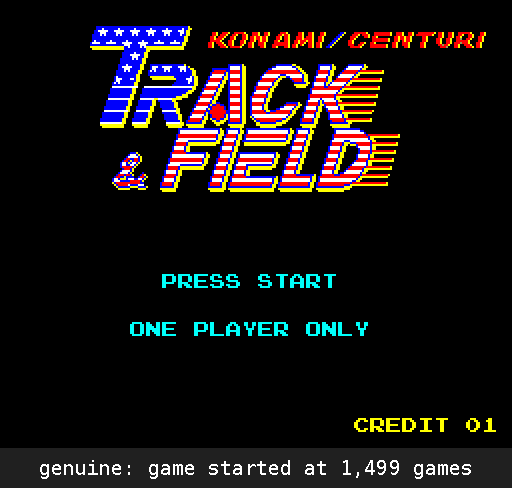
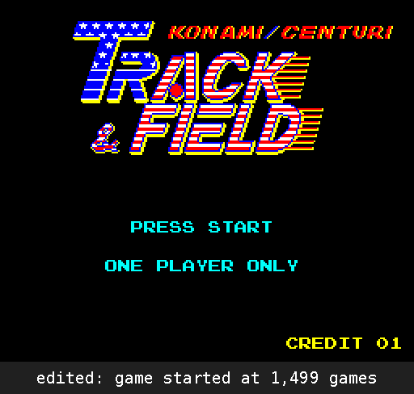

# Bootleg boards that gave away free games: hidden anti-piracy traps in 1979–83 arcade code

In the 1980s my friend Phil S was a member of Bexley Squash Club, and on Sunday afternoons we'd go there to play the arcade machines. On one of them, someone could get free games with a button trick. Forty-odd years later I went looking for it in the code.

It's real. Two Taito games from 1979, **Lunar Rescue** and **Space Invaders Part II**, contain hidden
routines that hand out free credits when you hold a secret button combination in attract mode, and
**they're designed to work only on copied boards**. On a genuine Taito machine the trap switches
itself off a few seconds after power-up. On a bootleg, it stays live.

It wasn't only Taito. Atari's **Asteroids Deluxe** (the first two revisions) quietly gives away 2 credits at
random game overs once its copyright line has been changed, and **Centipede** adds credits at every game start
on a board without a genuine POKEY sound chip. Instead of locking up a copied board, these games make it lose
money for whoever is operating it.

Konami went the other way. **Track & Field** (1983) pays out nothing: it locks up a board whose copyright line has
been edited, and half of its checks wait for 50, 1,500 or 4,000 games first, long after the board has been sold.

> [!NOTE]
> **As far as I can find, the free-credit routines in Lunar Rescue, Space Invaders
> Part II and Asteroids Deluxe, and Track & Field's delayed tamper checks, haven't been documented before.** Repairers had already
> spotted the reset half of Part II's board check, and Centipede's is known; see below.

## The short version

| Game | Copy check | What a copied board does | |
|---|---|---|---|
| [**Lunar Rescue**](docs/lunar-rescue.md) (Taito, 1979) | the "© TAITO CORPORATION" text has been altered | 3 credits for P1 Start + Fire + Right in attract mode | new |
| [**Space Invaders Part II**](docs/space-invaders-part-ii.md) (Taito, 1979) | one of two ground links on the board is missing | 2 credits for P1 Start + P2 Start + Fire + Left in attract mode | new |
| [**Asteroids Deluxe**](docs/asteroids-deluxe.md), revisions 1 and 2 (Atari, 1980) | the copyright line has been altered | 2 credits at about 1 game over in 3, on the high-score table | new |
| [**Centipede**](docs/centipede.md) (Atari, 1980) | no genuine POKEY sound chip | extra credits at every game start | known |
| [**Track & Field**](docs/konami-track-and-field.md) (Konami, 1983) | the "© KONAMI 1983" line, the code that draws it, or one data byte has been changed | an edited board crashes, freezes or keeps resetting, after 50, 1,500 or 4,000 games or a particular result | new: delayed, permanent tamper checks (no earlier write-up found) |

Every Taito and Atari listing in this repo is checked against the real ROMs by `scripts/verify.py` (Taito) and
`atari/verify_atari.py` (Atari), and every free-credit trap is shown working in an emulator, with the genuine board
alongside.

---

## Lunar Rescue (Taito, 1979)

Each time the title screen draws "© TAITO CORPORATION", a routine reads three bytes of screen memory *inside the
letters of "TAITO"* and compares them with what they should be. If they match, the trap's "armed" flag is cleared and the trap is
dead: on a genuine board, the trap disarms itself 2.6 seconds after switch-on. But if a bootlegger changed the
copyright line, which they routinely did to sell copies under another name, the check fails, the flag stays set,
and anyone who knows the combo gets free games on the bootlegger's machine: 3 credits for P1 Start + Fire + Right
in attract mode.

| Genuine `lrescue` | Bootleg `desterth` (Destination Earth) |
|---|---|
|  |  |

*Same buttons (P1 Start + Fire + Right) held in the attract demo, then released once the credit counter changes. Genuine: nothing. Destination Earth: 3 credits. Made with `scripts/trapdemo.py --gif`.*

Full details: [docs/lunar-rescue.md](docs/lunar-rescue.md).

## Space Invaders Part II (Taito, 1979)

The trigger is the hardware, not the text: the game keeps reading two input lines (port 0, bits 1 and 3) that do
nothing else. According to the notes in MAME's driver, taken from Taito's schematic, both are **tied to ground** on
Taito's board, so the check is looking for two specific ground links. A copier who missed both got a board that
won't start; one who missed one, or wired it differently, got a board that gives free games: 2 credits for
P1 Start + P2 Start + Fire + Left in attract mode.

| Genuine wiring (port 0 = `$00`) | One line high (port 0 = `$02`) |
|---|---|
|  |  |

*`invadpt2`, P1 Start + P2 Start + Fire + Left held in the attract demo and then released: nothing with Taito's wiring, 2 credits with one of the two lines high. Made with `scripts/trapdemo.py --gif`.*

Full details, including the schematic, chip positions and the repair threads:
[docs/space-invaders-part-ii.md](docs/space-invaders-part-ii.md).

## Asteroids Deluxe (Atari, 1980)

Asteroids Deluxe keeps **two copies** of its copyright line, "© 1980 ATARI INC": it draws one on screen and never
displays the other. When a game ends with a **new top score**, it checks every byte on screen against the hidden
copy; a bootlegger who put their own name in the copyright changed only the copy that is drawn, so the two differ,
and a flag is set for good. From then on, the board gives itself 2 credits at about 1 game over in 3, on the
high-score table. So the board pays out at random, only to people who play well, and only after someone has set a
top score, which makes it far harder to notice than Lunar Rescue's combo.

| Genuine board | Copyright changed |
|---|---|
|  |  |

*Simulating a bootleg in MAME (the copyright changed to "1980 ACME INC", one coin per game, the ship left alone).
Made with `atari/astdelux_trap.lua`.*

Full details: [docs/asteroids-deluxe.md](docs/asteroids-deluxe.md).

## Centipede (Atari, 1980)

At power-up and at the start of every game, Centipede puts its POKEY sound chip into reset, which freezes the
chip's random-number register. It then reads that register twice and adds the difference to the credit count, so
a board without a genuine POKEY gets extra credits at every game start. This one is known: the commented
disassembly at [6502disassembly.com](https://6502disassembly.com/va-centipede/Centipede_rev4.html) calls it "add
credits if it's not a POKEY". What the MAME sets add is the bootleggers' side.

| Genuine POKEY | Random register not frozen |
|---|---|
|  |  |

*Straight after power-up, before any coin. Made with `atari/centipede_trap.lua`, which makes only those two
reads differ.*

Full details: [docs/centipede.md](docs/centipede.md).

## Track & Field (Konami, 1983)

Konami's protection works the other way round from the traps above: it catches pirates who **edit** the ROMs, not
straight copies, and it stops the game instead of giving credits away. **Track & Field** (Hyper Olympic in Japan)
has six checks on the "© KONAMI 1983" line, the code that draws it and one data byte. Three of them are held back
by two hidden games-started counters that the game keeps for nothing else, so they only switch on after 50, 1,500
or 4,000 games. In the emulator, changing one letter of "KONAMI" leaves the game working normally until the 1,500th
game, after which the board resets about once a second, and still does after a power cycle, because the armed
state is kept in battery-backed RAM.

| Genuine `trackfldu` | "KONAMI" changed to "KNNAMI" |
|---|---|
|  |  |

*Games-started counter set to 1,499, then one game: the 1,500th arms the check, which runs once the game is over.
Genuine: attract mode carries on. "KNNAMI": the board resets about once a second from then on. Made with
`konami/demo.sh 2`.*

Full details: [docs/konami-track-and-field.md](docs/konami-track-and-field.md).

---

## It worked on real bootlegs

Scanning the 149 Taito-family sets in a MAME 0.277 collection and running each Lunar Rescue copy in the emulator:

| Set | Made by | Trap as shipped |
|---|---|---|
| **Destination Earth** (`desterth`) | bootleg | **live: the combo gives 3 credits** |
| **Escape from Mars** (`escmars`) | bootleg | **live: the combo gives 3 credits** |
| **Moon Lander, set 2** (`mlandera`) | Leisure Time Electronics (UK) | **live: the combo gives 3 credits** |
| Moon Lander, set 1 (`mlander`) | Leisure Time Electronics (UK) | armed but blocked: patched so the controls read nothing while idle |
| Rescate Lunar (`resclunar`) | Niemer S.A. (Spain) | disabled: `RZ`→`RET` at `$47E6`, plus its own ROM checksum |
| Lunar Rescue Model Racing / Artic copies, Galaxy Rescue | various | switched off: Taito copyright left intact |

Three pirate copies pay out free games. Two others don't: Rescate Lunar patches the trap out directly, and
the other Moon Lander set ignores the controls while the game is idle, which blocks it. All six Space Invaders
Part II sets carry their trap too.

Details, including the Moon Base Zeta near miss and [what was going on at the squash
club](docs/bootleg-results.md#so-what-was-going-on-at-the-squash-club): [docs/bootleg-results.md](docs/bootleg-results.md).

## Was this policy?

On the evidence so far, the free-credit traps were a tactic of 1979–80, when copied boards were everywhere:

- **Taito:** the original 1978 Space Invaders has no trap, only an easter egg. Both 1979 games put the trap in the
  **add-on ROM at `$4000`** and tie it to an anti-copy check. Through the 1980s Taito moved to **hardware
  protection**: custom microcontrollers the game can't run without. Since checked: Balloon Bomber, Lupin III,
  Polaris, Space Chaser, Indian Battle and Steel Worker (no trap), and the Z80 games that followed: Crazy Balloon,
  Space Cruiser, Space Seeker, Alpine Ski, Wild Western, Jungle King, Front Line, Elevator Action (no trap). The
  Elevator Action bootleg had to patch nine places to run without Taito's 68705 protection chip: by 1983 the
  protection lived in hardware.
- **Atari:** Centipede (revisions 1, 2 and 4, the ones checked) and the first two revisions of Asteroids Deluxe pay out on copies; Asteroids
  Deluxe revision 3 drops it. Atari's other tricks of the time were evidence and sabotage rather than payouts:
  Centipede's hidden Morse-code signature, used in court, and checksums such as Tempest's.
- **Konami:** by 1983, Track & Field locked up edited boards instead of paying out on copies.

## How it was found

1. Disassembled the program ROMs: Intel 8080 for the Taito games, 6502 for the Atari ones. (Atari's Lunar Lander was
   checked first as a control, an unrelated 1979 game on a 6502, and is clean: see [docs/lunar-lander-clean.md](docs/lunar-lander-clean.md).)
2. Found the credit counter by inserting coins in the emulator, then traced **every** instruction that writes it.
   Anything other than "coin in" and "start pressed" is suspicious.
3. Ran the Taito ROMs in a purpose-built 8080 emulator of the Space Invaders board, held the combos, and
   simulated a bootleg by altering one letter of "TAITO". The credits appeared; on the unmodified ROM
   they don't.
4. Turned the patterns into a scanner, which finds every hidden routine above and, on the original
   Space Invaders, only the known easter egg.
5. For the Atari games, scanned every set that uses Atari's coin routine (`atari/slamscan.py`), went through every
   remaining credit write by hand, and confirmed each trap in MAME with Lua scripts that play the game unattended,
   on a genuine and a simulated bootleg board.
6. For Konami, a 6809 disassembly of Track & Field, made while checking its Hammer Throw for a missing easter egg;
   the checks turned up on the way, and were verified with Lua scripts using MAME's debugger.

Two side trails: [the "kick me for a free game" story](docs/kick-me-hunt.md), looked for and not found (that search
is what turned up Asteroids Deluxe and Centipede), and [the easter egg that travelled](docs/easter-egg-travelled.md),
Space Invaders' "TAITO COP" in other companies' games.

## Try it yourself

ROMs are not included; use your own MAME sets (the results here are from MAME 0.277 sets, Konami's from 0.285).

**Taito** (pure Python 3: a disassembler, a signature scanner and an 8080 emulator of the Space Invaders board):

```bash
python3 trapscan.py run lrescue.zip --frames 1720 --patch 4676=13 \
    --hold start1+fire+right@1600-1700 --watch 20eb     # bootleg simulation -> credits 03
```

**Atari** (MAME's Lua scripting; the scripts play by themselves and print the credit count):

```bash
mame astdelux1 -autoboot_script atari/astdelux_trap.lua              # copyright changed: +2 credits at some game overs
```

**Konami** (MAME's Lua scripting and debugger; the Track & Field results are from MAME 0.285):

```bash
python3 konami/build_roms.py ~/roms          # one-byte edits of trackfldu, built from your own set into konami/roms/
konami/demo.sh 2 ~/roms                      # "KONAMI" -> "KNNAMI", counter at 1,499: genuine passes, edited boot-loops
```

More commands (the genuine-board runs, the MAME debugger steps, the verify scripts, Centipede, the slam-switch scan,
the whole-collection search) and full instructions: [docs/USAGE.md](docs/USAGE.md#every-maker-at-a-glance).
Sets worth collecting: [docs/ROMLIST.md](docs/ROMLIST.md).

## Caveats

- Confirmed by disassembly and emulation, **not yet on real hardware**.
- Z80 games are scanned statically (no Z80 emulator yet).
- Which real boards had one of the Part II input lines high is unknown. MAME leaves them low (Taito's wiring),
  so the trap is off there unless you poke the flag. If you have a genuine or bootleg Part II board: are port 0
  bits 1 and 3 (both grounded on Taito's schematic) really tied low on yours, and how is that link made? Does the
  combo work? An issue on this repo with the answer would settle it.
- The Asteroids Deluxe bootleg is simulated (I don't know of a dumped bootleg of revision 1 or 2 with its copyright
  changed). Two more checks in that game, one during play and a ROM checksum, are not traced yet.
- The Centipede demonstration changes only the two reads at the check, to show its effect; a real board without a
  POKEY would differ in other ways too.
- The Track & Field edits are simulated (one byte changed in a genuine set; no dumped bootleg changes a checked
  byte), only two of its six checks are demonstrated in the emulator, and its results are from MAME 0.285.
- "Right" means bit 6 of input port 1, the standard Space Invaders wiring.
- "Not documented before" means I couldn't find it online, in TCRF, Computer Archeology, 6502disassembly.com or the
  arcade history databases. If you know otherwise, open an issue; I'd love to hear it.

## Prior art

Other anti-copying tricks from the same era that are documented:

- **Centipede (Atari, 1980)** adds credits when its POKEY isn't genuine (above), and hid a data pattern that spells
  "COPYRIGHT 1980 ATARI" in Morse code once decoded. The Morse pattern does nothing at run time; Atari used it as
  evidence in court that the bootleg *Magic Worm* was copied from its code
  ([Arcade Blogger](https://arcadeblogger.com/2019/06/29/atari-centipedes-hidden-code-trap/),
  [6502disassembly.com](https://6502disassembly.com/va-centipede/Centipede_rev4.html)).
- **Donkey Kong (1981)** checks part of "NINTENDO" in its copyright line and freezes if it has been changed
  ([TCRF](https://tcrf.net/Donkey_Kong_(Arcade))).
- **Track & Field (Konami, 1983)**, above, works like Donkey Kong's check (the copyright line, and a stopped game),
  but waits for hidden games-started counters, stays armed for good in battery-backed RAM, and spreads the test over
  six checks. Its hidden "©KONAMI 1983" message was published by cmonkey on UKVAC in 2016; I found no earlier
  write-up of the checks.
- **Tempest (1981)**: a buggy anti-piracy checksum in the first revision could award 40 free credits; Atari
  fixed it in revision 2 ([TCRF](https://tcrf.net/Tempest_(Arcade))).
- **Space Invaders Part II's board check:** its reset was identified by repairers in 2022, as a guard against
  ROM-swap upgrades, with the patch to remove it
  ([Arcade Museum forum](https://forums.arcade-museum.com/threads/taito-3-board-space-invaders-part-2-bad-shifter-causes-resets.504475/),
  [UKVAC](https://www.ukvac.com/forum/threads/taito-3-pcb-invaders-boardset-resetting.75648/)); MAME's driver notes
  the two lines are tied low on Taito's schematic. The credit trap behind the same check hasn't been described.
- **Space Dungeon (Taito America, 1981)** has an untriggered message, "STOLEN FROM THE GOOD BUDDY'S AT TAITO
  BY AN UNAUTHORIZED DO BADDER" ([TCRF](https://tcrf.net/Space_Dungeon)).
- General Computer's "kick me for a free game" story, told second-hand
  ([Ned Batchelder](https://nedbatchelder.com/blog/200404/arcade_copy_protection)); not found, see above.

What's different here: the Lunar Rescue, Part II and Asteroids Deluxe traps actually run, they're tied to a copy
check, and the Lunar Rescue one pays out on real bootlegs (Destination Earth, Escape from Mars, one version of Moon
Lander).

## References

- [The Cutting Room Floor: Space Invaders (Arcade)](https://tcrf.net/Space_Invaders_(Arcade)), the "TAITO COP" easter egg
- [Computer Archeology: Space Invaders](https://www.computerarcheology.com/Arcade/SpaceInvaders/), hardware and original code
- [6502disassembly.com: Centipede](https://6502disassembly.com/va-centipede/Centipede_rev4.html), commented disassembly
- [arcade-history.com: Lunar Rescue](https://www.arcade-history.com/game/1418/)
- [MAME machine data: Space Invaders Part II](https://data.spludlow.co.uk/mame/machine/invadpt2)
- MAME's driver sources (`8080bw.cpp`, `asteroid.cpp`, `centiped.cpp`, `pokey.cpp`), for memory maps, inputs and
  POKEY behaviour
- [List of Taito games (Wikipedia)](https://en.wikipedia.org/wiki/List_of_Taito_games)
- [robotron-2084.co.uk: Taito Space Invaders Part II 3-layer board stack](https://www.robotron-2084.co.uk/hardware/boardset/taito-space-invaders-part-ii-3-layer-board-stack), board photos and Taito's
  schematics (CPU AA017757, ROM AA017756A, I/O and sound PV070010); thanks for making them available
- Arcade Museum forum (HudsonArcade, Lurch666 and others) and UKVAC, for the repair-side knowledge of Part II's
  board check

*Mark Hawkings, Bexley, 2026.*

Licence: MIT
