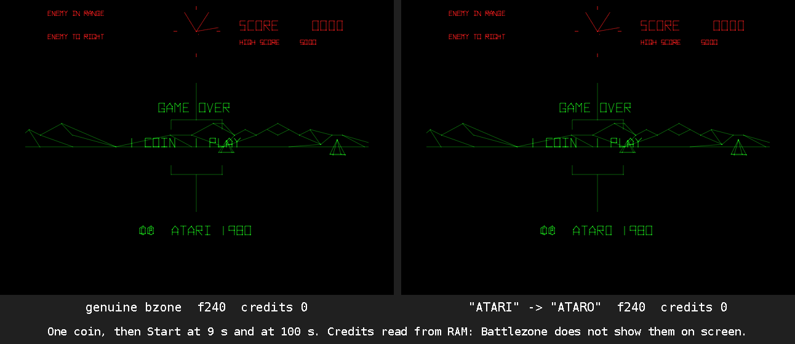
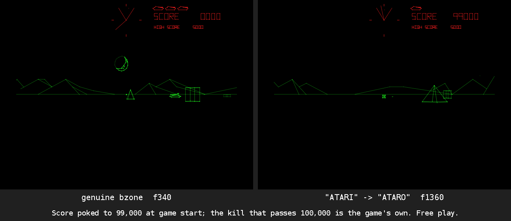

# Battlezone (Atari, 1980) – an altered copyright sets the price of a game, and the second bonus tank stops it

> [!NOTE]
> **Both checks below are published.** Andy McFadden's commented disassembly of Battlezone, at
> [6502disassembly.com/va-battlezone](https://6502disassembly.com/va-battlezone/), documents the two sums over the
> copyright's display list, that the second one is used when credits are deducted, and that the first stops the
> saucer sounds after 100,000 points and is never cleared. All the credit for finding them is his. What this page adds
> is only what they do when run: the measured effects on a board with one copyright letter changed, and the one
> bootleg in MAME, which is unaffected.

MAME sets `bzone` (revision 2), `bzonea` (revision 1), `bzonec` (cocktail) and `dsrtwars` (Desert Wars, a bootleg by
Andra with an AY-3-8910 for sound; MAME marks it "not working", but it boots and plays). One 6502 and a vector display.
Addresses are `bzone`'s. MAME 0.285, ROMs from 0.277 sets.

## In short

Battlezone draws "© ATARI 1980" at the bottom of the screen and checks the drawing, not the text: it reads the first
54 bytes of the frame's vector display list, which hold the calls that draw the copyright. Two checks read them:

- **The sum (`$527B`)** is stored at `$0370`, and **Start subtracts `$0370` from the credit count.** On a genuine board
  it is 1, so a game costs one credit. With one letter changed it is `$E6`, which in 8 bits is −26, so **each Start
  adds 26 credits.**
- **The XOR (`$5118`)** is stored at `$02ED`. When the second bonus tank is given (at 100,000 points with the default
  settings), the game sets a flag that only a passing XOR clears. With the copyright changed it is never cleared, and
  **the game stops for good**.

The one bootleg in MAME, **Desert Wars**, kept Atari's copyright line and both checks, so neither fires.



*Left: genuine `bzone`. Right: "ATARI" changed to "ATARO" (`$6F34`). One coin (1 Coin/1 Credit), Start at 9 s and again
at 100 s. Genuine: 1 credit, then 0; the second Start is ignored. ATARO: 1, then 27, then 53. Battlezone does not show
the credit count on screen, so the captions take it from RAM (`$0E`). Made with `atari/demo_bzone.sh credits`.*

## What the checks read

The copyright text is in ROM at `$6F30`, coded as character × 2 ("A" = `$16`), and the text routine at `$6CB6` turns it
into vector-generator calls (`JSRL`) at the start of each frame's display list. Both checks read those first 54 bytes
(`$36`): some set-up, then one call per character of "ATARI 1980". So changing a letter in ROM changes the calls, and
both results.

| Check | Code | Result | Genuine | One letter changed (`$6F34` "I" to "O") | Used by |
|---|---|---|---|---|---|
| XOR | `$5118` | `$02ED` | `$01` | `$7C` | the stop at the second bonus tank (`$51C2`) |
| sum | `$527B` (0 minus each byte, minus ROM byte `$7493`) | `$0370` | `$01` | `$E6` | Start (`$563C-$5650`): credits := credits − `$0370` |

## Credits

Measured with one coin and two Starts (above), and in an earlier run with default coinage (2 coins per credit): one
credit and Start, then after that game two more credits and Start again:

| Run | `$0370` | First Start | Second Start |
|---|---|---|---|
| `bzone`, genuine | `01` | 1 to 0 | 2 to 1 |
| `bzone`, `$6F34` "I" to "O" ("ATARO 1980") | `E6` | 1 to **27** | 29 to **55** |

Play was otherwise normal on both: the lives went 3, 2, 1, 0 at similar times.

## The stop at 100,000

The bonus-tank code at `$615F` reads the bonus-life DIP switch. The first bonus tank only adds a life. The second
(`$6188`, at 100,000 points with the default settings, when the hundred-thousands digit `$B9` becomes non-zero) adds a
life and sets `$0345` = `$FF` (`$6192`). While `$0345` bit 7 is set, the main loop skips every game-update call and goes
to `$51C2`, which clears `$0345` only if the XOR check passed.

Run: the score's thousands byte `$B8` poked to `$99` (99,000) two seconds into each game, free play, a scripted player
that sits still and fires. Nothing else written. Both sides got a kill past 100,000 in their first game:

| Run | Kill | `$0345` | After |
|---|---|---|---|
| `bzone`, genuine | frame 423, 100,000 | set, cleared 106 frames later | lives 4, 3, 2, 1, 0; game over; attract mode |
| "ATARO" | frame 1447, 101,000 | set, **never cleared** | lives stay at 2 to the end of the run (frame 16,407; 24 emulated minutes in a longer run); the screen is still redrawn (the radar sweeps) but nothing in the game moves |



*Left: genuine. Right: ATARO, shown 1,020 frames later so that the two kills line up. The score was poked to 99,000 at
game start; the kill that passes 100,000 is the game's own. Genuine plays on (the cracked screen is the player being
hit). ATARO stops. Made with `atari/demo_bzone.sh 100k`.*

## Desert Wars

`dsrtwars` (Andra): the XOR check, the stop at `$51C2`, the sum check, Start's subtraction, the ROM byte `$7493`, the
bonus-tank code, the text routine and the copyright text "ATARI 1980" are byte-identical to `bzone` revision 2. Its
roughly 2,100 changed bytes are almost all in the vector ROM. In MAME the 54 checked bytes are identical to genuine,
`$0370` = 01, `$02ED` = 01, and Start takes 1 credit: **unaffected**, because the copyright line was left alone.

## Rerun

From the repo root, with your MAME ROM folder (`bzone.zip`):

```bash
atari/demo_bzone.sh credits ~/roms   # about 20 seconds: genuine 1 -> 0, ATARO 1 -> 27 -> 53
atari/demo_bzone.sh 100k ~/roms      # about a minute: genuine plays on, ATARO stops
```

The edited set is built from your own `bzone.zip` by `scripts/patchzip.py` (file `036411-01.k1`, offset `0x734`,
`26` to `32`) into a temporary folder that is the only rompath for that run; each log starts with the loaded copyright
bytes. `atari/bzone_credits.lua` and `atari/bzone_100k.lua` hold the inputs and the logging.

## Caveats

- MAME 0.285, emulation only, not real hardware.
- The credit count is read from RAM (`$0E`); the game does not show it.
- The 100,000 run poked the score to 99,000; the kill and everything after it were the game's own. An earlier test
  forced `$0345` instead, with the same result.
- McFadden's listing also shows `$0370` copied into the vector display list at `$5588`, and a checksum-adjust byte at
  `$5340`; neither was tested here.
- No bootleg in MAME has its copyright line changed, so the ATARO board is a simulation.
