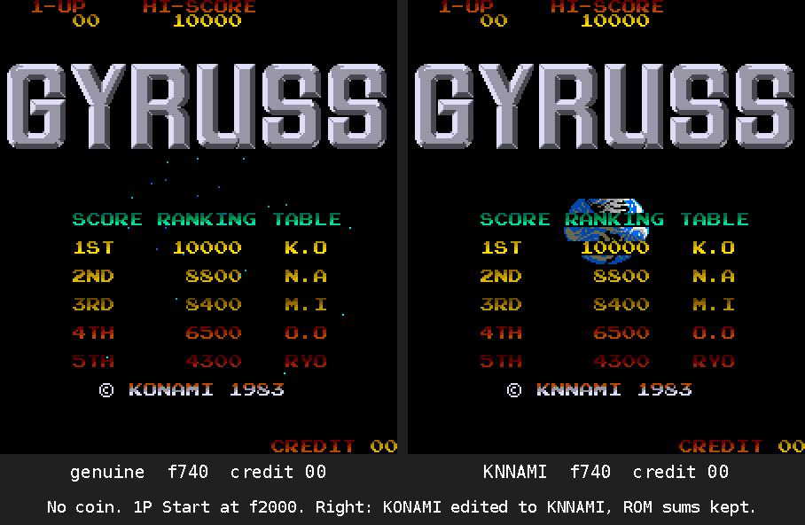
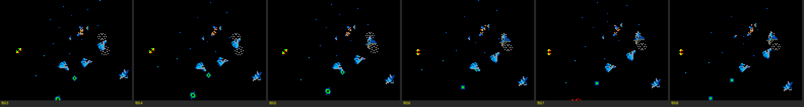
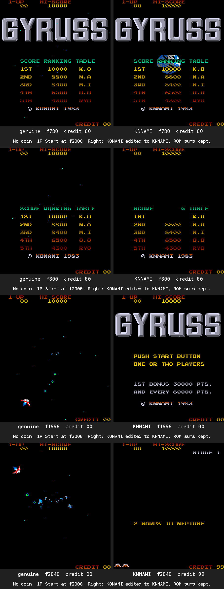

# Gyruss (Konami, 1983) – ROM sums all through the game, and a copyright edit that gives free play

[Back to the README](../README.md)

MAME sets `gyruss` (Konami), `gyrussce` (Centuri), `gyrussb` (MAME: "bootleg?") and `venus` (bootleg). A Z80 main
CPU, a Konami-1 sub CPU (a 6809 with encrypted opcodes) and the sound CPUs. Addresses are main Z80 addresses in
`gyruss`; all four sets share that layout, and every difference between them is an in-place byte change in the main
Z80's program (the sub CPU, sound, graphics and PROM files have the same CRCs in all four). No battery-backed RAM.
MAME 0.285, ROMs from 0.277 sets.

## In short

That Gyruss checks its own ROM is **already published**. **cmonkey** wrote on the Arcade Museum forum in March 2015
([thread "Gyruss - Line across the screen + TEST ROM", page 3](https://forums.arcade-museum.com/threads/gyruss-line-across-the-screen-test-rom.339280/page-3))
that there are "over 20 different places in the code where various areas and data ranges of rom are checked", that
"The results of tampering with the code vary from a reset to an unplayable game", and that the checks "have had the
JR NZ,xxx NOPed in Venus". The same thread documents the sub CPU's ROM-sum report for the diagnostics ROM. No
addresses of the main CPU's checks were given in the pages read.

What this repo adds:

- **The list.** The main Z80 has **29 loops that sum or XOR a block of ROM** (C01 to C29) and **5 checks that read
  letters of "© KONAMI 1983" back from the screen** (V1 to V5). They run all the time: power-on, every attract cycle,
  coin, game start, every stage, every wave, game over and name entry. There is no counter and no arming, and the
  sub CPU has no check.
- **What failure does.** Reset, a hang, a jump into data or into the middle of a routine, or a wrong game state. Two
  checks swallow a coin. Some checks do not branch at all: their sum *is* the next game state.
- **A copyright edit with the ROM sums fixed gives free play** (in MAME, on an edited copy of a genuine set). With
  "KONAMI" changed to "KNNAMI" and two balancing bytes, every ROM sum passes, but a screen check fails in the first
  attract demo. The board then sits on "PUSH START BUTTON" with 0 credits, and Start with no coin starts a game and
  sets the credits to 99. Genuine, same inputs: attract mode, 0 credits.
- **The bootlegs.** `venus` removed or patched nearly every check, but missed a sound number that Konami took from the
  "9" of 1983, so its mid-distance kills are silent. `gyrussb` carries a balanced 17-byte patch that makes the game
  harder faster. Centuri's `gyrussce` put "LICENSED TO CENTURI" into a blank slot already in Konami's ROM. No check
  acts on any of them in normal play.



*Left: genuine `gyruss`. Right: the same ROM with "KONAMI" edited to "KNNAMI" and two more bytes changed so the ROM
sums stay right. No coin on either side; 1P Start at frame 2000. At frame 788 the edited board's screen check (V5)
fails and it drops to PUSH START BUTTON with CREDIT 00; Start then begins a game, and by frame 2040 the credits read
99. Genuine: attract mode, CREDIT 00, Start ignored. Nothing poked. The caption's credit count is read from RAM
(`$9406`); it is also on screen. Made with `konami/demo_gyruss.sh`.*

## The checks

Found in an `unidasm` listing of the main Z80, then evaluated by running each check's own code over each set's ROM
image (a small Z80 interpreter), and run in MAME with a breakpoint on each check's decision instruction. "When" is the
first hit in a genuine played run (coin at frame 600, Start at 660).

### The 29 ROM checks

| id | decision | reads | operation and constant | on failure (from the code) | when (first frame) |
|---|---|---|---|---|---|
| C01 | `$0083` | `$0000-$00FF` | sum, `SUB $00`, result unused | nothing | boot |
| C02 | `$01D2` | `$37A8-$38A7` (copyright header and text) | sum, `SUB $3F` | `JP $0000` reset | boot, 138 |
| C03 | `$01ED` | `$3900-$39EF` | sum, `SUB $1E` | `JP $0FAB` (the tail of the game-start routine) | coin, 602 |
| C04 | `$0513` | `$0F10-$100F` | sum, `SUB $B3` | `JP $3785` (into a data table) | power-on, 0 |
| C05 | `$057B` | `$3778-$37F7` (copyright text) | XOR, `ADD $10` | `JP $1845` (middle of a routine) | attract demo |
| C06 | `$058C` | `$40A0-$419F` | sum, `ADD $E5` | `JP $4876` (middle of an instruction) | boot 172, each attract cycle |
| C07 | `$05D1` | `$0060-$015F` | XOR, `SUB $00`, then NOPs | nothing | not reached |
| C08 | `$06EE` | `$11E0-$12DF` | XOR, `SUB $06` | `JP $42FE` (middle of a drawing routine) | after coin, 629 |
| C09 | `$0DB6` | `$0500-$057F` | sum, `SUB $C9` | `JP $0000` reset | stage clear |
| C10 | `$0F1E` | `$37A9-$37AB` (copyright header, "©") | `RST $18`, `XOR H`, `SUB $EB` | `JP $0000` reset | boot, 138 |
| C11 | `$1278` | `$5D50-$5D8F` | XOR, `ADD $E7` | `JP $1892` (middle of a routine) | each stage start, 741 |
| C12 | `$13B7` | `$4BC7-$4CC6` (bonus-life table) | sum, `SUB $C8` (`gyrussce`: `$58`) | `JP $0FAB` (game-start tail) | coin, 602 |
| C13 | `$1590` | `$24C1-$25C0` | `$942C` -= sum, `XOR $1E` | wrong next game state | game start, 630 |
| C14 | `$1B82` | `$0560-$065F` | sum, `ADD $62` | `JP $0000` reset | life lost, 2352 |
| C15 | `$2002` | `$1556-$15D5` | `$942C` = `$942B` + sum + `$94` | wrong next game state | game start, each stage |
| C16 | `$24DD` | `$0500-$06FF` | XOR, `ADD $D3` | `JP $07FF` (state change) | title, 531 |
| C17 | `$259A` | `$0BC0-$0CBF` | sum, `SUB $31` | `CALL $0000` reset | each stage, 812 |
| C18 | `$2E38` | `$1550-$164F` | sum, `SUB $8C` | `JP $0000` reset | each stage, 854 |
| C19 | `$3520` | `$1C58-$1D57` | sum, `SUB $AD` | `JP $07FF` | title, 532 |
| C20 | `$4068` | `$2DED-$2EEC` | XOR, `ADD $40` | `JP $0192` (the NMI exit, on a stack with no NMI frame) | stage clear, 5813 |
| C21 | `$4119` | `$0071-$0170` | sum, `ADD $F7` | `JP $152B` (into text data) | attract demo |
| C22 | `$4289` | `$4683-$4782` | `$942B` -= sum, `SUB $0E` | wrong game state | attract, game over |
| C23 | `$4413` | `$4C09-$4D08` | `$942C` -= sum, `XOR $02` | wrong game state | attract demo |
| C24 | `$4575` | `$055E-$05DD` | `$942C` = -sum + `$9F` | wrong game state | each wave |
| C25 | `$46E0` | `$34A3-$35A2` | XOR, `ADD $13` | `JP $04EA` reset | boot 172, attract |
| C26 | `$4C21` | `$0100-$01FF` | XOR, `SUB $A9` | `JP $0066` (the NMI handler, with no NMI) | boot, 170 |
| C27 | `$4C78` | `$0D50-$0D5C` | sum + `$50`, `CP $90` | `JP $0192` | name entry |
| C28 | `$4CDA` | `$06E0-$07DF` | `$9600` += sum + `$C0` | `$9600` not zero: extra code at `$42EC` | stage counter 16 to 19 (not reached) |
| C29 | `$4FCC` | `$0000-$5FFF` (the whole ROM) | sum, must be 0 | `JP $4FCC` (a hang) | power-on ROM test, 36 |

So 27 of the 29 act on their result: 19 branch to sabotage on a bad sum (a reset, a jump into data or the middle of
an instruction or routine, the NMI handler, a hang), 2 branch into the game-start code (C03, C12), 5 use the sum
itself as the next game state (C13, C15, C22, C23, C24), and 1 adds it to a RAM byte (C28). C01 and C07 compute a sum
that nothing uses.

`$942C` and `$942B` are the game's main and sub state. The five state checks do not branch: a changed byte in their
range sends the game to a different state, so there is no branch to remove. `$0FAB` and `$07FF` are ordinary state
code too: `$0FAB` is where 1P and 2P Start normally lead, and `$07FF` steps the sub state and resets the main state.

### The copyright on screen, and a sound number in the copyright

The copyright is drawn from ROM (`$37AB-$37B7`) into video RAM. Five places read single letters back from the screen:

| id | where | reads | effect when the letter is wrong | when |
|---|---|---|---|---|
| V1 | `$00F9` | `$863B` ("A") | the state does not advance | attract |
| V2 | `$106A` | `$85FB` ("I") | `JP $07FF`, a state change | the "push start" state (not reached) |
| V3 | `$24E4` | `$867B` ("O") | the command sent to the sub CPU is `$00` instead of `$01` | title, 531 |
| V4 | `$3523` | `$861B` ("M") | the letter, less `$3A`, plus 1, becomes the sub state | title, 532 |
| V5 | `$3911` | `$869B`, `$867B`, `$865B` ("K", "O", "N") | `JP $07FF` | attract demo |

And one routine (`$5CD4`) loads a **sound command from ROM `$37B5`, the "9" of "1983"**. In `gyruss` that byte is
`$1A`, a sound effect. Nothing compares it; it is simply used. This is what `venus` missed (below).

Interpretation: the checks look deliberate and layered: sums over ROM, the copyright as drawn, and sums folded into the
game's own state numbers so that they cannot simply be branched around. The alternative, that some are leftovers,
fits C01, C07 and a sum at `$3923` followed by `NOP NOP NOP`, which look disabled in the shipped program.

Compared with the other Konami games here: unlike [Track & Field](konami-track-and-field.md), Gyruss has no NVRAM, no
games-started counters and no arming; its checks run from the first game. Like [Time Pilot '84](konami-time-pilot-84.md)
it has a power-on ROM test (C04, C29) and copyright sums (C02, C05, C10), but no accusation message was found.

Two signatures sit in the ROM: "PROGRAMED BY TOSHIO ARIMA 83 4 21" in tile codes at `$0526`, and ASCII staff credits
at `$1E9A` (`venus` blanked the ASCII one). No code was found that reads either.

## What a failed check does

In MAME, normal coin and Start, nothing poked, snapshots every 300 frames:

| check | effect in MAME |
|---|---|
| C02, C25 | reset at boot, over and over (the cross-hatch screen; 86 and 69 resets in 12,000 frames) |
| C04 | never draws a picture; the power-on check runs again and again |
| C29 | hangs at the cross-hatch (PC `$4FCC`) |
| C03, C12 | **the coin is taken and no game starts**: on a coin the board freezes on a damaged ranking screen (letters and the top score missing), CREDIT 01, no "PUSH START" |
| C06 | the GYRUSS logo is missing from the first title; play then looks normal |
| C08 | after Start, an empty playfield with a full row of reserve ships across the top |
| C11 | at each stage start the lives drain |
| C13, C15, C17, C18 | at game start or the first stage: one reset, then attract mode; no game |
| C20 | at the first stage clear the main state goes out of range |
| C21 | attract mode freezes on the ranking screen |
| C23 | attract mode crashes into RAM; the screen fills with garbage |
| C26 | at boot, sits on "PUSH START BUTTON / ONE PLAYER ONLY" with the CREDIT label gone |
| **C16, C19, V5** | **the board drops to "PUSH START BUTTON / ONE OR TWO PLAYERS" with 0 credits; Start with no coin gives a game and 99 credits** (below) |

MAME ignores the [watchdog](../README.md#terms-used) (the `$C000` write is mapped to nothing), so a hang stays a hang in
MAME; on a board the watchdog would presumably reset it (not tested).

## The initials entry: no Easter egg

The high-score name entry (`$0A22-$0AE1`) reads the stick, steps through the letters, writes them to the screen and
the score table, and moves to the next state after three letters or when its timer runs out. It has no compare
against letter codes. In MAME, a read tap on the score table (`$9488-$94AF`) through one game with name entry and the
attract mode after it found the initials read only by the display and by the code that shifts the table down. So no
initials Easter egg was found, in the code or in MAME.

## The bootlegs

`venus`, `gyrussb` and `gyrussce` were each run in MAME for 30,000 frames (about 8 minutes) of normal play: a coin
every 4,000 frames, Start, the stick swept and fire tapped, nothing poked, with a breakpoint on every check and a count
of every sound command the main CPU sent. **No check acts on any of them.**

| | `venus` | `gyrussb` | `gyrussce` |
|---|---|---|---|
| ROM checks | the branch after 20 of them removed (`00 00 00`); where its edits change a summed range the sum comes out wrong, but nothing follows | all intact; all pass | all intact; all pass |
| State checks C13, C15, C22, C23, C24 | the arithmetic replaced by the constants genuine computes; same values as genuine | same values as genuine | same values as genuine |
| Screen checks V1 to V5 | compare constants changed to its own "1 9 8 3"; all pass | all pass | all pass |
| Free play on Start with no coin | no game, credits 00 | no game, credits 00 | no game, credits 00 |
| Sound `$1A` | **never sent**; "stop sound 3" (`$83`) sent instead, 69 times (genuine sent `$1A` 73 times) | as genuine | identical to genuine |
| Difficulty `$960A` at stage counter 1 | 1, as genuine | **3** (genuine 1) | 1 |

### Venus: every check handled except a sound number

`venus` draws a VENUS logo, replaces "© KONAMI 1983" with "1 9 8 3" (Konami's name and the © gone), blanks the default
initials and the ASCII staff credits. In its code, every change sits at a check:

| check | in `venus` |
|---|---|
| C02, C03, C04, C05, C06, C08, C09, C10, C11, C12, C14, C16, C18, C19, C20, C21, C25, C26, C27, C29 | **removed**: the branch overwritten with `00 00 00` (three NOPs); the sum still runs and nothing follows it |
| C13, C15, C23, C24 | the sum replaced by a constant load (`$02`, `$03`, `$08`, `$07`), the values genuine computes in play |
| C22, C28 | the sum loop removed (C22) or cut to one byte with the result zeroed (C28) |
| C17 | intact: its range is unchanged in `venus`, so it passes |
| V1 to V4 | compare constants changed to match its own copyright text |
| V5 | constants changed, and its branch also removed |
| the sound command at `$5CD4` | **not handled**: it still reads `$37B5`, which in `venus` is a space (`$83`) |

The sound CPU treats a command with bit 7 set as "stop sound n", so `$83` means "stop sound 3". Where genuine plays
sound `$1A`, `venus` sends "stop sound 3", and plays nothing in its place.

**What sound `$1A` is.** In an attract-mode run of each set, recorded with MAME's `-wavwrite`, the two recordings are
identical sample for sample up to frame 955.7, where genuine sends `$1A` and `venus` sends `$83`. Genuine minus
`venus` from there is a **noise burst of about 0.8 s**: steady for about 15 frames, then fading, gone by about frame
1005. Its zero-crossing rate is about 2,400 to 5,000 Hz with no clear period, so it is broadband noise, a hiss, not a
pitched tone. `venus`'s "stop sound 3" cuts at most one frame (about 17 ms) of sound 3, which the game sends again a
frame later.

On screen at that frame, an enemy is shot down: the player's shot reaches it at frame 955 and it becomes the explosion
sprite at frame 956. In the code, the handler is in the enemy's "just hit" state, which plays the kill sound and starts
the explosion. **`$1A` is the explosion sound for an enemy killed at mid distance** (the handler picks it by the
enemy's position byte, `$60-$AF`); nearer and farther kills take their sound numbers from other bytes (`$3800`,
`$1258`), which `venus` left alone. **So on `venus`, mid-distance kills are silent.**



*Genuine `gyruss`, attract mode, frames 953 to 958, cropped and enlarged: the shot reaches the enemy at frame 955 (the
frame genuine sends sound `$1A`), and from 956 it is an explosion. Nothing poked.*

The sound is described from the waveform figures; the recordings were not listened to.

Interpretation: `venus`'s makers found nearly every check (they patched constants to match their own text, not just
branches), but missed a sound number hidden in the copyright year, which costs `venus` one sound effect. Whether
Konami put it there as a check, or simply kept a constant where it fell, can't be told: nothing compares it.

The `venus` runs stay identical to genuine frame for frame until about frame 12,000, after which the games drift
apart: a NOPped branch takes 12 cycles where the untaken `JP NZ` took 10, which moves later timing. That is not a check.

### gyrussb: a harder game, balanced

`gyrussb` ("bootleg?" in MAME; its board has Taito New Zealand stickers, per the comments in MAME's driver) changes
17 bytes, all code, and every check is intact. `$0DFD` now calls a new routine in unused filler at `$0050`, which adds
2 more to the difficulty level `$960A` (it indexes the enemy speed and attack tables). So **the difficulty rises by 3
per stage instead of 1**, capped at `$11` as in genuine; in MAME, `$960A` was 3 at stage counter 1, against 1 on
genuine. A second routine puts an `OUT ($FF),A` before each chance-stage sound; the main CPU has no I/O map in MAME,
so it does nothing here. Two never-executed bytes (`$0056-$0057`) balance the other changes, so **the whole-ROM byte
sum (the power-on ROM test) is unchanged and still passes**.

Interpretation: the patch makes the game harder sooner; the `OUT` may drive extra hardware on the bootleg board. Not
tested on hardware.

### gyrussce: the Centuri licence

The Centuri set changes 56 bytes. "LICENSED TO CENTURI" goes into **a blank 19-character slot that is already in
Konami's ROM** (`$1102-$1114`, all spaces in `gyruss`), covered by no check except the whole-ROM sum. The bonus-life
tables and texts and the default initials (C.E N.T U.R I.A) change too. The only other code-area changes are two
compensation bytes: C12's constant (`$13B6`, `$C8` to `$58`), moved by exactly what the bonus-life table change moves
its sum, and the filler byte `$0006`, which keeps the whole-ROM sum. Neither is beside the licence line. No check
fires.

Interpretation: every change is balanced, including a check's constant, which suggests the Centuri version was built
by Konami or by someone who knew the checks; the bytes cannot say which.

## In MAME

### Every check reached, both ways

Each check was run with an edited copy of a genuine `gyruss.zip`, built by `scripts/patchzip.py` and loaded alone:

- **Inside edit:** one byte inside the check's range, +1, chosen from bytes the game did not read or run in a
  30,000-frame played coverage run.
- **Outside edit:** the nearest unused `$FF` byte outside every check's range.
- Both paired with `$0006` `$04` to `$03` (an unused filler byte, the one Centuri used), so the whole-ROM sum stays
  right and the power-on test does not stop the board first.
- **Genuine:** the unedited zip, loaded the same way.

The evidence that a check tripped is its own decision instruction: a breakpoint logs the flag at the branch, or for
the state checks the value stored, against genuine's at the same point. **Every inside edit trips its own check (or,
where the byte is shared, the first check to run over it); no outside edit and no genuine run trips anything.** C29 was
shown with a one-byte edit and no compensation: it fails at frame 36 and hangs. Not demonstrated: C27 (all 13 bytes of
its range are live data; an edit there caused a reset with no check failing, which is not evidence), C28 (it needs stage counter 16 to 19, not reached), C01 and C07
(results unused).

In most of these runs the lives byte `$9620` was **topped up to 2 by RAM poke** whenever it fell below 2 after frame
800, so that the game lasted long enough to reach the stage checks; each poke is logged. The effect films above, the
free-play demo below and all the bootleg runs poke nothing.

### The copyright edit with every ROM sum kept: free play

What a bootlegger meets who changes "KONAMI" and fixes the ROM sums. The edit: `$37AE` `$B1` to `$47` ("KONAMI"
becomes "KNNAMI"), plus `$37BD` `$6F` to `$99` and `$388A` `$FF` to `$3F`. With those two, C02's sum, C05's XOR and
the whole-ROM sum are all unchanged; in MAME, C02 and C10 pass at frame 138.

| frame | genuine | KNNAMI |
|---|---|---|
| 531 | V3 reads "O": the sub CPU is sent `$01` | V3 reads "N": the sub CPU is sent `$00` |
| 788 | V5 passes; attract demo | **V5 fails** (K, O, N), `JP $07FF`: sub state 1 to 2, main state 0 |
| 800 on | attract cycle continues | "PUSH START BUTTON / ONE OR TWO PLAYERS", CREDIT 00, for good (no demo) |
| 2000 | 1P Start (no coin): ignored | 1P Start (no coin): **a game starts** (`$0FAB` at 2001), lives 3 |
| 2040 on | attract, CREDIT 00 | in play, **CREDIT 99** |

Why: the "push start" state's 1P Start handler (`$10A0`) subtracts 1 from the BCD credit count `$9406` without testing
it, since that state is normally reached only with credits on the board; from 00 the BCD subtraction gives 99. 2P
Start (`$108A`) subtracts 2 the same way. After the game the board goes back to "PUSH START" with 99 credits. C16 and
C19 failing do the same (both fail at the title into `$07FF`). Nothing is poked in this demo.



Interpretation: a copyright edit that fixes the sums leaves the board giving away games, the pattern of the Taito and
Atari traps rather than Konami's usual sabotage. Whether Konami meant it as a payout can't be told from the code: 00
minus 1 giving 99 may simply be a side effect of sending the game to "push start" with no credits.

Controls: genuine with the same inputs gives no game and 0 credits, and so do `venus`, `gyrussb` and `gyrussce`. The
published account (over 20 checks, reset to unplayable, NOPped in Venus) agrees with what was found. There is no
published list of addresses to compare against, so "nothing else" (no check on the sub CPU, no initials Easter egg, no
checks beyond these) is weaker than the positive findings.

## Rerun

From the repo root, with your MAME ROM folder (`gyruss.zip`):

```bash
konami/demo_gyruss.sh ~/roms      # genuine against KNNAMI with the ROM sums kept: no coin, Start at frame 2000
```

It builds two one-folder copies of your `gyruss.zip` with `scripts/patchzip.py` (unchanged, and with the three bytes
above), runs `konami/gyruss_free.lua` on each through `scripts/mame.sh`, and prints each log's `LOADED` lines (the CRC32
of each 8 KB of the main ROM as loaded, and the copyright bytes), every `CREDITS` change and every `STATE` change. On
the KNNAMI side the state drops to main state 0, sub state 2 at frame 789 and the credits go `00 -> 99` just after the
Start; the genuine side has no `CREDITS` line. Logs, snapshots, the GIF and the still go to `konami/out/` (not
committed). About 20 seconds; the GIF needs Pillow.

## Prior art and sources checked

Published, and not claimed here:

- **cmonkey**, Arcade Museum forum,
  ["Gyruss - Line across the screen + TEST ROM"](https://forums.arcade-museum.com/threads/gyruss-line-across-the-screen-test-rom.339280/page-3),
  11 March 2015: "over 20 different places in the code where various areas and data ranges of rom are checked"; "The
  results of tampering with the code vary from a reset to an unplayable game"; the checks "have had the JR NZ,xxx NOPed
  in Venus", with "even more protection routines that have been NOPed in Venus". No addresses, ranges or per-check
  details in the pages read. So the existence of 20+ ROM-range checks on the main Z80, their reset-to-unplayable
  effects and Venus's NOPping of them are cmonkey's.
- The same thread, cmonkey, 11 to 14 March 2015: **the sub CPU's diagnostics report**. When the diagnostics ROM sets
  `$67F0` (sub CPU address), the sub CPU writes a 16-bit sum of its ROM to `$67F2/$67F3`, expected `$FEE8` for
  Konami's ROM; "The sub-cpu does NOT perform checks on the shared ram". This matches the reading here: a report, not
  a check.
- Shoestring's [Gyruss test ROM](https://jammarcade.net/gyruss-test-rom/) (jammarcade.net, from March 2015, and the
  same thread): CRC16 of the main ROMs, with support for the Centuri, `gyrussb` and Venus sets. A diagnostics tool,
  not a game check.
- **mdeslaur**, Arcade Museum forum,
  ["Bootleg Gyrus Konami-1 dumps needed"](https://forums.arcade-museum.com/threads/bootleg-gyrus-konami-1-dumps-needed.558971/)
  (December 2025 to January 2026), and
  [mdeslaur/gyruss-konami1-bypass](https://github.com/mdeslaur/gyruss-konami1-bypass): a sub-CPU ROM patch for a plain
  6809E, "modified ... so that the checksum stays the same so the test rom still reports it being good" (the test
  ROM's check, not a game check).
- A gamoover.net bootleg repair thread mentions the "PROGRAMED BY TOSHIO ARIMA" text (found by web search).

Read, with nothing on the game's checks: the rest of the Arcade Museum thread above (pages 1, 2 and 4 to 10: sub-CPU
self-test, RAM faults, test-ROM messages, sound hardware); UKVAC
["Gyruss bootleg but it's not Venus"](https://www.ukvac.com/forum/threads/gyruss-bootleg-but-its-not-venus.10715/)
(2003: a bootleg with a standard CPU plus logic); UKVAC
["The Konami-1 crypto engine on a Gyruss bootleg"](https://www.ukvac.com/forum/threads/the-konami-1-crypto-engine-on-a-gyruss-bootleg.25360/)
(2014 to 2018, pages 1 and 2: the opcode encryption and a PAL version of it); web searches for "Gyruss arcade copy
protection checksum bootleg", "Venus bootleg Gyruss arcade" and "Gyruss Toshio Arima programed by hidden message ROM"
(ROM sites, Wikipedia, MobyGames, the gamoover.net thread, a YouTube longplay); MAME 0.285
[`gyruss.cpp`](https://github.com/mamedev/mame/blob/mame0285/src/mame/konami/gyruss.cpp) (no comment on protection;
`gyrussb`: "minor code patch / redirection", Taito New Zealand stickers). Could not be read: the Aussie Arcade topic
"Gyruss repair log & Gyruss test/diagnostic rom" (HTTP 403); nothing rests on it. TCRF was not checked: TCRF does not
allow automated or AI access.

Not found in the sources checked: the addresses and ranges of the individual checks; the five checks of the copyright
as drawn on screen; the checks whose sum is the next game state; the coin-time checks that jump into the game-start
code; the free play from a sum-fixed copyright edit; the sound number taken from the copyright year, and Venus's miss
of it; Centuri's and `gyrussb`'s compensation bytes; `gyrussb`'s faster difficulty climb.

## Caveats

- MAME 0.285, emulation only; no board was tested. MAME ignores the watchdog, so hangs stay hangs here; on a board the
  watchdog would presumably reset them.
- The free play is shown on an edited copy of a genuine set (three bytes, built from your own ROMs); no set in MAME
  changes the copyright and keeps the sums. Nothing is poked in that demo.
- The lives byte `$9620` was topped up by RAM poke in most of the per-check runs (each poke logged). The free-play
  demo, the effect films and all the bootleg runs poke nothing.
- Effects were sampled every 300 frames (every 60 in the KNNAMI runs). An inside edit that is not an `$FF` byte is data
  the game did not read in the coverage run; a later read of it could add its own effect. The decision log, not the
  effect, is the evidence that a check tripped.
- C27 and C28 were not shown in MAME; that they pass on every set rests on running their code over each ROM image.
- Sound `$1A` is described from waveform figures (`-wavwrite`); the recordings were not listened to. The kill was
  confirmed on screen at frame 955 of one attract-mode run.
- "Nothing else found" (no sub-CPU check, no initials Easter egg, no checks beyond the 29 and 5) is weaker than the
  positive findings: there is no published list to test the method against. The method did find every visible change
  `venus` and `gyrussce` made, and every code change in `venus` lands on a listed check.
