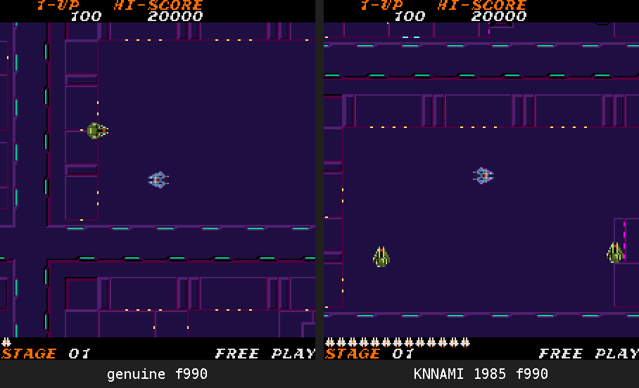
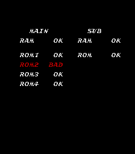
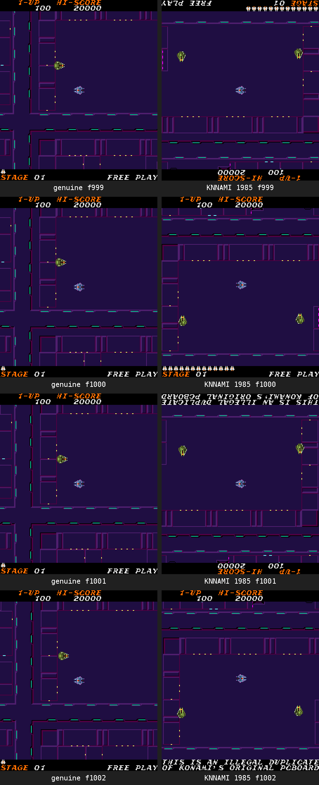

# Time Pilot '84 (Konami, 1984) – copy checks that wreck the game and print an accusation

MAME sets `tp84`, `tp84a` and `tp84b`. Two 6809s (main CPU tag `cpu1`, unencrypted) and a Z80 for sound. No
battery-backed RAM. Program ROMs at `$8000–$FFFF`. Addresses below are `tp84`'s.

**No bootleg of Time Pilot '84 is known in MAME.** All three sets are Konami's own: `tp84a` differs from `tp84` in 9
bytes, none of them read by a check, and `tp84b` is a rebuild with the same checks at other addresses. So, as with
the Track & Field edits, the demonstrations here are simulated, with edited copies of a genuine set.

## In short

Time Pilot '84 checksums its own copyright, "© KONAMI", and a stored message, "THIS IS AN ILLEGAL DUPLICATE OF
KONAMI'S ORIGINAL PCBOARD". If a sum is wrong the game does not stop. **It takes all your lives, flips the screen and
swaps the controls between player 1 and player 2 on every frame, and prints that message across the screen.** One
check runs on every frame of play and one at game start and similar set-up points; three more wait for a counter, and only open
about once every 18 minutes of play.

There are two layers. The board's own **power-on ROM test** adds up each 8 KB ROM block, so a careless one-byte edit
is caught before the game starts ("ROM2 BAD", then the board halts and resets). The **hidden checks** catch the
pirate who edited the copyright *and* rebalanced the ROM sums so that the test still passes. That case is simulated
here by also changing the last digit of the year, which keeps the block sum the same.



*Left: genuine. Right: "KNNAMI 1985", with the ROM test defeated. Frames 990 to 1,012, every frame: the edited board flips
on alternate frames, and from frame 1,001 the message is on screen. Made with `konami/demo_tp84.sh sumkept` and
`konami/gif_pair.py`.*

## What the checks do

| Check | Sums | Against | Runs |
|---|---|---|---|
| `$A7C6` | the 7 bytes `$BD5E-$BD64`, "©KONAMI" (the year is not included) | `$1B` | **every frame of play** (called from the per-frame routine at `$87EC`, no gate) |
| `$A99E` | the same 7 bytes | `$1B` | at the start of a game and at other set-up points (8 runs in the first 2,200 frames of the genuine run) |
| `$9504`, `$8354` | the same 7 bytes | `$1B` | only in the one play frame in 65,536 where the counter `$5235` equals `$FFFF` |
| `$A8EF` | the last 28 bytes of the message (`$C24D`) | `$34` | the same one frame in 65,536 |
| `$B555` | the same 7 bytes | `$1B` | not reached in my runs (entered through a table; trigger not traced) |

Seven more checks compare single code bytes with constants (`$34`, `$35` and `$1B`, for example `$8370` reads
`$94FA` and `$8383` reads `$A8FC`): each reads an operand of another check, so the checks guard one another. Editing
one trips another. No code range is summed.

`$5235` goes up once per play frame (`$87D1` calls `$94F2`) and is zeroed at the start of every game. It reaches
`$FFFF` once in 65,536 frames, about 18 minutes of continuous play in one game. It is ordinary RAM, so nothing
survives a power cycle: this is a delay, not a permanent arming like Track & Field's.

The message sits in ROM at `$C21F-$C25C` and nothing refers to its address. The checks queue two text commands,
`$0052` and `$0053`, through the same queue the game uses for sounds; the queue's consumer draws string `$52` and
`$53` (the two lines of the message) with the text writer at `$83C8`. That is why a scan for references to the message
finds none.

## What a failed check does

Two variables do the damage. **`$57C8` is the current-player index** (0 = player 1, 1 = player 2): the game reads the
input of whichever player it selects (`$852E`) and writes it to the main latch bits 4 and 5, which MAME's driver wires
to flip-screen X and Y. **`$57D0` is the number of lives** (3 at the start of a game; it goes down when a ship is lost
and up for a bonus ship).

- `$A7C6` fails: `$57C8` **toggles**, every frame. The screen turns upside down on alternate frames and the controls
  alternate between P1 and P2.
- `$A99E` and `$A8EF` fail: **`$57C8` := 1 and `$57D0` := 0**: player 2, no lives.
- `$9504`, `$8354` fail: the two message lines are drawn.

## Demonstration (MAME 0.285)

Three sides, the same script, a fresh empty NVRAM folder for each. DIP "Coin A" is set to Free Play and 1P Start is
pressed at frame 480 (a coin press did not register in MAME; not investigated). P1 holds Left from frame 700. At
**frame 1,000, mid-game, the counter `$5235` is set to `$FFFE` by a RAM poke**, so the next play frame opens the rare
checks (otherwise that takes about 18 minutes). Nothing else is written. Scratch ROMs are built from your own set
by `konami/build_tp84.py` and never committed.

### Layer 1: the power-on ROM test catches a one-byte edit

Edit: `$BD60` "O" to "N", so "KONAMI" reads "KNNAMI". At power-on the board sums each 8 KB block (`$B700-$B717`) and
compares it with a table at `$FD6B-$FD73`. The block `$A000-$BFFF` no longer adds up: at **frame 192** the screen
shows "ROM2 BAD" and the CPU sits in a branch to itself at `$B774`. The watchdog resets the board every 372 frames
(frames 371, 743, 1,115, 1,487, 1,859). **The game never starts**, so no hidden check ever runs.



*The edited board at frame 300. Made with `konami/demo_tp84.sh onebyte`.*

### Layer 2: the hidden checks catch a rebalanced ROM

A pirate who changes the copyright and then fixes the ROM test's table (or the ROM) would sail past layer 1.
To stand in for that, the second edit also changes `$BD69`, the last digit of the year, from "4" to "5". The text now
reads "KNNAMI 1985", the 8 KB block sum is unchanged, and the ROM test passes. The year is not part of any check.
(This variant changes two bytes; one byte is stopped by layer 1 first.)

| Frame | Genuine | Edited ("KNNAMI 1985") |
|---|---|---|
| 485 | the game starts; lives 3, player 1 | `$A99E` **fails**: `$57C8` := 1, `$57D0` := 0 (no lives, player 2) |
| 614 onward | `$A7C6` runs on every play frame (878 runs) and passes; `$57C8` never changes | `$A7C6` **fails on every play frame** (1,061 of 1,061); `$57C8` toggles |
| 1,000 (poke) | `$9504`, `$A8EF`, `$8354` run once and pass | `$9504` and `$8354` **fail** and queue the message lines; `$A8EF` passes (the message was not edited) |
| 1,001 | normal | **the message appears** |



*Frames 999 to 1,002. Genuine: upright, one reserve-ship icon. Edited: upside down on frames 999 and 1,001, upright on
1,000 and 1,002; a row of 14 reserve-ship icons (no lives); from 1,001 the message, upside down and then the right way up.*

**The controls.** On the genuine board the game reads only player 1's input byte. On the edited board the reads
split between P1 and P2 (reads per 120-frame window, P1 / P2, and flips of `$57C8`):

| Window ending at frame | Genuine | Edited |
|---|---|---|
| 720 | 159 / 0 / 0 | 65 / 94 / 106 |
| 960 | 132 / 0 / 0 | 18 / 114 / 18 |
| 1,080 | 217 / 0 / 0 | 108 / 109 / 120 |
| 1,440 | 240 / 0 / 0 | 108 / 132 / 109 |

Held Left therefore reaches the game about half the time. The message stays up: it is in every snapshot from frame 1,001
to 1,035 and still there at frame 2,000, partly over the stage text. Sound was not recorded (MAME ran with sound off),
and the code queues no sound command on failure.

An earlier run, in attract mode (the coin had not registered, so the demo was playing; not kept), showed the same
flipping and the message, so an edited board shows it from its first demo.

## Compared with the original Time Pilot (1982)

[TCRF](https://tcrf.net/Time_Pilot_(Arcade)) documents copyright checksum checks in the original Time Pilot that hang
or reset the game on a mismatch. I haven't run the original (a Z80 board), so this comparison rests on that
description:

| | Time Pilot (1982), per TCRF | Time Pilot '84 |
|---|---|---|
| Checksum of the copyright | yes | yes: "©KONAMI" |
| Checksum of a stored message | not mentioned | yes: "THIS IS AN ILLEGAL DUPLICATE OF KONAMI'S ORIGINAL PCBOARD" |
| Checksums over code ranges | yes | no; single code bytes check each other instead |
| When | not clear to me | every play frame and every game start, plus one frame in 65,536 |
| On failure | the game hangs or resets | the game keeps running but is wrecked (no lives, screen flipping, controls split) and **prints the accusation** |
| First layer | not known | a power-on ROM test that halts the board on any block sum mismatch |

What I can't find described elsewhere: failure that leaves the game running, and says why on screen, and the two
layers. I couldn't read TCRF's own Time Pilot '84 page, so check it for anything I've missed.

## Default high scores

The ranking screen shows **GSX 20000, XJS 17500, CBR 15000, RGB 12500 and CRT 10000**, stored in ROM as plain text at
`$BC2F`. No check reads them, and I couldn't tie them to anything else.

## Rerun

From the repo root, with your MAME ROM folder (`tp84.zip`):

```bash
python3 konami/build_tp84.py ~/roms         # checks the genuine CRC, writes konami/roms/tp84_onebyte and tp84_sumkept
konami/demo_tp84.sh onebyte ~/roms          # "ROM2 BAD" at frame 192, board resets every 372 frames
konami/demo_tp84.sh sumkept ~/roms          # hidden checks: logs konami/out/tp84_sumkept_{genuine,edited}.log
python3 konami/gif_pair.py konami/out/tp84_sumkept_genuine.log konami/out/tp84_sumkept_genuine/tp84 "genuine f{f}" \
    konami/out/tp84_sumkept_edited.log konami/out/tp84_sumkept_edited/tp84 "KNNAMI 1985 f{f}" pair.gif 990-1012
```

Each run takes a few seconds with `-nothrottle`. `konami/demo_tp84.lua` holds the inputs, the poke and the
breakpoints on each check; the logs list every change of `$57C8`, which input byte was read, the message commands and
each check's run and fail. The GIF tool needs Pillow (`pip install pillow`).

## Caveats

- MAME 0.285, emulation only, not real hardware.
- The hidden-check demonstration needs a **two-byte** edit that keeps the ROM test's block sum. One byte is stopped
  by the ROM test first. A real pirate who rebalanced the ROM would also have had to find the ROM test's table.
- The counter `$5235` is poked to `$FFFE`; without that, the rare checks open only after about 18 minutes of play.
- Games ran on free play (the coin did not register in MAME). Sound was not recorded.
- The fifth copy of the copyright check (`$B555`) was not reached; `tp84a` and `tp84b` were compared statically and
  not run.
- The comparison with the original Time Pilot is from TCRF's description, not from running that game.
- I also looked at two other Konami 6809 games, Hyper Sports and Road Fighter. Hyper Sports has no copy check, only
  the already known initials egg. Road Fighter has a coin counter and key checks in battery-backed RAM, but they only
  act if an input line that is low on every board in MAME is wired high; on a normal board they never run.
