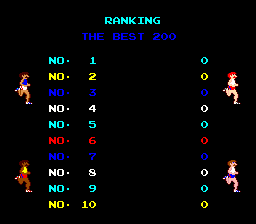
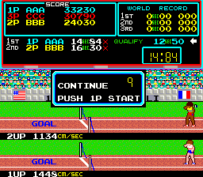
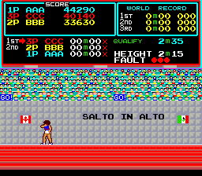
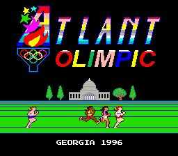
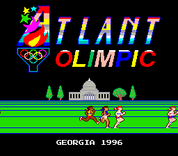
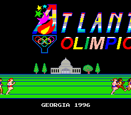
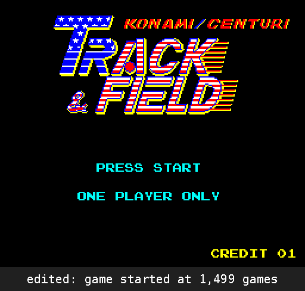
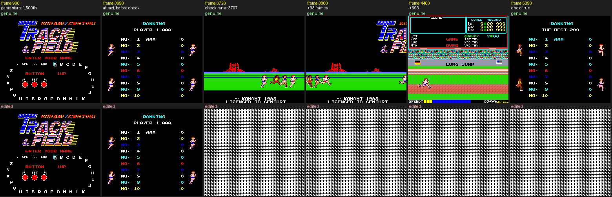
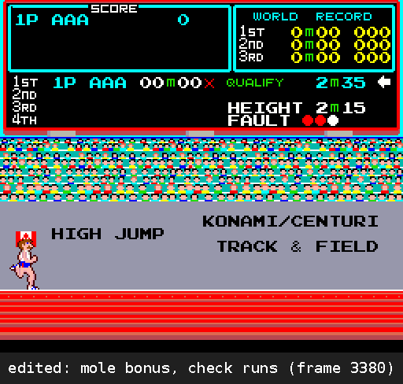

# Track & Field / Hyper Olympic (Konami, 1983) – copy checks that stop an edited board, and the bootleg they caught

MAME sets `trackfld`, `trackfldc` (Centuri), `trackfldu` (Centuri, unencrypted), `hyprolym`, `hyprolyma`, and the
bootlegs `hyprolymb`, `hyprolymba`, `trackfldnz`, `hipoly` and `atlantol`. 6809 CPU (Konami-1 encrypted in all but
`trackfldu`; in `atlantol` only above `$6000`). Program ROMs at $6000–$FFFF; battery-backed RAM $2800–$2FFF.
Addresses below are `trackfldu`'s unless a set is named.

Konami's copyright protection here works differently from the traps elsewhere in this repo. It doesn't pay out
on a copied board. It stops a board whose ROMs have been **edited**: changing the copyright line, or the code
that draws it, or one particular data byte, makes the game crash, freeze or keep resetting. And most of the checks
wait: they stay dormant until the board has started 50, 1,500 or 4,000 games, counted by hidden counters that
nothing else in the game uses.

## In short

Konami's protection works the other way round from the Taito and Atari traps. It catches pirates who **edit** the
ROMs, not straight copies, and it stops the game instead of giving credits away. **Track & Field** (Hyper Olympic in
Japan) has six checks on the "© KONAMI 1983" line, the code that draws it and one data byte. Three of them are held
back by two hidden games-started counters that the game keeps for nothing else, so they only switch on after 50,
1,500 or 4,000 games. The others wait for moments such as a 7.2 m long jump or the high jump mole bonus. If a checked
byte has been changed, the game crashes, freezes or resets.

It has also caught a **real bootleg**. **Atlant Olimpic** (1996, an Italian bootleg of Hyper Olympic) moved the
copyright line and draws "GEORGIA 1996" in its place; check 6 compares the line's screen address, so it fails. In
normal play a 3- or 4-player game that reaches the round 1 high jump sets the check's flag in battery-backed RAM, and
from then on the board freezes at the attract demo after every game and every power-on, until the RAM is cleared.
That is the next section. Changing one letter of "KONAMI" in a genuine set, in the emulator, leaves the game working
normally until the 1,500th game, after which the board resets about once a second, and still does after a power
cycle, because the armed state is kept in battery-backed RAM. Three of the six checks are demonstrated (checks 1 and
2 on edited ROMs, check 6 on `atlantol`); the rest are described from the code. The other dumped bootlegs
(`hyprolymb`, `hyprolymba`, `trackfldnz`, `hipoly`) change no checked byte, so none of them trips anything. The game
also hides a "©KONAMI 1983" message, first published by cmonkey on UKVAC in 2016.

## Atlant Olimpic: a real bootleg caught by check 6

**Atlant Olimpic** (`atlantol` in MAME) is an Italian bootleg of Hyper Olympic from 1996, themed on the Atlanta
Olympics. It runs Hyper Olympic's program with about 2,400 instructions of the bootleggers' own code added at
`$4000-$5FFF`, new title graphics and a continue feature. And it **moved the "© KONAMI 1983" line off screen**: the
screen address stored with the text, `$A6B6`, changed from `$36CA` to `$37F0`, and the bootleggers' code draws
**"GEORGIA 1996"** in its place. They left the text itself and Konami's checks alone. Checks 1 to 5 read only the
text and the code that draws it, so they pass. **Check 6 also compares the screen address, so it fails**, and the
board hangs (a `BRA` to itself at `$8A28`). None of the other dumped bootlegs changes anything a check reads; this is
the one that does.

| Genuine `hyprolym` (flag set, check 6 passes) | `atlantol` (check 6 fails) |
|---|---|
|  |  |

*Check 6's NVRAM flag set by a RAM poke at frame 200 (see "The genuine control" below), then the attract demo. Frame 1,800
of each run. Made with `konami/demo_atlantol.sh check6`.*

### How a board gets there in normal play

Check 6 only runs when two bits in battery-backed RAM are set (`$2FFF` bits 7-6 = 01). Konami's own code sets them
(`$7547-$754C`) during the 6th event, the high jump, of round 1, if at least three of the four player slots are still
in the game. Nothing clears them: the boot code keeps those two bits. So the trigger is:

> a 3- or 4-player game in which at least three players are still in at the high jump of round 1.

They get there by qualifying in all five earlier events (100 m, long jump, javelin, 110 m hurdles, hammer) or by
paying for **continues**: `atlantol` adds a continue offer ("CONTINUE 9, PUSH 1P START", on by default through the DIP
"Allow Continue").



I ran it with **no RAM writes at all**: MAME's default DIP settings and fresh NVRAM, then only coins, start buttons
and the players' controls (the script reads RAM to time its presses, as a person watching the screen would, and never
writes it). Three coins, **3 Players Start**, each player enters "AAA" and then runs flat out, and whenever a continue
is offered the script puts in a coin and presses Start. At **frame 30,818**, in the round 1 high jump with players 1, 2
and 3 still in, the game sets `$2FFF` from `00` to `40` itself (15 coins used: 3 to start, 12 for continues). The
script then leaves the game alone. It ends at frame 866,850, only because player 3 has 255 lives (see below). After one
more idle 1-player game, attract mode starts, and **at frame 874,740 the first attract demo starts, check 6 runs and
fails**. Every snapshot after that is identical: the board is frozen.

| Frame 30,818: the game sets the flag | Frame 875,636: frozen since 874,740 |
|---|---|
|  |  |


*Natural play, no RAM pokes: the round 1 high jump with three players in, the end of that game, then the first attract
demo, frozen. Every 8th frame; the captions give the emulator frame. 875,000 frames take about 20 minutes. Made with
`konami/demo_atlantol.sh natural`.*

**How often would an operator hit it?** Once per board, and then for good: it needs one group of three or four to
reach the round 1 high jump together, by playing well or by paying for continues. After that the board stops at its
first attract demo, again after every power-on. On a site where groups play, that is likely early in the board's
life; I can't put a number on it.

### The genuine control

- **The same code.** The code that sets the flag (`$7528-$754F`, 40 bytes), the gate and check 6 (`$7625-$766C`, 72
  bytes) and the boot code that keeps the flag (`$6036-$603F`, 10 bytes) are **byte for byte identical** in `hyprolym`
  and `atlantol`. The one input check 6 reads that differs is the copyright's screen address at `$A6B6`.
- **With the flag set, `hyprolym` carries on.** I set the flag by a RAM poke at frame 200 (`konami/demo_atlantol.sh
  check6`): check 6 runs and passes at frames 642, 2,748 and 5,504 and attract mode carries on, while `atlantol`
  freezes at its first demo (frame 664).
- **That control used a forced flag, not play.** The genuine game has no continues, so three players would have to
  qualify in all five events. The same script put all three players out by the long jump or javelin on default
  settings, and by the hurdles with the easy settings and extra lives, and I did not automate qualifying play. The
  natural route is shown on `atlantol` only.

### Recovery

Clearing the battery-backed RAM unfreezes the board, until a game sets the flag again. Three runs, none writing RAM
(`konami/demo_atlantol.sh recovery`):

| Run | NVRAM at power-on | Result |
|---|---|---|
| 1 | empty, flag forced | frozen at the first attract demo (frame 664) |
| 2: switched off and on, battery kept | the NVRAM run 1 saved (`$2FFF` = `40`) | check 6 runs at the first demo and fails: **frozen again** |
| 3: battery cleared | empty | the gate reads `$2FFF` = `00` and skips check 6; a game started with a coin plays normally; attract mode carries on |

| Battery kept: frozen | Battery cleared: running at frame 11,970 |
|---|---|
|  |  |

Clearing the RAM also wipes the high scores and records. Unlike Konami's counter-gated checks nothing here counts
games: the flag is the only state, so the board freezes again after the first 3- or 4-player game that reaches the
round 1 high jump.

### The watchdog (an inference)

MAME's `atlantol` ignores writes to `$1000`, the watchdog on Konami's board (`init_atlantol` installs a `nop_write`),
so in MAME its watchdog never arms and the freeze lasts for ever. Nothing in MAME says why; the line is unchanged since
MAME 0.121 (2007). **My inference, from the code and not from a real board:** the real bootleg has no working
watchdog. Genuine Hyper Olympic writes `$1000` at least every 3 frames. On `atlantol` an idle game left at the continue
offer goes 1,013 frames (17 seconds) without a write, because the bootleggers' countdown never kicks it, so a
3-second watchdog would reset the board in the middle of every continue offer. So either the board has none or it is
disabled, which is what MAME has.

What a failed check 6 does depends on that:

| | No watchdog (MAME as it is) | A 3-second watchdog (simulated in Lua; `TF_WATCHDOG=180`) |
|---|---|---|
| At the first attract demo | the picture freezes for good | the same freeze |
| Then | coins are not counted, Start does nothing | reset 181 frames later, title screen, freeze again at the next demo: a loop of about 14 seconds, for ever |
| Can anyone play? | only after switching off and on, in the ~11 seconds before the first demo; the next game ends in the same freeze | only if a coin goes in during the ~11-second window; the game then starts, and its end resumes the loop |

### The bootleggers' own checks

The added code has **five checks of its own**. Each reads a byte at an address that is unmapped on Konami's board
(`$0200`, `$0210`, `$2210`, `$2060`, `$2000`) and expects a particular value; only the bootleg board, which decodes its
64 KB EPROM there too, returns it. They guard nothing of Konami's: they are a board lock, so that the bootleg ROM
would fail on a genuine Konami board or another conversion. Two hang (at power-on and at the credit screen), three
jump back to the main loop. I have not run them.

One bug from the same code: the continue handlers always restore the lives of player 1 or 2, whichever player
continued. A continuing player 3 or 4 stays in play with no lives, and the next lost life takes the count from 0 to 255.
That is why the natural run is so long. It doesn't change when the flag is set.

## The checks, from the start

Checking the copyright and failing had been done before. Donkey Kong (1981) freezes if "NINTENDO" is changed, and
Konami's own **Time Pilot (1982)** already had a dense set of copyright checks: [TCRF](https://tcrf.net/Time_Pilot_(Arcade)) lists two copies of the
copyright string drawn on alternate frames and two more in the sprite ROM; checksums of the copyright and of many code
ranges across six phases (boot, crosshatch, title, demo and gameplay, special checks, high-score entry); palette checks
on the copyright line and on individual letters ("M", "K", "N"); checks triggered by game events (losing a life, the
next stage, entering stage 5); and failures by reset, hang or garbage graphics. So **event-triggered checks, multiple
checksums, and checks on how the copyright is displayed (Time Pilot's palette, Track & Field's screen position) were
already there in 1982**; see [Prior art](../README.md#prior-art). What was not found in the sources checked (listed
under the main README's [Caveats](../README.md#caveats)) is
the hidden games-started counters with their thresholds, the arming kept for good in battery-backed RAM, and a real
bootleg (Atlant Olimpic) caught by a check in normal play. Check 2, the one that waits for the 1,500th game:

```
F99D  LDD   $2FE4       ; games started: +1 at every game start ($F774), read by nothing but the checks
F9A0  CMPD  #$05DC      ; the 1,500th?
F9A4  BNE   $F9B1
F9A6  LDA   #$19        ; arm for good: signature 19 65 DB in battery-backed RAM
F9A8  STA   $2FE7
F9AB  LDD   #$65DB
F9AE  STD   $2FEE
 ...                    ; from then on, in the interrupt handler, all through attract mode:
673E  LDA   $2FE7
6741  CMPA  #$19        ; armed? (likewise $2FEE and $2FEF)
6743  BNE   $67AB
6753  LDY   #$A6BC      ; "KONAMI", each letter compared with an offset, so the values don't spell it:
6757  LDA   ,Y+
6759  DECA
675A  CMPA  #$4A        ; "K" - 1
675C  BNE   $67A8
 ...                    ; "O" + $20, "N" - 5, "A" + 1, "M" + 3, "I"
6783  LDX   #$FC47
6786  LEAX  36,X        ; $FC6B: the code that draws the copyright line
 ...                    ; add 4 of its bytes
67A2  CMPD  #$0312
67A6  BEQ   $67AB       ; all as Konami wrote them: carry on
67A8  LBRA  $B8E6       ; otherwise jump into data: the board crashes and resets
```

## The hidden counters

`$2FE4` and `$2FE0` are two 16-bit counters in battery-backed RAM. The normal game-start code adds 1 to each for
every game started, 1- or 2-player alike (`$F774`, `$F7C2`); a coin alone does nothing. They aren't bookkeeping:
no screen shows them, and the only code that reads them is the checks.

```
F774  LDD   $2FE4
F777  ADDD  #$0001
F77A  STD   $2FE4        ; games started
 ...
F99D  LDD   $2FE4
F9A0  CMPD  #$05DC       ; exactly 1,500?
F9A4  BNE   $F9B1
F9A6  LDA   #$19
F9A8  STA   $2FE7
F9AB  LDD   #$65DB
F9AE  STD   $2FEE        ; signature 28 74 EA -> 19 65 DB: check 2 armed for good
```

The counters are cleared only at power-on, and only if the signature at `$2FE7`/`$2FEE`/`$2FEF` is neither the
normal `28 74 EA` nor the armed `19 65 DB`. So they keep counting from one day to the next, and once armed, check 2
stays armed.

## The six checks

| # | Where | Trigger | Compares | On failure |
|---|---|---|---|---|
| 1 | `$E376` (high jump mole bonus) | each step of the mole bonus | ROM `$C418` = `$B1` | sets `$2A8E`; at the player's next failed third attempt, `JMP $D000` (the middle of an instruction): the game freezes |
| 2 | `$6753` (interrupt handler) | from the 1,500th game | "KONAMI" at `$A6BC`, each letter offset (`K`−1, `O`+$20, ...); sum of the code bytes `$FC6B`, `$FC6E`, `$FC71`, `$FC74` = `$0312` | `LBRA $B8E6`, into data: the board crashes and resets, again and again |
| 3 | `$6E3D` (end of each event) | `$2FE0` ≥ 4,000 | `$A6C0` = "M" and `$FC71` = `$CC` | `LBRA $EFFC`, the middle of an instruction |
| 4 | `$9A5C` (long jump result) | `$2FE4` ≥ 50 and a jump of 7.20–7.29 m | sum of the 13 bytes "© KONAMI 1983" = `$034E` | game phase := `$0A` |
| 5 | `$7BEA` (race result) | both runners are players and the second is under 10.00 s | the same sum, then 9 code bytes from `$FC6B` = `$03FD` | machine mode := `$10` |
| 6 | `$762E` (start of each attract demo) | a battery-backed flag (`$2FFF` bit 6) set after a round played by 3 or 4 players, never cleared | the same 9 code bytes, the copyright's screen address `$370A`, and its "A" | `BRA` to itself: the board hangs until the watchdog resets it |

**What the checked bytes are.** `$A6B8`–`$A6C6` is the text table entry for the copyright line: its screen
address, then "© KONAMI 1983" (the game draws each byte as tile = byte − `$30`). `$FC6B`–`$FC79` is the code that
puts it on the title screen:

```
FC6B  LDD  #$0100
FC6E  JSR  $84F5         ; text colour 0
FC71  LDD  #$021C
FC74  JSR  $84F5         ; draw string 28: "© KONAMI 1983"
FC77  LDD  #$023E
FC7A  JSR  $84F5         ; draw string 62: "LICENCED TO CENTURI"
```

So the checks notice the copyright being changed **or** no longer drawn. They don't cover the Centuri licence
line, the licensee or title in the logo, or the high-score defaults: a copier could change any of those without
tripping anything. `$C418` is a byte in a block of data nothing else reads.

Konami kept all six in every version and updated the constants each time the text or code changed (`trackfld`
`$01FC` at `$67A2`, `trackfldc` `$0206`, and so on). `trackfldu` is exactly `trackfldc` decrypted, except for the
7 bytes of check constants, recomputed so the checks still pass: whoever made it knew about the checks.

## Demonstrations

`konami/build_roms.py` builds one-byte edits of `trackfldu` from your own genuine set (into `konami/roms/`, never
committed). Each demo runs the genuine and the edited set side by side in MAME with fresh NVRAM and identical
inputs. On edited ROMs only checks 1 and 2 are demonstrated; check 6 is shown on a real bootleg (above). Checks 3 to 5 are
described from the code and were evaluated by running each check's own code on each set's ROM, but are not yet shown
in MAME.

### Check 2: "KONAMI" → "KNNAMI" (`$A6BD` 4F → 4E), counter at 1,499

The script sets `$2FE4` to 1,499 and starts one game; false starts end it quickly.

| Frame | Genuine | Edited |
|---|---|---|
| 908 | the game starts; counter 1,500; signature 19 65 DB written | same |
| 3707 | back in attract mode, check 2 runs and passes; attract mode carries on | check 2 fails; the screen fills with a repeated tile |
| 3766 on | normal | the board resets every 57 frames, and fails again after each reset (29 resets by frame 5400) |

| Genuine `trackfldu` | "KONAMI" changed to "KNNAMI" |
|---|---|
|  |  |

*Counter set to 1,499, one game started (the 1,500th), then attract mode. Every 4th frame of the `konami/demo.sh 2` runs.*
*The 1,500th game arms the check, which runs once the game is over. Genuine: attract mode carries on. "KNNAMI":
the board resets about once a second from then on.*



Because the armed signature is kept in battery-backed RAM, the edited board never recovers: switching it off and
on again changes nothing.

### Check 1: `$C418` B1 → B4

The script starts a game at the high jump, forces the mole bonus (by setting the state a third-try clear leaves), then
sets the next event to the high jump again, where the player, with no input, fails three times.

| Frame | Genuine | Edited |
|---|---|---|
| 3413–3429 | mole bonus: the check runs and passes; 1,000 paid | the check fails and sets `$2A8E`; the 1,000 is still paid |
| 6534 | third failed attempt: the event ends, then ranking and attract mode | `JMP $D000`: the game freezes in the high jump, with garbage on the result line, until the end of the run (frame 9000) |

| Genuine `trackfldu` | `$C418` changed |
|---|---|
|  |  |

*The mole bonus (forced), then the next high jump with no input: the third miss ends the event on the genuine
board and freezes the edited one. Every 4th frame of the `konami/demo.sh 1` runs.*


### Rerun

From the repo root, with your MAME ROM folder (`trackfld.zip`, merged, or `trackfldu.zip`):

```bash
python3 konami/build_roms.py ~/roms         # checks the genuine CRCs, writes konami/roms/check1..6
konami/demo.sh 2 ~/roms                     # logs: konami/out/demo_check2_{genuine,edited}.log
konami/demo.sh 1 ~/roms
konami/demo_repair.sh ~/roms                # the "For repairers" runs: battery kept, Erase on Reset, good ROM, flat battery
```

Every run goes through `scripts/mame.sh` (a fresh, empty NVRAM folder, headless) with **one folder** on the ROM
path: your own folder for the genuine side, `konami/roms/checkN` alone for the edit. Each `konami/roms/checkN` is a
complete copy of your zip with one chip changed (and, for split sets, an unchanged copy of the parent `trackfld.zip`),
because with your own folder as a second path MAME rejects the edited chip on its checksum and silently loads the
genuine one. The logs list the ROM bytes under test as the CPU reads them.

`konami/demo_check1.lua` and `konami/demo_check2.lua` hold the inputs and forces; `konami/lib_demo.lua` the
breakpoints on each check's run, pass and fail addresses (MAME's debugger, started with `-debug -debugger none`).
On Windows, run `mame trackfldu -rompath ... -debug -debugger none -autoboot_script konami/demo_check2.lua` by hand
with `TF_SIDE` set to `genuine` or `edited`, a fresh NVRAM folder each time, and only one folder on the ROM path (yours
for genuine, `konami/roms/check2` for the edit).

Atlant Olimpic needs no edited ROMs (genuine sets only):

```bash
konami/demo_atlantol.sh check6 ~/roms       # hyprolym against atlantol, flag forced: a minute or two
konami/demo_atlantol.sh recovery ~/roms     # frozen, still frozen with the NVRAM kept, running with it cleared
konami/demo_atlantol.sh natural ~/roms      # no RAM writes at all; about 20 minutes (needs hyprolym.zip or trackfld.zip)
```

`konami/demo_atlantol.lua` plays the natural run, `konami/demo_check6.lua` the forced-flag and recovery runs (with
`TF_WATCHDOG=180` it simulates a 3-second watchdog). Both log the loaded copyright entry (`$A6B6`: `36 CA` in
`hyprolym`, `37 F0` in `atlantol`). Each run uses a one-folder copy of your set made by `scripts/patchzip.py` (with the
parent `trackfld.zip` for split sets). Logs and snapshots go to `konami/out/`; each run starts from an empty NVRAM
folder, except step 2 of `recovery`, which reuses the NVRAM step 1 saved (`scripts/mame.sh`'s `MAME_KEEP_NVRAM`).

## For repairers

Check 2 can't tell a pirate's edit from a fault. On a genuine board whose program ROM has started to fail, a bad
read of one of the bytes it checks (the "KONAMI" text at `$A6BC`–`$A6C1`, or the code at `$FC6B`–`$FC74`)
would fail it in the same way. Once the counter has passed 1,500 games, the board would then reset about once a
second, and keep doing so after being switched off and on, exactly like the edited board above. I haven't seen a
real board do this; it follows from the code and the runs below.

What clears it (MAME runs on the "KNNAMI" edit, armed as above; the battery-backed RAM is carried over between runs
except where the table says it is empty; `konami/demo_repair.sh`):

| Run | Result |
|---|---|
| Armed and failing, then switched off and on (the battery-backed RAM kept) | fails 54 frames after power-on and resets every 57 frames: switching off doesn't help |
| The same, with the "World Records" DIP switch at "Erase on Reset" | no change: that setting clears the record tables, not the arming |
| Empty battery-backed RAM (as after a flat or replaced battery), edit still in place | plays normally; check 2 stays dormant until the counter reaches 1,500 again (forced here), then fails |
| The good ROM back in place, the battery-backed RAM still armed | plays normally: the armed check runs and passes |

So the fix is to replace the bad ROM. That alone stops the loop. Clearing the battery-backed RAM as well puts the
counters and the arming back to zero, but also wipes the high scores and records; it isn't needed for the board
to work. Clearing the RAM without replacing the ROM only buys time until the 1,500th game.

## How this differs from the other traps here

- **It targets edited ROMs, not straight copies.** A board copied byte for byte passes every check. Only a change
  to the copyright line (its text or, as Atlant Olimpic shows, its place on screen), the code that draws it, or `$C418`
  sets it off.
- **It stops the game rather than giving credits away.** The Taito and Atari traps make a copied board lose money
  for its operator. Konami's checks crash, freeze or reset the board.
- **Most of it waits.** Checks 2 to 4 sleep until 50, 1,500 or 4,000 games have been started; check 5 needs a
  2-player race under 10 seconds; check 6 a 3- or 4-player round. An edited board works normally until then.

## The bootlegs

Four of the five dumped bootlegs trip nothing, because none changes a checked byte:

- `trackfldnz` is `trackfldc` with data lines D6 and D7 swapped on the program ROMs; once MAME swaps them back,
  the program is identical.
- `hyprolymb` and `hyprolymba` match an official Hyper Olympic revision (Konami's fixes in `hyprolyma`, less one
  table); `hyprolymba` adds two single-bit differences that look like a bad chip or dump. Both replace the speech
  chip with their own board, without changing the code.
- `hipoly` (Hipoly) has the same kind of replacement sound board, and its program ROM (`$6000-$FFFF`) is byte for
  byte `hyprolymb`'s.

The fifth, `atlantol`, does change something a check reads, and trips check 6 (above). Why the other bootleggers
didn't touch it, whether because the protection deterred them or because they simply copied, the dumps can't tell
us. That Atlant Olimpic left the text and every check in place and still got caught also shows the bootleggers did not
know about check 6. This page describes copyright protection that works as designed; it doesn't claim the
protection deterred any real pirate, only that it caught one board in an emulator.

## Konami's ownership signature

The same games carry a hidden message, first published by cmonkey on the UKVAC forum in July 2016 ("TnF/Hyper
Sports initial entry Easter Eggs"). With every DIP switch On (which includes free play) and a 4-player game whose
players register as ISI, HAR, A·L and ABO, the name-entry screen shows "©KONAMI 1983" and the game stops
(`$F77D`–`$F78A` test the switches at each game start; `$FA2C`–`$FA8E` compare the names and write the message).
It changes nothing else, so it reads as an ownership signature: a way to show that a board runs Konami's code,
which would still work on a straight copy. I've confirmed it from the code and in MAME on the first eight sets (all but `hipoly` and `atlantol`).

Together they cover both cases: the signature could show that a straight copy runs Konami's code, and the checks stop a copy
whose copyright has been edited.

## Caveats

- MAME 0.285 with MAME's dumps, not real hardware.
- Three checks demonstrated (1 and 2 on edited ROMs, 6 on `atlantol`); checks 3 to 5 are described from the code only.
- The edit demos force their triggers in RAM (the counter, the mole bonus, the next event), as noted above; the ROM
  edit is the only change to the game itself.
- **`atlantol`'s natural run needs no pokes, but the genuine control does:** the flag on `hyprolym` was set by a RAM
  poke, because the genuine game has no continues. The flag-setting code is byte for byte identical in both sets.
- **The watchdog is an inference.** MAME disables `atlantol`'s; that the real board has none comes from the code
  (the continue countdown never kicks it), not from a board.
- The natural run is a script playing the game, not a person, and one route of several (continues); the 15 coins and
  the 3-player game are what that script used.
- The bootleggers' own five checks were read, not run.
- TCRF's Track & Field (Arcade) and Time Pilot (Arcade) pages were read by hand before I was banned from the site
  (it doesn't allow AI agents).
