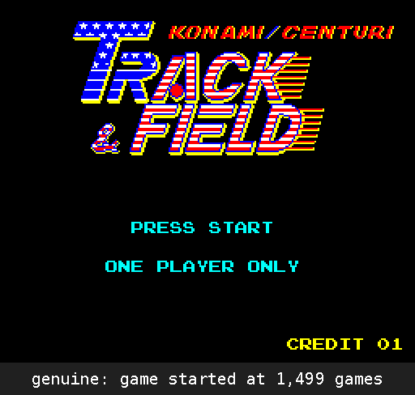
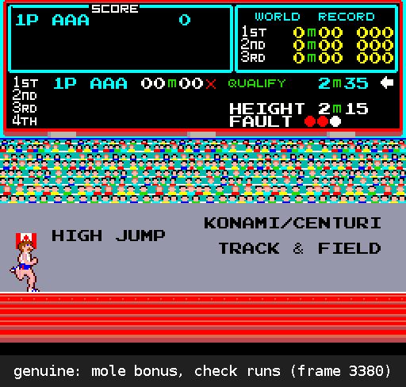
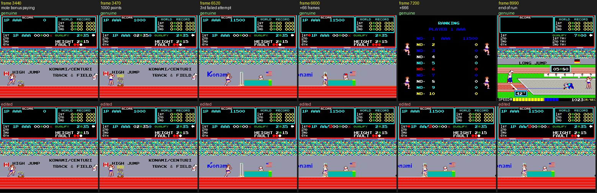

# Track & Field / Hyper Olympic (Konami, 1983) – copy checks that stop an edited board

MAME sets `trackfld`, `trackfldc` (Centuri), `trackfldu` (Centuri, unencrypted), `hyprolym`, `hyprolyma`, and the
bootlegs `hyprolymb`, `hyprolymba` and `trackfldnz`. 6809 CPU (Konami-1 encrypted in all but `trackfldu`).
Program ROMs at $6000–$FFFF; battery-backed RAM $2800–$2FFF. Addresses below are `trackfldu`'s.

Konami's copyright protection here works differently from the traps elsewhere in this repo. It doesn't pay out
on a copied board. It stops a board whose ROMs have been **edited**: changing the copyright line, or the code
that draws it, or one particular data byte, makes the game crash, freeze or keep resetting. And most of the checks
wait: they stay dormant until the board has started 50, 1,500 or 4,000 games, counted by hidden counters that
nothing else in the game uses.

## The hidden counters

`$2FE4` and `$2FE0` are two 16-bit counters in battery-backed RAM. The normal game-start code adds 1 to each for
every game started, 1- or 2-player alike (`$F774`, `$F7C2`); a coin alone does nothing. They aren't bookkeeping:
no screen shows them, and the only code that reads them is the checks.

```
F774  LDD   $2FE4
F777  ADDD  #$0001
F77A  STD   $2FE4        ; games started
 ...
F99D  LDD   $2FE4
F9A0  CMPD  #$05DC       ; exactly 1,500?
F9A4  BNE   $F9B1
F9A6  LDA   #$19
F9A8  STA   $2FE7
F9AB  LDD   #$65DB
F9AE  STD   $2FEE        ; signature 28 74 EA -> 19 65 DB: check 2 armed for good
```

The counters are cleared only at power-on, and only if the signature at `$2FE7`/`$2FEE`/`$2FEF` is neither the
normal `28 74 EA` nor the armed `19 65 DB`. So they keep counting from one day to the next, and once armed, check 2
stays armed.

## The six checks

| # | Where | Trigger | Compares | On failure |
|---|---|---|---|---|
| 1 | `$E376` (high jump mole bonus) | each step of the mole bonus | ROM `$C418` = `$B1` | sets `$2A8E`; at the player's next failed third attempt, `JMP $D000` (the middle of an instruction): the game freezes |
| 2 | `$6753` (interrupt handler) | from the 1,500th game | "KONAMI" at `$A6BC`, each letter offset (`K`−1, `O`+$20, ...); sum of the code bytes `$FC6B`, `$FC6E`, `$FC71`, `$FC74` = `$0312` | `LBRA $B8E6`, into data: the board crashes and resets, again and again |
| 3 | `$6E3D` (end of each event) | `$2FE0` ≥ 4,000 | `$A6C0` = "M" and `$FC71` = `$CC` | `LBRA $EFFC`, the middle of an instruction |
| 4 | `$9A5C` (long jump result) | `$2FE4` ≥ 50 and a jump of 7.20–7.29 m | sum of the 13 bytes "© KONAMI 1983" = `$034E` | game phase := `$0A` |
| 5 | `$7BEA` (race result) | both runners are players and the second is under 10.00 s | the same sum, then 9 code bytes from `$FC6B` = `$03FD` | machine mode := `$10` |
| 6 | `$762E` (start of each attract demo) | a battery-backed flag (`$2FFF` bit 6) set after a round played by 3 or 4 players, never cleared | the same 9 code bytes, the copyright's screen address `$370A`, and its "A" | `BRA` to itself: the board hangs until the watchdog resets it |

**What the checked bytes are.** `$A6B8`–`$A6C6` is the text table entry for the copyright line: its screen
address, then "© KONAMI 1983" (the game draws each byte as tile = byte − `$30`). `$FC6B`–`$FC79` is the code that
puts it on the title screen:

```
FC6B  LDD  #$0100
FC6E  JSR  $84F5         ; text colour 0
FC71  LDD  #$021C
FC74  JSR  $84F5         ; draw string 28: "© KONAMI 1983"
FC77  LDD  #$023E
FC7A  JSR  $84F5         ; draw string 62: "LICENCED TO CENTURI"
```

So the checks notice the copyright being changed **or** no longer drawn. They don't cover the Centuri licence
line, the licensee or title in the logo, or the high-score defaults: a copier could change any of those without
tripping anything. `$C418` is a byte in a block of data nothing else reads.

Konami kept all six in every version and updated the constants each time the text or code changed (`trackfld`
`$01FC` at `$67A2`, `trackfldc` `$0206`, and so on). `trackfldu` is exactly `trackfldc` decrypted, except for the
7 bytes of check constants, recomputed so the checks still pass: whoever made it knew about the checks.

## Demonstrations

`konami/build_roms.py` builds one-byte edits of `trackfldu` from your own genuine set (into `konami/roms/`, never
committed). Each demo runs the genuine and the edited set side by side in MAME with fresh NVRAM and identical
inputs. Only two of the six checks are demonstrated so far; checks 3 to 6 are described from the code and were
evaluated by running each check's own code on each set's ROM, but are not yet shown in MAME.

### Check 2: "KONAMI" → "KNNAMI" (`$A6BD` 4F → 4E), counter at 1,499

The script sets `$2FE4` to 1,499 and starts one game; false starts end it quickly.

| Frame | Genuine | Edited |
|---|---|---|
| 908 | the game starts; counter 1,500; signature 19 65 DB written | same |
| 3707 | back in attract mode, check 2 runs and passes; attract mode carries on | check 2 fails; the screen fills with a repeated tile |
| 3766 on | normal | the board resets every 57 frames, and fails again after each reset (29 resets by frame 5400) |

| Genuine `trackfldu` | "KONAMI" changed to "KNNAMI" |
|---|---|
|  |  |

*Counter set to 1,499, one game started (the 1,500th), then attract mode. Every 4th frame of the `konami/demo.sh 2` runs.*


Because the armed signature is kept in battery-backed RAM, the edited board never recovers: switching it off and
on again changes nothing.

### Check 1: `$C418` B1 → B4

The script starts a game at the high jump, forces the mole bonus (by setting the state a third-try clear leaves), then
sets the next event to the high jump again, where the player, with no input, fails three times.

| Frame | Genuine | Edited |
|---|---|---|
| 3413–3429 | mole bonus: the check runs and passes; 1,000 paid | the check fails and sets `$2A8E`; the 1,000 is still paid |
| 6534 | third failed attempt: the event ends, then ranking and attract mode | `JMP $D000`: the game freezes in the high jump, with garbage on the result line, until the end of the run (frame 9000) |

| Genuine `trackfldu` | `$C418` changed |
|---|---|
|  |  |

*The mole bonus (forced), then the next high jump with no input: the third miss ends the event on the genuine
board and freezes the edited one. Every 4th frame of the `konami/demo.sh 1` runs.*



### Rerun

From the repo root, with your MAME ROM folder (`trackfld.zip`, merged, or `trackfldu.zip`):

```bash
python3 konami/build_roms.py ~/roms         # checks the genuine CRCs, writes konami/roms/check1..6
konami/demo.sh 2 ~/roms                     # logs: konami/out/demo_check2_{genuine,edited}.log
konami/demo.sh 1 ~/roms
```

`konami/demo_check1.lua` and `konami/demo_check2.lua` hold the inputs and forces; `konami/lib_demo.lua` the
breakpoints on each check's run, pass and fail addresses (MAME's debugger, started with `-debug -debugger none`).
On Windows, run the two `mame trackfldu ... -autoboot_script konami/demo_check2.lua` commands from `konami/demo.sh`
by hand, with `TF_SIDE` set to `genuine` or `edited`.

## For repairers

Check 2 can't tell a pirate's edit from a fault. On a genuine board whose program ROM has started to fail, a bad
read of one of the bytes it checks (the "KONAMI" text at `$A6BC`–`$A6C1`, or the code at `$FC6B`–`$FC74`)
would fail it in the same way. Once the counter has passed 1,500 games, the board would then reset about once a
second, and keep doing so after being switched off and on, exactly like the edited board above. I haven't seen a
real board do this; it follows from the code and the runs below.

What clears it (MAME runs on the "KNNAMI" edit, armed as above; the battery-backed RAM is carried over between runs
except where the table says it is empty):

| Run | Result |
|---|---|
| Armed and failing, then switched off and on (the battery-backed RAM kept) | fails 54 frames after power-on and resets every 57 frames: switching off doesn't help |
| The same, with the "World Records" DIP switch at "Erase on Reset" | no change: that setting clears the record tables, not the arming |
| Empty battery-backed RAM (as after a flat or replaced battery), edit still in place | plays normally; check 2 stays dormant until the counter reaches 1,500 again (forced here), then fails |
| The good ROM back in place, the battery-backed RAM still armed | plays normally: the armed check runs and passes |

So the fix is to replace the bad ROM. That alone stops the loop. Clearing the battery-backed RAM as well puts the
counters and the arming back to zero, but also wipes the high scores and records; it isn't needed for the board
to work. Clearing the RAM without replacing the ROM only buys time until the 1,500th game.

## How this differs from the other traps here

- **It targets edited ROMs, not straight copies.** A board copied byte for byte passes every check. Only a change
  to the copyright line, the code that draws it, or `$C418` sets it off.
- **It stops the game rather than giving credits away.** The Taito and Atari traps make a copied board lose money
  for its operator. Konami's checks crash, freeze or reset the board.
- **Most of it waits.** Checks 2 to 4 sleep until 50, 1,500 or 4,000 games have been started; check 5 needs a
  2-player race under 10 seconds; check 6 a 3- or 4-player round. An edited board works normally until then.

## The bootlegs

None of the three dumped bootlegs trips anything, because none changes a checked byte:

- `trackfldnz` is `trackfldc` with data lines D6 and D7 swapped on the program ROMs; once MAME swaps them back,
  the program is identical.
- `hyprolymb` and `hyprolymba` match an official Hyper Olympic revision (Konami's fixes in `hyprolyma`, less one
  table); `hyprolymba` adds two single-bit differences that look like a bad chip or dump. Both replace the speech
  chip with their own board, without changing the code.

Whether that is because the protection deterred pirates from editing, or because they simply copied, the dumps
can't tell us. This page describes copyright protection that works as designed; it doesn't claim the
protection caught or deterred any real pirate.

## Konami's ownership signature

The same games carry a hidden message, first published by cmonkey on the UKVAC forum in July 2016 ("TnF/Hyper
Sports initial entry Easter Eggs"). With every DIP switch On (which includes free play) and a 4-player game whose
players register as ISI, HAR, A·L and ABO, the name-entry screen shows "©KONAMI 1983" and the game stops
(`$F77D`–`$F78A` test the switches at each game start; `$FA2C`–`$FA8E` compare the names and write the message).
It changes nothing else, so it reads as an ownership signature: a way to show that a board runs Konami's code,
which would still work on a straight copy. I've confirmed it from the code and in MAME on all eight sets.

Together they cover both cases: the signature could show that a straight copy runs Konami's code, and the checks stop a copy
whose copyright has been edited.

## Caveats

- MAME 0.285 with MAME's dumps, not real hardware.
- Two checks demonstrated; four described from the code only.
- The demos force their triggers in RAM (the counter, the mole bonus, the next event), as noted above; the ROM
  edit is the only change to the game itself.
