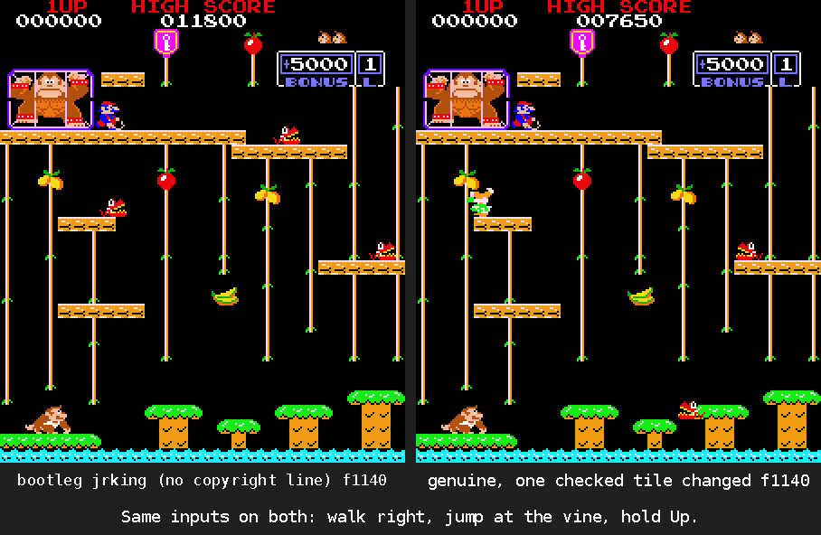
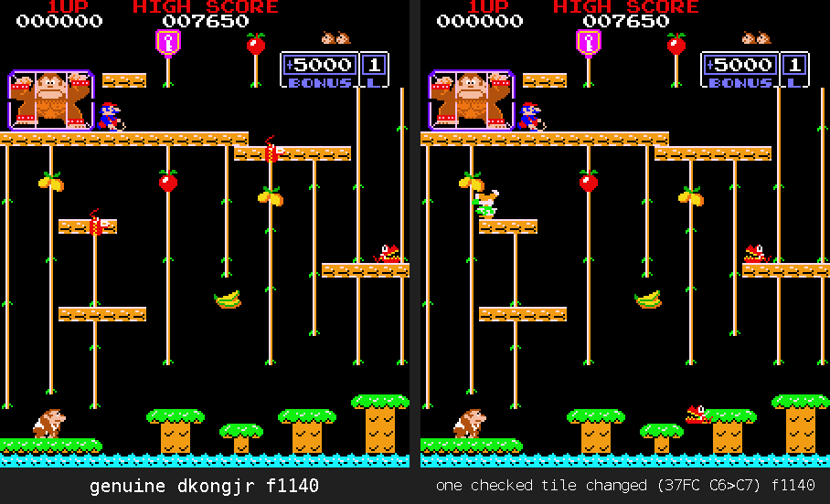

# Donkey Kong Jr. (Nintendo, 1982) – a copyright check that breaks the vines, and the bootlegs that dodged it

MAME sets `dkongjr` (US), `dkongjrj` and `dkongjnrj` (Japan), `dkongjre` (E kit), `dkongjr2` (question-marked in MAME
as a possible bootleg) and the bootlegs `dkongjrpb`, `dkingjr`, `dkongjrb`, `jrking` (Junior King), `maguila` (Up
Maguila), `dkongjrm` and `dkongjrmc` (on Moon Cresta hardware). One Z80. Addresses are Z80 CPU addresses, written
`#xxxx` as in the Donkey Kong disassembly. MAME 0.285, ROMs from 0.277 sets (`dkingjrv` is not in them).

## In short

Donkey Kong (1981) sums six letters of "NINTENDO" in ROM at every screen start, and a failed sum breaks a ladder table,
which freezes the game later. That check is published (furrykef's [dkdasm](https://github.com/furrykef/dkdasm), and the
[Super Mario Wiki](https://www.mariowiki.com/Donkey_Kong_(game))). I used it as the control: in MAME, one letter changed inside "INTEND" froze the game at frame
1496; the first N, the last O and the genuine set did not.

**Donkey Kong Jr. has the same check at the same addresses** (`#2441`, called from `#0D62`), pointed at seven tiles in
the middle of its title-screen copyright line. A failed sum makes the game build that screen's **vine table** in the
wrong place, so **Jr. cannot hold a vine**. The game does not freeze; it simply cannot be won.

**No working bootleg in MAME trips it.** All eight read the seven checked bytes, sum them to zero and build the vine
table normally. The five that have no copyright line on screen removed it outside the checked bytes: four blanked the
letters in the graphics ROM, one moved the line's screen address to `0000`.



*Left: the bootleg `jrking`, whose copyright line is blanked in the graphics ROM; the checked bytes are intact, the
check sums to 00, and Jr. climbs. Right: genuine `dkongjr` with one checked tile changed (`#37FC`); the check sums to
01, the vine table is empty, and Jr. drops back to the ground. The same inputs on both: walk right, jump at the vine,
hold Up. Made with `nintendo/demo_dkjr.sh`, which also runs the unpatched genuine set as a control (it climbs).*

## The copyright line

The attract title screen draws "©1982 Nintendo of America Inc." (Japan: "©1982 Nintendo") at the bottom, in its own
lettering, not with the game's letter codes. It is an ordinary entry in the game's string table at `#37F4`: a screen
address (2 bytes), tile codes `C0` to `D5`, and `3F` to end. The glyphs are tiles `1C0`-`1D5` of the character ROM.

## The check

```
0D62  CD 41 24     call $2441                 ; at every screen start
2441  21 FB 37     ld   hl,$37FB              ; the 6th tile of the copyright entry
2444  3E 88        ld   a,$88
2446  06 07        ld   b,$07
2448  86 23 10 FC  add a,(hl) / inc hl / djnz  ; sum tiles C5 to CB
244C  DD 21 00 63  ld   ix,$6300
2450  A7           and  a
2451  CA 58 24     jp   z,$2458
2454  DD 21 00 64  ld   ix,$6400              ; failed: build the table at 6400 instead
2458  ...                                     ; build this screen's table through IX
```

- Checked: `#37FB`-`#3801`, the tile codes `C5`-`CB`. Not checked: the screen address, tiles `C0`-`C4` and `CC`-`D5`.
- On failure the vine table is written to `#6400`, so `#6300` stays zero. `#6300` is read by `#236E` (the same CPIR
  search as Donkey Kong's ladder search, byte for byte) and by six more scans.
- The routine is byte-identical in every set of the family except the E kit, and is always called from `#0D62`.
- Donkey Kong's check is also `#2441` called from `#0D62`, with `LD HL,#3F0C`, A = `#5E`, B = 6, and `INC IY` on
  failure.

Confirmed in MAME (the edited zip alone on the rompath, the loaded bytes logged): `#37FC` C6 to C7 and `#3801` CB to CC
(inside the range) left `#6300` empty; `#37F6` and `#3802` (outside) and the genuine set built it normally. With
scripted play for 300 s on three seeds, the edited board's Jr. never rose above the top of a jump from the ground,
while every genuine run held a vine, and no run froze.

Interpretation: the check is a deliberate trap modelled on Donkey Kong's: the same addresses, the same style of
breaking a table, and an effect that makes the game unwinnable rather than visibly broken.

## The bootlegs

The same watcher, unedited sets, scripted play:

| Set | Copyright on the title screen | How | Check | `#6300` | Jr. holds vines |
|---|---|---|---|---|---|
| `dkongjr2` | ©1982 Nintendo of America Inc. | unchanged (CPU image identical to `dkongjr`) | sums 00 | filled | yes |
| `dkongjrpb` | ©1982 Nintendo of America Inc. | unchanged (nine small edits elsewhere) | sums 00 | filled | yes |
| `dkongjrmc` | ©1982 Nintendo | unchanged | sums 00 | filled | yes |
| `dkingjr` | none | glyphs blanked in the character ROM | sums 00 | filled | yes |
| `dkongjrb` | none | glyphs blanked | sums 00 | filled | yes |
| `jrking` | none | glyphs blanked | sums 00 | filled | yes |
| `maguila` | none | glyphs blanked | sums 00 | filled | yes |
| `dkongjrm` | none | the line's screen address set to `0000` | sums 00 | filled | yes |

- The four "glyphs blanked" sets have tiles `1C0`-`1D5` all zero in the character ROM, where genuine sets have 135
  non-zero bytes; their copyright entry and checked bytes are byte-identical to the Japanese genuine set's.
- `dkongjrm` (Moon Cresta hardware) moved the screen addresses in the same string table to that board's video RAM, but
  set this one to `0000`, outside the checked bytes, so the line is written nowhere.
- `dkongjrb`, `jrking` and `maguila` also replaced the developers' names in the default high-score table. No check
  reads that table.

Interpretation: the bootleggers may have avoided the checked bytes on purpose. Equally, blanking glyphs in a graphics
ROM, or zeroing one address, was simply the easiest way to remove the line, and needs no knowledge of the program. The
evidence can't tell these apart.



*The first demonstration: genuine `dkongjr` against one checked tile changed, the same fixed-seed random inputs.
Genuine: Jr. jumps and hangs on the vine from frame 1153. Edited: Jr. falls back and walks on; the snapjaws, which also
use the vine table, stay on the platforms.*

## The E kit's own copy of the check is broken

`dkongjre` calls the check too, but its version is Donkey Kong's constants pointed at Donkey Kong Jr.'s tiles: it sums
six tiles (`#37FA`, `C4`-`C9`) with Donkey Kong's constant `#5E`, which gives `05` on the genuine E kit, so the check
always fails. Its only failure action is `INC IY`, and the table builder always writes through IX at `#6300`, so nothing
happens: in MAME the E kit builds the same vine table as the US set and Jr. holds vines.

Interpretation: a leftover copy of Donkey Kong's routine, re-pointed without the constant being updated, in a version
where the IY table no longer exists.

## Rerun

From the repo root, with your MAME ROM folder (`dkongjr.zip`, plus `jrking.zip` in a split set):

```bash
nintendo/demo_dkjr.sh ~/roms     # about 20 seconds; three runs, writes nintendo/out/dkjr_jrking_pair.gif
```

The edited set is built from your own `dkongjr.zip` by `scripts/patchzip.py` (file `djr1-c_5b_f-2.5b`, offset
`0x17FC`, C6 to C7) into a temporary folder that is the only rompath for that run. `nintendo/dkjr_vine.lua` holds the
inputs and logs the loaded copyright entry, each pass of the check with its sum, the vine table and Jr.'s position.

## Prior art and sources checked

Donkey Kong's check is published (dkdasm's comments: "runs checksum on the NINTENDO, breaks if not correct"). For
Donkey Kong Jr., a piracy check is shown in a YouTube video ("Donkey Kong Jr. - Piracy Check") that links to TCRF; that description
was not read; TCRF was not checked (it does not allow automated or AI access).

Not found in the sources checked: the bootlegs' two ways of dodging the Donkey Kong Jr. check, and the E kit's broken
copy. Sources checked: MAME 0.285
[`dkong.cpp`](https://github.com/mamedev/mame/blob/mame0285/src/mame/nintendo/dkong.cpp); dkdasm (Donkey Kong only);
the Super Mario Wiki's Donkey Kong (arcade) page (search result text, Donkey Kong's check only); an Aussie Arcade "Donkey
Kong Jr" repair log (search snippet only; the page refused the request); rotheblog's "Donkie Buddy, the fancy bootleg?"
(bootleg boards with and without the copyright line, no check mentioned); an Arcade Museum forum thread "Donkey Kong,
Bootleg or not bootleg" (search result only); web searches for a Donkey Kong Forum thread (none found).

## Caveats

- MAME 0.285, emulation only, not real hardware.
- Scripted play reached screen 1 only, so the other screens' tables were not exercised.
- `dkingjrv` is not in the 0.277 ROM sets and was not run. The Moon Cresta sets' character ROMs were not compared.
- Donkey Kong's published trigger ("when a barrel is destroyed") was not reproduced; in the control the freeze came at
  a barrel's ladder test.
