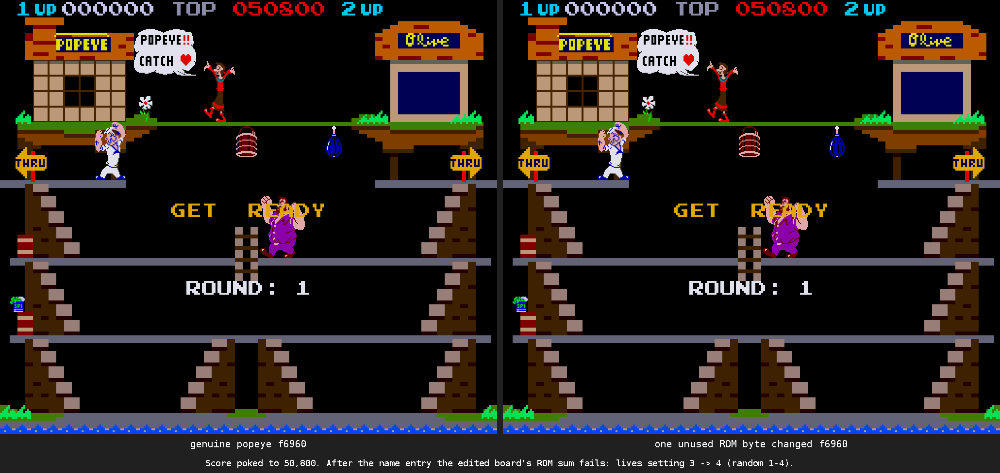
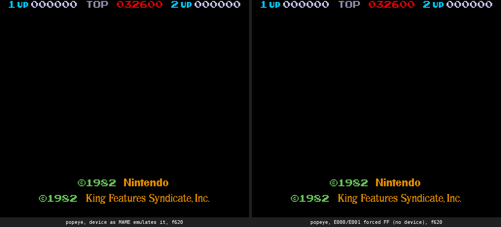
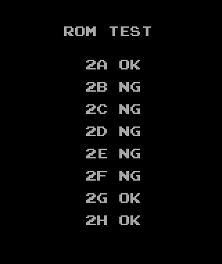

# Popeye (Nintendo, 1982) – a protection device, three software sums, and bootlegs that copied one and switched off the other

MAME sets `popeye` (revision D), `popeyeu` (revision D, not protected), `popeyef` (revision F), `popeyej` and `popeyejo`
(Japan), the bootlegs `popeyebl`, `popeyeb2` and `popeyeb3`, and `popeyehs` (a 2001 high-score kit). One Z80 with
encrypted program ROMs. Addresses are Z80 CPU addresses in `popeye`; the Japan line (`popeyej`, `popeyejo`,
`popeyebl`, `popeyeb2`) has some at other addresses. MAME 0.285, ROMs from 0.277 sets.

**A note on the set names.** MAME swapped `popeyebl` and `popeyeb2` on 21 April 2018 (commit
[16a0695af](https://github.com/mamedev/mame/commit/16a0695afe88108dc69edcde75f39aa2057d7de4), "Swapped popeyebl &
popeyeb2"). Arcade History's "No copyright in bootleg set 1" describes today's `popeyeb2`. The names here are MAME
0.285's.

## In short

Popeye's board has a **protection device** at `E000`/`E001`, a shifter. The game uses it to decode its level data, so
a board without it can't be played: it resets when a game starts. That is published (jammarcade.net, below).

On top of the device, the genuine game has **three software checks**, none of them found in the sources checked:

| Check | Where | Runs | On failure |
|---|---|---|---|
| Power-on ROM sum | `1B22` | every reset | the board goes to test mode, marks the bad chip "NG" and stops |
| High-score ROM sum | `142F` | after a top-five name entry | the lives setting is replaced by a **random 1 to 4** for later games |
| Copyright sum | a 10-byte routine copied from `4BFD` into RAM at `8EA0` | at the end of a game sequence | **one credit is taken** |

**No bootleg trips a check in normal play.** Two bootlegs, `popeyebl` and `popeyeb2`, replaced the device with a
**32-byte PROM** holding a software shifter, and switched off the two in-game ROM sums. They passed the copyright sum
by leaving the copyright records alone (`popeyeb2` hides the line by skipping the calls that draw it). What they missed
is the service-mode ROM test, which now fails.



*The high-score sum. Left: genuine `popeye`. Right: the same set with one unused ROM byte changed (`76F0`, FF to FE).
Same inputs; the score was poked to 05xxxx so that a top-five name entry follows the game over, and the name entry
timed out naturally. On the edited board the sum then fails and the lives setting becomes 4 (`8FF0` 03 to 04 at frame
5891). The next game: genuine 3 lives, edited 4 ("=2" against "=3" on Olive's house), and after the life lost at frame
7447, "=1" against "=2". Made with `nintendo/demo_popeye.sh`.*

## The device

The game writes the level number + 1 to `E000` as a shift count, pushes table bytes into `E001` and reads the shifted
pair back: at every level start (31 bytes through a decoder at `5163`) and during play (one byte per call at `3663`).
A second bit, `E001` bit 2, is tested at screen set-ups.

Without it (every read of `E000`/`E001` forced to `FF` or `00` with a Lua read tap, no ROM change), the level-start
decoder writes nonsense, wipes RAM, and the CPU ends up at `0000` at frame 738; the game restarts and returns to attract
mode. This is the published symptom.



*The published symptom (jammarcade.net, 2017), reproduced: left, the device as MAME emulates it; right, reads forced to
`FF`. At the first level start the right-hand board crashes, draws the playfield upside down and goes back to attract
mode.*

## The three software checks

**Power-on ROM sum.** At every reset, `1B22` sums the whole 32 KB program (`ADD A,(HL)` over `0000`-`7FFF`) and jumps to
test mode at `7470` if it is not `00`. Confirmed by changing `76F0` (unused fill) and resetting: the ROM test showed
"7E NG" and stopped. The same reset without the change booted normally.

**High-score ROM sum.**

```
142F  67 6F        ld   h,a / ld l,a     ; HL = 0000
1431  01 00 80     ld   bc,8000
1434  ...          sum 0000-7FFF
143B  A7           and  a
143C  C8           ret  z
143D  ED 5F        ld   a,r              ; the refresh register: a pseudo-random value
143F  E6 03        and  03
1441  3C           inc  a
1442  32 F0 8F     ld   (8FF0),a         ; the lives setting (3 from the DIP switch at boot)
```

It runs after a name is entered in the top five. `8FF0` is copied to the lives count at each game start. Confirmed with
the same unused byte changed: `8FF0` went from 03 to 04 and the next game started with 4 lives; the genuine set kept 3.
MAME gave 4 in both edited runs because its emulation is deterministic; the code allows 1 to 4.

**Copyright sum.** The sprite-clear routine copies 10 bytes from `4BFD` into RAM at `8EA0`. At the end of a sequence
(state `89C2` = 4, countdown `89C3` to `F0`) the game calls that RAM copy over the four copyright records
(`18B0`-`190A`: the three "Nintendo" variants and "King Features Syndicate, Inc."):

```
8EA0  CD F5 4B     call 4BF5             ; sum
8EA3  3D           dec  a
8EA4  C8           ret  z                ; must be 01
8EA5  21 DD 8F     ld   hl,8FDD          ; the credit count
8EA8  35           dec  (hl)
8EA9  C9           ret
```

Confirmed with the trigger poked one frame short (state 4, countdown at `F1`; the natural route was not found): a byte
changed inside the range (`18B4`) took a credit, 01 to 00; the byte just before it (`18AF`) and the genuine set did not.

Interpretation: as in Mr. Do!, the protection is in layers: a device whose absence stops the game, and software sums
that punish edits quietly (random lives, a lost credit), in the same spirit as the Donkey Kong and Donkey Kong Jr.
checks.

## The bootlegs

| Set | Device | Device reads | Copyright line | Software checks | Effect |
|---|---|---|---|---|---|
| `popeye`, `popeyej`, `popeyejo` | yes | used | shown | all pass | none |
| `popeyeu` | no | removed: tables stored already decoded | shown | all pass | none |
| `popeyef` | no | not used by the code | shown | all pass | none |
| `popeyebl` | **32-byte PROM at `E000`** | faked in software | shown | power-on and high-score sums **switched off**; copyright sum passes | service-mode ROM test fails |
| `popeyeb2` | **32-byte PROM at `E000`** | faked in software | **hidden** (draw calls NOPped) | as `popeyebl` | no copyright line; service-mode ROM test fails |
| `popeyeb3` | no | removed (`popeyeu`'s code) | shown | all pass (sum table recalculated) | none |
| `popeyehs` (hack) | no | removed (`popeyeu`'s code) | shown | power-on and high-score sums bypassed; copyright sum passes | none |

- **`popeyebl` and `popeyeb2`** are built from the Japanese program. The PROM at `E000` holds a small routine that
  shifts like the device; its results equal the device's at all 58 addresses it decodes. The power-on sum is replaced
  by `XOR A` (the real sums are `57` and `D3`), and the high-score sum by `XOR A; RET`.
- What they missed: the per-chip sum table used by the **service-mode ROM test**, which they never updated. In service
  mode both stop at "ROM TEST" with chips 2B to 2F "NG". Normal play is not affected.

  

- **`popeyeb2`** differs from `popeyebl` only in 12 bytes: four calls that draw the copyright lines, NOPped. The records
  the copyright sum reads are untouched, so it passes. Only "©1982" is text; "Nintendo" and "King Features Syndicate,
  Inc." are sprites.
- **`popeyeu`** stores the level tables already decoded for all three levels (every byte matches the device's output),
  NOPs the device code, and has a consistent sum table. `popeyeb3` is `popeyeu`'s code with one Japanese table and the
  sum table recalculated.

Interpretation: `popeyeu` looks like Nintendo's own unprotected build rather than a bootleg (its tables and sums are
consistent, and revision F is also device-free), which fits MAME's description of it, but the evidence can't rule out a
skilled bootlegger. The `popeyebl`/`popeyeb2` maker understood the device well enough to imitate it in 32 bytes and found
both in-game uses of the ROM sum; they either missed the service-mode test or didn't care. Like the Donkey Kong Jr.
bootlegs, `popeyeb2` removed the copyright from the screen without touching the bytes that are checked.

## Rerun

From the repo root, with your MAME ROM folder (`popeye.zip`):

```bash
nintendo/demo_popeye.sh ~/roms     # about a minute; writes nintendo/out/popeye_lives_pair.gif
```

The program ROMs are encrypted, so the edit is made in MAME's decrypted copy of the program, from Lua at frame 30,
and the byte is logged as the CPU reads it before and after; no ROM file or zip is changed. `nintendo/popeye_lives.lua`
holds the inputs, the score poke and the logging (every write to the lives setting and the lives count).

## Prior art and sources checked

Published, and not claimed here: the device and its effect. [jammarcade.net, "Popeye tech info"](https://jammarcade.net/popeye-tech-info/)
(2017): "Without this chip present Popeye will reset when starting a game." MAME's
[`popeye.cpp`](https://github.com/mamedev/mame/blob/mame0285/src/mame/nintendo/popeye.cpp) describes the shifter and
`popeyeu` ("has the protection disabled in a very clean way"). The Arcade Museum forum thread
["WTB: Security IC used in Popeye"](https://forums.arcade-museum.com/threads/wtb-security-ic-used-in-popeye.557068/)
calls it "a crude bitshift chip used only for the security".

Not found in the sources checked: the power-on, high-score and copyright sums, and what the bootlegs did about each.
Sources checked: MAME 0.285 `popeye.cpp`, `popeye.h` and `popeye_v.cpp`, and the history of `popeye.cpp`; Arcade
History's Popeye page; the Arcade Museum forum threads "WTB: Security IC used in Popeye" (page 1) and "Popeye security
chip pcb"; jammarcade.net "Popeye tech info"; Not In Mame,
["Popeye pcb (bootleg) repair"](https://notinmame.blogspot.com/2018/05/popeye-pcb-bootleg-repair.html) (a bootleg board
without the copyright line); web searches for Popeye disassemblies and Donkey Kong Forum material (none found). TCRF was
not checked (it doesn't allow AI agents).

## Caveats

- MAME 0.285, emulation only, not real hardware. MAME's PROM mapping decides what `popeyebl`/`popeyeb2` read at `E001`.
- Triggers poked: the copyright sum (the sequence state, one frame short; its natural route, probably the end of a
  round, was not found) and the high-score sum (the score; the game over and the name entry were natural).
- The scripted player reached level 1 only, so shift counts 2 and 3 were checked from the code, not at run time.
- One indirect test of `E001` bit 2 was never reached, so its effect is not known. `popeyehs`'s added code was not
  traced.
- A forum post says the device is mirrored up to `FFFF` on real boards; not checked.
