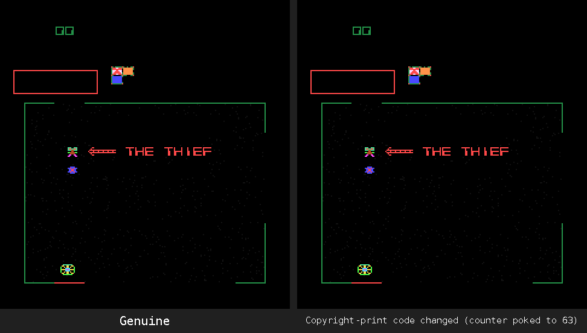
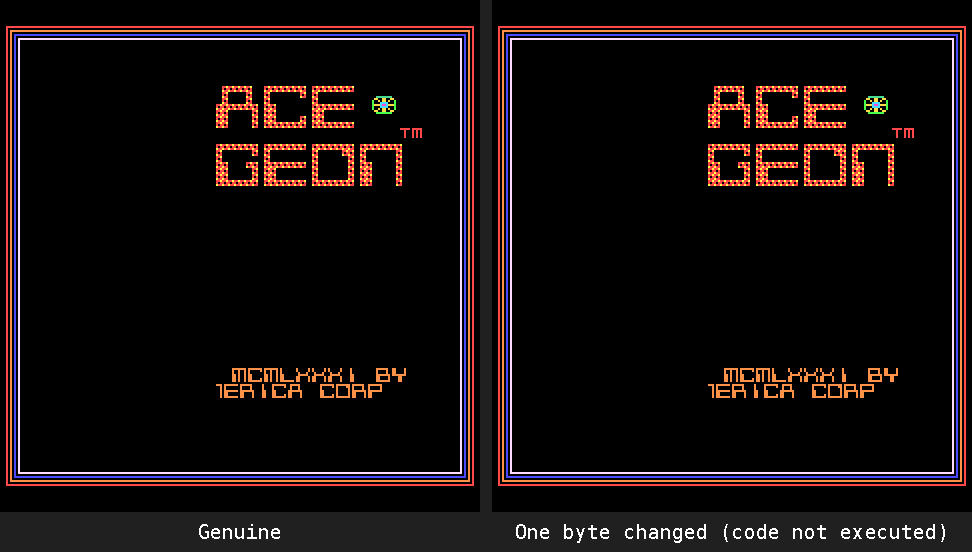

# Space Dungeon (Taito America, 1981) – the "STOLEN" message is unused; the real protection is silent code checksums

MAME sets `sdungeon` and `sdungeona` (the same bytes on all three CPUs; `sdungeona`'s chips are `sdungeon`'s joined
in pairs). Qix hardware: a 6809 data CPU, a 6809 video CPU, a 6802 for sound and a 68705 microcontroller. Addresses are
data CPU addresses. MAME 0.285, ROMs from 0.277 sets. No bootleg of Space Dungeon is known in MAME.

## In short

The data CPU's ROM holds the message **"STOLEN FROM THE GOOD BUDDY'S AT TAITO BY AN UNAUTHORIZED DO BADDER"**, listed
as untriggered on TCRF ([Space Dungeon](https://tcrf.net/Space_Dungeon); TCRF was not checked for this work, see the
caveats). I looked for
a way it could be shown, as Time Pilot '84 shows its accusation. **Nothing the game runs prints it.** The only
instruction naming its address sits in a block of filler-like bytes that no code enters, and even with the CPU forced
into that block the text does not appear.

The protection that does run is **silent**: checksums over parts of the program, whose penalty is to retype objects in
the display list, so that enemies, or the thief, are drawn wrongly or not at all. One of them is **delayed**: it adds
one byte of the code that prints the copyright at each of 64 game events, and only then compares. And the one sum that
covers the copyright text itself is computed and then ignored. These checks were not found in the sources checked.



*The delayed check. Left: genuine. Right: one byte of the code that prints the copyright changed (`$BDDA`, the screen
position operand of `LDY #$2C40`, to `$2C41`). The check's counter was poked to 63 at frame 4400; the 64th event, the
thief taking the treasure in the attract demo, is the game's own, at frame 4455. Genuine: sum `$6A`, nothing happens.
Edited: sum `$6B`, the penalty runs and from then on the thief is drawn as a cut-down shape. No message appears. Made
with `taito/demo_sdungeon.sh`.*

## The checks

| Where | Sums | Wanted | Runs | On a mismatch |
|---|---|---|---|---|
| `$EEDA` | `$B37D-$B3BC` (code) | `$FB` | every frame of play | penalty (`$EF15`) |
| `$EEEA` | 0 minus each byte of `$BD71-$BDA0` (code, including the end of the text routine) | `$6B` | every frame of play | penalty (`$EF15`) |
| `$EEFD` | every even-addressed byte of `$A000-$FFFE`, a slice at a time | `$1D` | about every 20 frames | **none**: `CMPA #$1D` is followed by `BRN` (branch never) |
| `$E0C4` | `$BDC0-$BDFF`, **one byte per event**, compared after 64 events | `$6A` | at each event (the thief taking a treasure; in a game, only from the second level down) | penalty (`$E0DA`) |
| `$E41A` | `$E0C0-$E0F2`, the `$E0C4` checker's own code | `$6D` | in a routine called at `$E3AC` (not reached in my runs) | penalty (`$E430`) |

- `$BDC0-$BDFF` is the title code that prints the copyright: `LDX #$C45E`, `LDY #$2C40`, `JSR $BD4D`, `LDX #$C474`,
  `LDY #$3838`, `JSR $BD4D`. The copyright text itself (`$C45E-$C485`) is covered only by the disabled even-byte sum.
- The penalty at all three active sites is `LDA #$78`, `JSR $B845`, which writes `$78` into the type byte of the
  current display-list record; `$E0DA` and `$E430` also bump a counter used by the interrupt code. No other code uses
  type `$78`.
- The delayed check's counter is the low byte of a pointer (`$87D0`), set to `$C0` at the start of each game; when it
  wraps from `$FF` to `$00` the sum is compared and reset.

## Tests in MAME

Each test used an edited copy of the zip, alone on the rompath, with the loaded byte logged; 40,000 frames of
scripted play from one coin.

| Edit | Result |
|---|---|
| copyright text, `$C460` "P" to "Q" | the even-byte sum becomes `$1E`, and is ignored: nothing happens |
| copyright-printing code, `$BDDA` `$40` to `$41` | the same: the delayed check was not reached in play (the scripted player never left the first level), so nothing happens; with the counter poked to 63 in the attract demo, the penalty runs (the GIF above) |
| genuine, loaded the same way | every sum as wanted |
| `$BD75`, an unexecuted byte inside an every-frame range | the penalty runs on every frame from frame 1670: enemies are not drawn, while play and the score go on |



*Genuine against `$BD75` changed (`FE` to `FF`), the same scripted play from the coin, 30 s of emulated time: on the
right the enemies are not drawn.*

No run printed the STOLEN text.

## Why the message is unused

- A decode of every byte offset of the data CPU's ROM, in every addressing mode, finds one instruction naming the text:
  `LDY #$FAF2` at `$FA94`, inside a 134-byte block (`$FA6C-$FAF1`) of filler-like bytes between the developer credit
  and the text. No code enters that block: the program's one indirect jump can't land there, nothing jumps into RAM
  or through a register, and the video CPU and the 68705 can't reach this ROM.
- Even there, `LDY` would be a screen position for the text routine, not a string pointer, and the block holds no call
  to the routine.
- The text routine leaves X just past the string it printed, so after the hidden developer-credit command prints "."
  (at `$FAF0`) X points at the STOLEN text. I timed the command out 38 times, in attract mode and in a game; the callers
  always reload X. Nothing printed.
- Forced (not natural): with the PC set to `$FA94` on the title screen, the CPU ran the text as code, drew a stray
  "100" over the logo and stopped in I/O space.

Interpretation: the STOLEN text is an unused message. Its place straight after the "." string, and the `LDY #$FAF2` in
the bytes that follow, could suggest a display that was planned and never wired in, but the ROM does not show that.
The protection that is wired in punishes quietly, and the one check that would catch an edited copyright text is
switched off with `BRN`, deliberately or by accident.

## Rerun

From the repo root, with your MAME ROM folder (`sdungeon.zip` and the 68705 device ROM `m68705p3.zip`):

```bash
taito/demo_sdungeon.sh ~/roms     # about 30 seconds; writes taito/out/sdungeon_delayed_pair.gif
```

Both sides are built by `scripts/patchzip.py` (an unchanged copy for genuine, so both load the same way; file
`sd15.u15`, offset `0xDDA`, `40` to `41` for the edit), each in a folder that is the only rompath for its run.
`taito/sdungeon_delayed.lua` uses MAME's debugger for breakpoints on the event, the compare and the penalty.

## Prior art and sources checked

The message is quoted in [Arcade Database](https://adb.arcadeitalia.net/dettaglio_mame.php?game_name=sdungeon&lang=en)
and [Arcade History](https://www.arcade-history.com/?id=2526&n=space-dungeon&page=detail) ("Developer messages are
hidden in the ROM chip sd19"), and [pronama.jp](https://pronama.jp/2024/05/31/space-dungeon/) (2024) says no command
displays it and reads it as possibly aimed at unauthorised copies. The finding here agrees: it is unused.

Not found in the sources checked: the checksums, the delayed check, the disabled even-byte sum and the block's
contents. Sources checked: those three pages; MAME 0.285 [`qix.cpp`](https://github.com/mamedev/mame/blob/mame0285/src/mame/taito/qix.cpp)
and its companion files (no comment on the messages, the credit command or the sums); a web search for forum
discussion of the phrase (none found).

## Caveats

- MAME 0.285, emulation only, not real hardware.
- TCRF's Space Dungeon page was not checked for this work (TCRF doesn't allow AI agents); "untriggered" is quoted from
  this repo's earlier prior-art list. The developer-credit command was worked out from the code, not taken from TCRF.
- The delayed check was shown only with its counter poked to 63 (the 64th event natural, in the attract demo); in a
  game the event needs the second level or deeper, which the scripted player did not reach. The `$E41A` check was not
  reached.
- One scripted-play seed. Changing the probe's snapshot or logging settings changed the course of scripted play
  between pairs, so only effects seen in both pairs are claimed: an earlier pair also showed the edited game stuck at
  score 0, a second pair did not, and that is not claimed.
