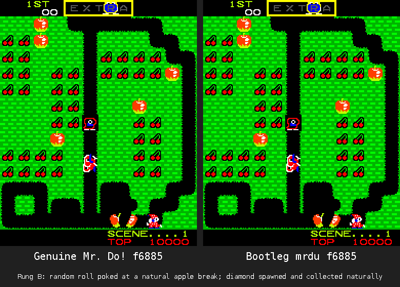
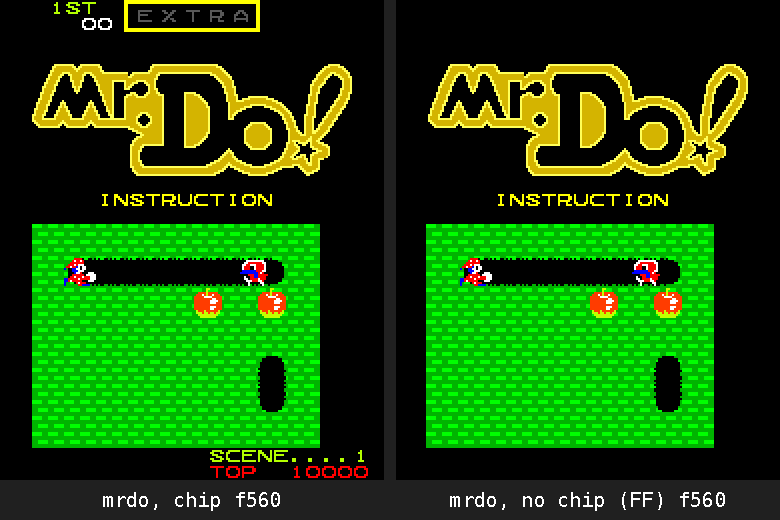

# Mr. Do! (Universal, 1982) – a protection chip, sums over the code that reads it, and a bootleg that pays 41 credits

[Back to the README](../README.md)

MAME sets `mrdo` (Universal), `mrdoy` (prototype), `mrdot` and `mrdofix` (Taito licence), and the bootlegs and hack
`mrdobl`, `mrdofabr` (Fabremar), `mrdu` (Mr. Du!), `mrlo` (Mr. Lo!) and `yankeedo` (Yankee DO!, a hack). One Z80.
Addresses are Z80 CPU addresses in `mrdo` unless a set is named. MAME 0.285, ROMs from 0.277 sets.

There is no known software copy check in Mr. Do! to test the method against (unlike Donkey Kong Jr., where Donkey Kong's
published check served as a control), so "nothing found" in this game is weaker than elsewhere in this repo.

## In short

Mr. Do!'s board has a **protection chip**, a PAL16R6 at U001, that answers four codes. The game asks it at every screen
set-up and in the EXTRA cut-scene; without the right answers screens are not cleared and the EXTRA letters stay lit.
That much is published (see [Prior art](#prior-art-and-sources-checked)).

On top of the chip, the game **sums the code that asks it**. Check A sums the screen set-up routine at each scene end;
check B sums the EXTRA routine when the diamond's free credit is given. If check B fails, the credit count is set to
the wrong sum plus 1 instead of the old count plus 1. These two sums were not found in the sources checked.

And a real bootleg trips check B. **Mr. Du! (`mrdu`)** is built on the Taito-licensed code, in which check B's sum no
longer matches its constant and the branch after it had been removed. Mr. Du!'s maker put that branch back (two bytes)
and adjusted a third byte so that the self-test's ROM sum still passes. So on Mr. Du!, **taking the diamond gives 41
credits instead of 1**. This was not found in the sources checked either.



*Left: genuine `mrdo`. Right: the bootleg `mrdu`. The same scripted game, frame for frame. The diamond is picked up at
frame 6939; at frame 7491 the credits go from 0 to 1 on the genuine board and from 0 to 41 on Mr. Du!. The captions
read the credit count from RAM (`0xE006`), because the SPECIAL screen shows at most 9 ("CREDIT 9"). One RAM write on
both sides: the random state at the first natural diamond roll (below). Made with `universal/demo_mrdu.sh`.*

## The protection chip

The game writes a code into video RAM and reads the chip at `0x9803`, in two places:

| Site | Where | Runs | Without the right answers |
|---|---|---|---|
| 1 | `0x0494`, in the screen set-up routine `0x0485` (14 callers) | every screen set-up: power-on, attract screens, coin, start, game over, cut-scenes | `RET NZ` before the screen is cleared and set up: status lines missing, screens drawn over the last one |
| 2 | `0x7729`, in the EXTRA routine `0x770B` | the EXTRA cut-scene, after the extra life is given | the player keeps the extra life, but X, T, R and A stay lit and the EXTRA count does not advance |

Measured in MAME by forcing every read of `0x9803` to `0xFF` (open bus) or `0x00` with a Lua read tap, no ROM change.
`0xFF` and `0x00` gave the same result. Play and scoring are not affected: with the force switched on only after the
start, the first game is identical to a normal one.



*Left: `mrdo` with the chip as MAME supplies it. Right: reads of the chip forced to `0xFF`. Around the coin: the
"PRESS / 1 PLAYER BUTTON ONLY" page is drawn over a playfield that was never cleared.*

## The two sums over the protection code

| Check | Where | Sums | Runs | On failure |
|---|---|---|---|---|
| A | `0x19FA` | site 1's routine and its table | each scene end | two per-scene counters (IY+8, IY+9) are not advanced |
| B | `0x74BB` (`0x74D2` in the Taito line) | `0x42` bytes from `0x770B`: site 2's routine and table; must be `0xDF` | the SPECIAL (diamond) cut-scene, at the free credit | credits (`0xE006`, BCD) := the wrong sum + 1, instead of credits + 1 |

```
74BB  21 0B 77     ld   hl,$770B
74BE  06 42        ld   b,$42
74C0  AF           xor  a
74C1  86 23 10 FC  add  a,(hl) / inc hl / djnz       ; sum the EXTRA routine
74C5  FE DF        cp   $DF
74C7  20 03        jr   nz,+3                       ; wrong: skip the load, A still holds the sum
74C9  3A 06 E0     ld   a,($E006)                   ; credits
74CC  C6 01 27     add  a,1 / daa
...                ld   ($E006),a
```

Check B was confirmed on the genuine set with an edited copy (the edited zip alone on the rompath, the loaded byte
logged): one byte changed inside its range (`0x7745` A5 to A6) gives 41 credits at the diamond; one byte outside it
(`0x59CB`, fill) gives 1; the genuine set gives 1. Check A is from the code only: no scripted game here cleared a scene.

A search for every accumulate loop over memory finds four in `mrdo`: check A's two parts, check B and the test-mode
ROM test. The test-mode test (`0x56EE`, both fire buttons held at reset) sums each 8 KB chip and expects chip N to sum
to N; nothing else reads those sums.

Interpretation: Universal protected the game twice over. The chip stops a board without it from working properly,
and the sums make patching the code that asks the chip change the game quietly (credits, scene counters) rather than
fail visibly.

## Mr. Du!: a real bootleg trips check B

`mrdu` was built on the Taito-licensed code (`mrdot`), not on Universal's. In the Taito code check B sums to `0x40`
against a constant of `0x6C`, so it would always fail, and the branch after it is `00 00` (two NOPs): the check runs
but nothing acts on it. Mr. Du! changes three program bytes in all:

| Address | `mrdot` (Taito) | `mrdu` | What it does |
|---|---|---|---|
| `0x74DE` | `00 00` | `20 03` | puts back the branch after check B, so the failed sum now acts |
| `0x7FFE` | `22` | `FF` | an unused byte; with the change above, ROM 4 still sums to 03, so the test-mode ROM test passes |

Together the two changes add `0x100` to ROM 4's sum, which leaves the 8-bit sum unchanged. No code reads `0x7FFE`.

**How a board gets there in normal play.** An apple breaks in a real game; if no diamond is on the board, the game rolls
its random number (`0x50C9`, state at `0xE07B`) and spawns a diamond 1 time in 512 (the default "Special: Easy"
setting). Picking it up starts the SPECIAL cut-scene ("CONGRATULATIONS / YOU WIN SPECIAL / ONE MORE GAME"), and check B
runs as the credit is given.

**The run.** The demonstration (the GIF above) is at what I call rung B: the random roll set, everything else natural.

- Rung A, nothing written at all, was tried for about 155 emulated hours on 20 seeds: about 1,870 natural rolls and 3
  natural diamonds, none usable, because each came from an apple that had just crushed or caught the player, and the
  game removes the diamond then.
- Rung B, seed 64: at frame 6895 an apple broke naturally with the player alive and normal; the script wrote only the
  random state (`0xE07B`: `0x3D21` to `0x0ED4`, whose next step is a winning roll). The game spawned the diamond where
  the apple broke, the scripted player walked into it at frame 6939, and check B ran at frame 7491.
- The same seed and the same single write on genuine `mrdo` give a frame-identical game.

| Credits (`0xE006`) at frame | 7490 | 7491 | 7492 |
|---|---|---|---|
| `mrdo` (genuine) | 00 | 01 | 01 |
| `mrdu` (bootleg) | 00 | **41** | 41 |

The 41 credits are real: in a longer run they were spent game by game (41, 40, 39, ...).

Interpretation: Mr. Du!'s maker knew the self-test's ROM sum (they kept it passing) but put back a branch whose sum
does not match in the Taito code. Whether the branch was copied from a Universal build by mistake or put back on
purpose, as a free-credit "feature", cannot be told from the bytes.

## The other bootlegs

The same rung B test, seed 64:

| Set | Built on | Check B | Credits at the diamond | Chip reads | Needs the chip? |
|---|---|---|---|---|---|
| `mrdobl` | Universal | passes | 00 to 01 | intact | yes: breaks like genuine without it |
| `mrdofabr` (Fabremar) | Taito | fails, branch removed | 00 to 01 | site 1 intact | yes |
| `mrdu` (Mr. Du!) | Taito | **fails, branch put back** | **00 to 41** | site 1 intact | yes |
| `mrlo` (Mr. Lo!) | Taito | fails, branch removed | 00 to 01 | both sites NOPped; check A's branch NOPped too | **no**: identical with reads of `0xFF`, `0x00` or 0 |
| `yankeedo` (hack) | Universal | passes | 01 to 02 (its own game) | intact | yes |

- `mrlo` is the only one that removed the protection: it NOPs both chip branches and both sum branches, the bypass
  described on the Arcade Museum forum in 2016 (below). MAME gives it no chip.
- `mrdobl`, `mrdofabr`, `mrdu` and `yankeedo` keep the chip reads, so their boards needed the PAL or a copy of it.
- The maker's name is a graphic logo, so the bootlegs changed the character ROM, not the code: `mrdofabr` shows
  FABREMAR, `mrdu` "Mr. Du!" with the UNIVERSAL and Taito logos removed, `mrlo` "Mr. Lo!" with "LICENCED BY".
- Per-chip ROM sums: `mrdobl` and `mrdu` adjusted a byte to keep them; `mrdofabr`, `mrlo`, `yankeedo` and Taito's own
  `mrdofix` did not. Only the test-mode ROM test reads them.

Nothing else was found: no read-back of the copyright or logo, no check on high-score initials, no other sums.

## Rerun

From the repo root, with your MAME ROM folder (`mrdo.zip`, or `mrdo.zip` and `mrdu.zip` in a split set):

```bash
universal/demo_mrdu.sh ~/roms      # about 30 seconds; prints both logs, writes universal/out/mrdu_special_pair.gif
```

`universal/mrdu_diamond.lua` holds the scripted player, the one write and the logging (the loaded check-B bytes, the
spawn, the pick-up and every change of the credit count). No ROM is edited; Mr. Du! is a real dumped set. Every run
goes through `scripts/mame.sh`. The GIF tool needs Pillow (`pip install pillow`).

## Prior art and sources checked

Published, and not claimed here:
- The chip, its symptoms and the bypass: [Arcade Museum forum, "Mr. Do PCB"](https://forums.arcade-museum.com/threads/mr-do-pcb.386835/)
  (2016): a PAL16R6 "programmed to output one of four values depending on the last value written to video RAM"; "If
  the correct value is not read back by the game, the screen will sometimes not be cleared"; a second poster gives the
  bypass as NOPping `0x049A` and `0x772F`, the same two branches `mrlo` NOPs.
- [MAME Testers 08201](https://mametesters.org/view.php?id=8201) (2022): after EXTRA "only the "E" turns gray and the
  others remain yellow", the site-2 effect above; "The Taito sets nop out the EXTRA protection check."
- MAME's [`mrdo.cpp`](https://github.com/mamedev/mame/blob/mame0285/src/mame/universal/mrdo.cpp) comments (the PAL,
  the Taito NOP, the HACK that answers from ROM) and commit
  [5ddd006](https://github.com/mamedev/mame/commit/5ddd0069199e3a7bcb67f81cef15bd1ec76e8c1f) ("The game doesn't clear
  the screen").

Not found in the sources checked: checks A and B (the sums over the protection code), Mr. Du!'s 41 credits, and the
per-chip ROM sum convention. Sources checked: MAME 0.285 `mrdo.cpp`, `mrdo.h` and `mrdo_v.cpp`; MAME Testers 08201;
MAME commit 5ddd006; the Arcade Museum forum threads "Mr. Do PCB" and "Weird Mr. Do ROMs"; Arcade History's Mr. Do!
page; a personal page on Yankee DO! (umjammercammy.neocities.org); web searches for a disassembly of the arcade game
(none found). TCRF was not checked: TCRF does not allow automated or AI access.

## Caveats

- MAME 0.285, emulation only, not real hardware. "With chip" means MAME's chip: for `mrdo`, `mrdobl` and `yankeedo`
  a hack that always answers correctly, for the Taito-line sets MAME's PAL equations.
- Rung B, not A: the random roll was set by one RAM write; the apple break, the spawn, the pick-up and the award were
  natural. One scripted player, seed 64.
- Check A and the test-mode ROM test are described from the code only.
- `mrdofabr`'s F4 ROM is marked BAD_DUMP in MAME (it matches `mrdot`'s). `yankeedo` is labelled a hack in MAME.
