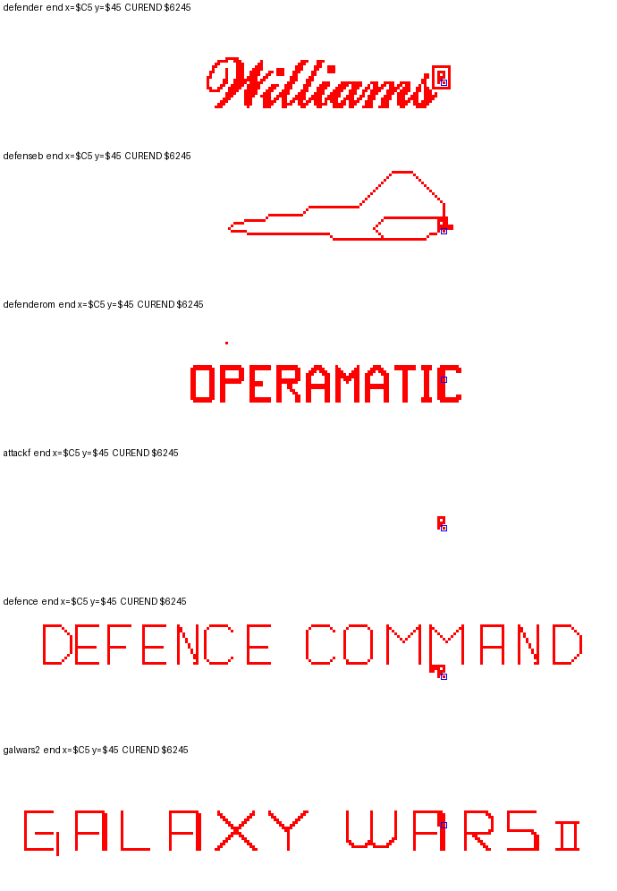
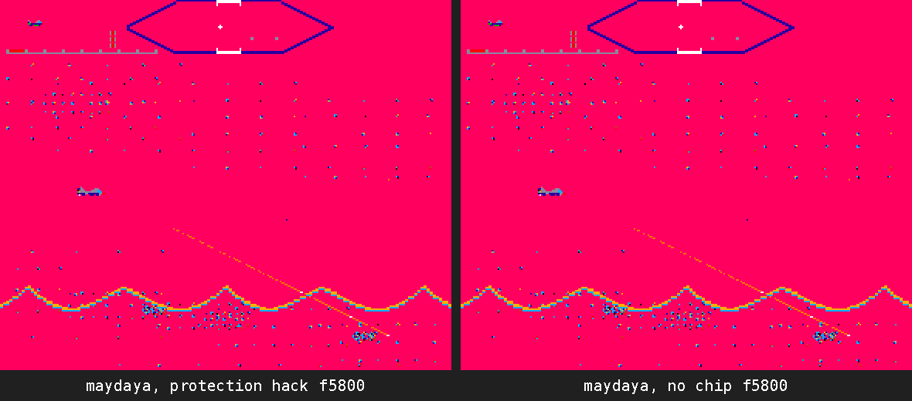

# Defender (Williams, 1980) – a logo trap that its bootlegs dodged or never had, and Hoei's Mayday

[Back to the README](../README.md)

MAME sets: genuine `defender` (Red label), `defenderb` (Blue), `defenderg` (Green), `defenderw` (White) and
`defenderj` (T.T Defender); bootlegs `defenseb`, `defenderom`, `attackf`, `defence`, `galwars2`, `defcmnd`, `startrkd`,
`tornado1`, `tornado2`, `zero`, `zero2`, `defndjeu` and `nextcent`; Hoei's `mayday`, `maydaya`, `maydayb` and their
bootleg `batlzone`. One 6809 main CPU, with a 4 KB banked window at `$C000`. Addresses are CPU addresses in `defender`
unless a set is named; "bank 1" is the first bank of that window. MAME 0.285, ROMs from 0.277 sets (`nextcent` from a
newer set). Source labels in backticks are from Williams' source code as published at
[mwenge/defender](https://github.com/mwenge/defender).

## In short

Defender's logo trap is **already published**. Williams' own source code is public
([mwenge/defender](https://github.com/mwenge/defender)). Aaron Bottegal's disassembly
([AaronBottegal/Defender-Source-Code](https://github.com/AaronBottegal/Defender-Source-Code)) and the
[nesdev thread](https://forums.nesdev.org/viewtopic.php?f=23&t=19987) that follows it (2020) found the copy protection:
a compare with `#$6245` tied to the Williams title drawing, which crashes the game if the intro is replaced.
nowhereman999 ([Glen's Weblog, 2021](https://nowhereman999.wordpress.com/2021/08/25/back-to-defender-copy-protection-progress/))
lists the check at `$E10E`, the random writes into the game's variables, and a one-branch patch that removes it. And
[tobybuk/DefenderPort](https://github.com/tobybuk/DefenderPort), a JavaScript port of the source, describes the
RAM-corrupting "bomb" in `SBLNK` that fires unless `WCURS` holds `$6245`, the value the genuine logo leaves there.

What this repo adds is the bootlegs' side. The White label version has no trap, and the eight bootlegs in MAME built
on it never had one. The five built on trapped code all pass it. Each rewrote the WILLIAMS handwriting table at exactly
the genuine length (351 bytes) and kept its last 10 bytes, so the drawing still ends at `$6245`. The control shows the
method detects a failing check: with the logo colour changed (one ROM byte), the game makes 13 bomb writes in about
80 s of play; genuine makes none. None of this was found in the sources checked.

Interpretation: keeping the last ten bytes while rewriting everything before them fits a bootlegger who knew the end
point mattered. It fits equally one who overwrote the table from the start and never reached its last segment. The
bytes cannot tell these apart.



*The WILLIAMS handwriting table (`LGOTAB`) of genuine `defender` and the five bootlegs that carry the trap, decoded
from the ROMs MAME loaded and drawn the way the logo routine draws it (red), with the end point boxed (blue). Not a
screenshot: the title and the copyright glyphs are separate tables and are not drawn. Every table is 351 bytes and ends
at x `$C5`, y `$45`, CUREND `$6245`, the small "R" of the registered mark. Nothing is edited. Made with
`williams/demo_logotab.sh`.*

## The check

| Source label | Address | What it does |
|---|---|---|
| `LOGO`, `LGOTAB` | bank 1 `$C941`, 351 bytes | draws the WILLIAMS handwriting; on its last byte saves the screen address of the last pixel in `CUREND` |
| logo colour operand (`LOGO8+1`) | bank 1 `$C6F8`, `0F` | the palette slot the logo is drawn in |
| logo check (`COPYRT`) | bank 1 `$C80B`-`$C816` | reads that palette slot; if its red component is full (`(~colour) & 7 == 0`), stores `CUREND` into `WCURS` |
| `WCURS` | `$A0B8` | holds `$6245` on a genuine board, from the first attract logo after power-up on |
| `SBLNK` compare | `$E116` (`CMPU #$6245`) | in play; on a mismatch, in a game (not attract) and when `SEED` is `$A0`, ... |
| bomb store | `$E12E` (`STB ,X`) | ... writes `HSEED` to `$A0xx`, xx = `LSEED`: a random byte of the game's own variables |

- `WCURS` is the end point of the WILLIAMS handwriting. The colour test only decides whether it is stored. `$6245` is
  the end of the table's last segment, a jump to `$C345` and then `22 22 44 11 81 50`: the small "R" inside the
  registered-mark box.
- The check runs once per power-up, at the first attract logo, and the stored value stays.
- The string "COPYRIGHT 1980 - WILLIAMS ELECTRONICS" is at `$CF46` in bank 3, and nothing in the code refers to it.

### The control

| Run | Change | `WCURS` | Compares reached | Failed in a game | Bomb writes |
|---|---|---|---|---|---|
| genuine | none (an unchanged copy, loaded the same way) | `$6245` | 1,372 | 0 | **0** |
| logo colour changed | `$C6F8` `0F` to `03` (palette slot `$03` has no red) | `$0000` | 598 | 474 | **13** |

About 200 s of emulated time each: attract mode, then about 80 s of scripted play. The 13 writes went to `$A0A8`,
`$A0D6`, `$A06C`, `$A057`, `$A007`, `$A09E`, `$A0D6`, `$A0D2`, `$A007`, `$A09E`, `$A031`, `$A0D4` and `$A091`. Nothing is
poked; the only change is that one ROM byte. Not examined: what each corrupted variable does to the play.

## The bootlegs

The trap code (logo check, `WCURS` store, `SBLNK` compare and bomb) is in the Red, Blue, Green and T.T sets, and **not
in the White label**: there, `SBLNK` has no compare and nothing stores `WCURS`.

| Set | Built on | Logo changed | `WCURS` in MAME | Trap | Bomb writes | Result |
|---|---|---|---|---|---|---|
| `defenseb` | T.T (807 bytes differ) | WILLIAMS strokes (a ship) and title | `$6245` | yes, unchanged | 0 (1,256 compares) | **dodged**; passes the ROM test |
| `defenderom` | T.T (910) | WILLIAMS strokes ("OPERAMATIC") and title | `$6245` | yes, unchanged | 0 (1,287) | **dodged**; passes the ROM test |
| `attackf` | Blue (1,088) | WILLIAMS strokes and title blanked | `$6245` | yes, unchanged | 0 (1,356) | **dodged**; fails the ROM test (ROMs 8, 10, 12) |
| `defence` | its own build (16,939 from Red) | WILLIAMS strokes ("DEFENCE COMMAND") and title | `$6245` (at `$A0CD`) | yes, its own addresses | 0 (1,290) | **dodged**; fails the ROM test (3, 8, 10, 12) |
| `galwars2` | `defence` (694) | WILLIAMS strokes ("GALAXY WARS II") and title | `$6245` (at `$A0CD`) | yes, its own addresses | 0 (1,191) | **dodged**; fails the ROM test (3, 8, 10, 12) |
| `defcmnd` | White (891) | logo and copyright routines bypassed by `JMP`, data `$FF` | none | no | none possible | nothing to trip |
| `startrkd` | White (873) | logo data zeroed, text | none | no | none possible | nothing to trip |
| `tornado1` | White (2,045) | logo data zeroed, enemy names, "JEUTEL" | none | no | none possible | nothing to trip |
| `tornado2` | White (14,346) | as `tornado1`, plus single-bit damage | none | no | none possible | nothing to trip |
| `zero` | White (2,001) | as `tornado1` | none | no | none possible | nothing to trip |
| `zero2` | White (3,333) | as `tornado1`, plus new code | none | no | none possible | nothing to trip |
| `defndjeu` | White (4,770) | copyright line, plus single-bit damage | none | no | none possible | nothing to trip |
| `nextcent` | White (2,846) | WILLIAMS strokes and title redrawn ("CENTURY") | none | no | none possible | nothing to trip |

"Bytes differ" counts the banked and main regions against the closest genuine set. Bomb writes are from about 200 s of
emulated time each, attract and scripted play, with debugger breakpoints on the compare and the bomb store. For the
White-label sets the "none possible" is from the code: their `SBLNK` is the White label's byte for byte, with no compare
and no bomb store. `nextcent` never left the audit pages in MAME (see Caveats), so its play was not observed.

### How the five dodged it

| Set | Table at | Length | Jumps (`HYPER`) | Data bytes (of which `$00`) | Pixels | Last 10 bytes | `CUREND` |
|---|---|---|---|---|---|---|---|
| `defender` (genuine) | `$C941` | 351 | 6 | 332 (0) | 667 | `FE C3 45 22 22 44 11 81 50 FD` | `$6245` |
| `defenseb` | `$C941` | 351 | 2 | 344 (236) | 452 | the same | `$6245` |
| `defenderom` | `$C941` | 351 | 11 | 317 (0) | 636 | the same | `$6245` |
| `attackf` | `$C923` | 351 | 2 | 344 (338) | 351 | the same | `$6245` |
| `defence` | `$C944` | 351 | 21 | 287 (0) | 594 | the same | `$6245` |
| `galwars2` | `$C944` | 351 | 24 | 278 (1) | 578 | the same | `$6245` |
| `nextcent` (no trap) | `$C927` | 351 | 12 | 314 (21) | 611 | `00 00 00 00 00 00 00 00 00 FD` | not stored |

- All five replaced the WILLIAMS handwriting, the game title (`DEFDAT`, 369 bytes) and the copyright glyphs under the
  logo (`CPRTAB`, 80 bytes), each table at its exact genuine length, so everything after them stays where it was.
- Each ends its new handwriting with Red's last ten bytes unchanged, so the end cursor stays at x `$C5`, y `$45`, which
  is `$6245`. The stroke and pixel counts all differ. `defenseb` and `attackf` pad with `$00` bytes (a `$00` redraws the
  current pixel); the other three use the space for new strokes.
- The leftover "R" is still drawn in each: under the second M of COMMAND in `defence`, inside the A of WARS in
  `galwars2`, at the tail of `defenseb`'s ship, alone in `attackf`.
- All five also pass the colour test: the logo's palette slot has full red when the check runs (`$07` in `defenseb`,
  `attackf` and `defence`; `$2F` in `defenderom` and `galwars2`).
- `nextcent`, built on the White label (which has no `CUREND` and no check), kept the 351-byte length but not the "R":
  its table ends with a jump off the visible screen and `$00` padding.

Interpretation: the colour test is weak (red component full), and the end point is the strong part; the bootlegs passed
both. Interpretation: whether the five kept the last segment because they knew the end point mattered, or because they
rewrote the table in place from the start and stopped before the last segment, cannot be told from the bytes.
`nextcent` (no check) not keeping it slightly favours the first reading, but it is a different bootlegger working on
different code, so it proves nothing. Interpretation: the White-label bootlegs avoided the trap by copying the code
that lacked it.

### What else the bootlegs changed

None of these edits touches the trap.

- `defenseb` and `defenderom` are built on T.T Defender and carry T.T's own changes: sound commands with the top two
  bits set, a game start that no longer clears the partial coin units (`$A038`, `$A039`), and two bytes that rebalance
  Williams' power-up ROM test; `defenseb` adds a balancing byte of its own. Both pass that ROM test. `attackf`,
  `defence` and `galwars2` fail it; `attackf` then plays normally.
- The White-label bootlegs: the power-up RAM test cut to 1 pass or skipped, "RAM OK" forced (`defcmnd`, `nextcent`), one
  PIA direction bit, a screen line drawn in colour 0, new default high scores, graphics, new code in `zero2`, and
  single-bit damage in `tornado2` and `defndjeu` (the pattern of a failing chip, not edits).
- The unreferenced "COPYRIGHT 1980 - WILLIAMS ELECTRONICS" string is kept in `attackf`, `defcmnd` and `defenseb`,
  replaced by "JEUTEL" in `defndjeu`, `tornado1`, `zero` and `zero2`, replaced by Operamatic text in `defenderom`, and
  blanked in `defence`, `galwars2` and `startrkd`. Defense Command's ROM is the one at issue in Williams v. Artic
  (1982, below); `defcmnd` keeps the Williams string as data. That shows only that the string is in the ROM, not that it
  is shown.

## Mayday (Hoei, 1980)

Mayday is a modified White-label Defender (6,991 bytes differ), so it has **no Williams trap**: no `WCURS` store and the
White label's `SBLNK`. Like `defcmnd`, it bypasses the Williams logo and copyright routines with a `JMP` and shares
`defcmnd`'s PIA edit at `$D811`. Hoei added a protection of its own.

- At power-up the game stores `$62` and `$E2` at `$A193`/`$A194` (from a table at `$F7AD`).
- Two sites read `$A190`/`$A191` back and compare them with those two constants: main `$EEC0`, in the routine run when an
  object is destroyed, and bank 1 `$C750`, in the first attract process.
- On a mismatch at `$EEC0` the stack is left one byte off, so the routine returns to a wrong address. At `$C750` the
  process would resume by running the RAM at `$A191` (from the code).
- On the real board something answers those reads with `$62` and `$E2`. MAME answers them with a hack in its driver
  (`protection_r` returns `$A193`/`$A194`), which is "with chip" here. The code at both sites, the start-up table and
  the stores are byte-identical in `mayday`, `maydaya`, `maydayb` and the bootleg `batlzone`.

**Without it, `maydaya` freezes.** With a Lua read tap that returns plain RAM at `$A190`/`$A191` instead of MAME's answer
(no ROM edit), the first object destroyed (frame 5950) reads `$00` against `$62` at `$EEC0`, and from then on the
picture does not change. The run with MAME's answer plays on. This was shown on `maydaya` only: the destroy routine did
not run in the other sets' scripted play.



*Left: `maydaya` with MAME's answer to the protection reads. Right: no chip, a Lua read tap returning plain RAM from
power-up. The same scripted game; identical until frame 5950, when the first object destroyed reads `$00` against `$62`;
from then on the right-hand picture is frozen. No ROM is changed and nothing is poked. From the study's run; the repo's
`williams/demo_mayday.sh` makes an equivalent pair (see Rerun).*

`batlzone` ("Battle Zone", a bootleg of Mayday by Video Game, per MAME) kept Hoei's protection unchanged: both compares,
the start-up table and the stores. It changed the language and graphics. Being built on White-label code, it has no
Williams trap either. Interpretation: its board would then have needed the same read-back behaviour at
`$A190`/`$A191`, from a chip or a copy of one; the ROM does not show which. Interpretation: Mayday's check is a
dongle-like read-back placed on a path that attract mode rarely runs.

## In MAME

- Every run went through `scripts/mame.sh` (fresh NVRAM, headless), with the loaded bytes logged. A fresh NVRAM boots
  Defender into its audit pages; Auto Up and Advance presses get it to attract mode.
- Lua memory write taps missed most RAM writes after boot here, so the `WCURS` and bomb results come from MAME's
  debugger: a write watchpoint on `WCURS` (proved on the boot RAM writes) and breakpoints on the check, the compare and
  the bomb store.
- The logo tables were decoded the way the logo routine reads them, and checked against the end cursor in RAM.

## Rerun

From the repo root, with your MAME ROM folder (`defender.zip` with its clones, and `mayday.zip`):

```bash
williams/demo_defender.sh ~/roms    # genuine against the logo colour changed: WCURS 6245 / 0000, bombs 0 / 13 (a few seconds per side)
williams/demo_logotab.sh ~/roms     # the six handwriting tables: length, strokes, last 10 bytes, CUREND; draws the image above
williams/demo_mayday.sh ~/roms      # maydaya with MAME's answer against no chip: the no-chip side freezes at the first object destroyed
```

- `demo_defender.sh` builds both sides with `scripts/patchzip.py` (an unchanged copy for genuine, so both load the same
  way; file `defend.9`, offset `0x6F8`, `0F` to `03` for the control), each alone on its rompath, and runs
  `williams/defender_bomb.lua` with the same scripted inputs. It prints the loaded byte, `WCURS` after the first logo,
  each bomb write and the totals; these match the control table above.
- `demo_logotab.sh` runs `williams/logotab.lua` on each set (the table addresses from the table above) and draws the
  result with `williams/logotab_png.py`. Nothing is edited.
- `demo_mayday.sh` loads an unchanged copy of `mayday.zip` on both sides and runs `williams/mayday_nochip.lua`. Its
  inputs (Auto Up off, no Advance, as Mayday needs) differ from the study's, and with them the attract-mode check at
  `$C750` runs before the first object is destroyed. So the demo switches the no-chip tap on at frame 3000, after that
  check has passed with MAME's answer, and the freeze shown is the one at `$EEC0`, at a different frame from the GIF
  above. The script and its Caveats entry say so.

## Prior art and sources checked

Published, and not claimed here:

- Williams' source code for Defender, at [mwenge/defender](https://github.com/mwenge/defender): the check, `WCURS`,
  `SBLNK` and the bomb, as written.
- Aaron Bottegal's disassembly ([AaronBottegal/Defender-Source-Code](https://github.com/AaronBottegal/Defender-Source-Code))
  and the [nesdev thread](https://forums.nesdev.org/viewtopic.php?f=23&t=19987) (2020): the copy protection, a compare
  with `#$6245` tied to the Williams title drawing, the value at `$A0B8`, and that replacing the intro crashes the
  game. The disassembly itself was not read in full here.
- nowhereman999, [Back to Defender: Copy Protection & Progress](https://nowhereman999.wordpress.com/2021/08/25/back-to-defender-copy-protection-progress/)
  (Glen's Weblog, 2021): the check at `$E10E` (`CMPU #$6245`), the random writes to the `$A0xx` variables that "will cause
  it to crash in different ways", and the patch to `BRA $E130`. It credits Aaron Bottegal. Bootlegs are not mentioned.
- [tobybuk/DefenderPort](https://github.com/tobybuk/DefenderPort): a JavaScript port of the source whose notes describe
  the `SBLNK` bomb, which fires unless `WCURS` holds `$6245`, "the value the genuine Williams logo leaves there". Not
  read in full here.
- Williams Electronics, Inc. v. Artic International, Inc. (3rd Cir. 1982;
  [text](https://www.digital-law-online.info/cases/215PQ405.htm)): the Defense Command ROM was copied from Williams'
  code. Summaries of the case do not mention the trap. Not read in full here.
- Sean Riddle, [New Williams Multigame](http://www.seanriddle.com/newmg.html): "I had to patch Mayday's protection
  scheme to get it to work", with a checksum-preserving patch of "a couple of comparisons" (no addresses). That matches
  the two compare sites above.
- MAME's [`williams.cpp`](https://github.com/mamedev/mame/blob/mame0285/src/mame/midway/williams.cpp) and
  [`williams_m.cpp`](https://github.com/mamedev/mame/blob/mame0285/src/mame/midway/williams_m.cpp): the bootleg sets, and
  Mayday's "unemulated protection chip of some sort" and the `$A190`/`$A191` hack.

Not found in the sources checked: what Defender's bootlegs did about the trap (the five that dodged it at `$6245` and
kept the last ten bytes of the handwriting, the eight with no trap); that the White label has no trap code; that the
check tests only the red component; that `defenseb` and `defenderom` are built on T.T Defender; the "JEUTEL" copyright
in four bootlegs; and for Mayday, what the check reads (`$A190`/`$A191` against `$62`/`$E2`), where the two compare
sites are, what a mismatch does, that Mayday has no Williams trap, and that `batlzone` kept the protection.

Sources checked: the above; Wikipedia's Defender page; the Arcade Museum forum thread "Defender bizarre Williams logo
using 27c512 EPROM" (2024: an EPROM fault with a logo running off to the right; no mention of the check); Arcade
Database pages for `defcmnd` and `defndjeu`, an andys-arcade prototype page and a Wikimedia Commons logo file (search
results only); the Arcade Museum forum multigame thread, uvlist and the arcade-museum.com Mayday page (search results
only). TCRF was not checked: TCRF does not allow automated or AI access.

## Caveats

- MAME 0.285, emulation only, not real hardware. One scripted player.
- The control is a one-byte ROM edit (`$C6F8`, `0F` to `03`); nothing is poked. Not examined: what the 13 corrupted
  variables do to the play.
- The check was sampled once per run, at the first attract logo (it runs once per power-up); other colour phases were
  not tested.
- `nextcent` never left the audit pages in MAME with the input sequences tried, so its play was not observed; its
  result rests on its code (no check, no bomb store).
- `tornado2` and `defndjeu` are marked preliminary in MAME; their single-bit differences look like chip damage.
- Mayday: the no-chip failure was shown on `maydaya` only, with a Lua read tap, not a ROM edit; "with chip" means MAME's
  hack. In the study's runs the attract-mode site `$C750` was not reached, so what it does on a mismatch is from the
  code. The repo's demo, with Mayday's own inputs (no Advance presses), does reach it (and passes, with MAME's
  answer); with the tap on from power-up that check fails first and the board restarts. That was seen while porting the
  demo and is not examined further here.
- Defender bootlegs not in MAME were not checked.
