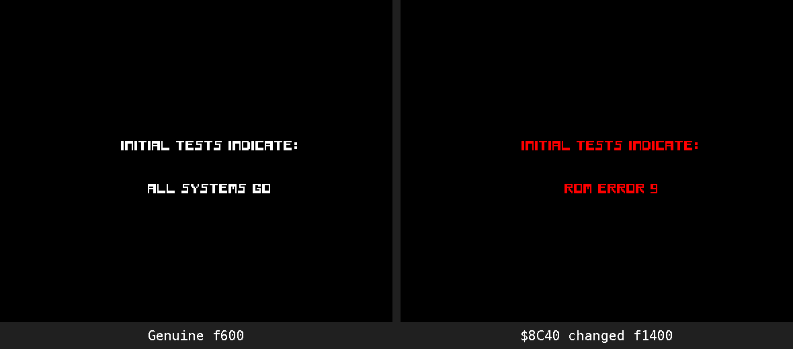

# Stargate (Williams, 1981) – two disguised ROM sums that corrupt a random byte, and a hidden copyright

[Back to the README](../README.md)

MAME set `stargate` (the only Stargate video set in MAME; no bootlegs or hacks). One 6809 main CPU. Addresses are CPU
addresses in `stargate`; ROMs 1 to 9 are at `$0000`-`$8FFF` and 10 to 12 at `$D000`-`$FFFF`. MAME 0.285, ROMs from 0.277
sets. Source labels in backticks are from Williams' source code as published at
[historicalsource/stargate](https://github.com/historicalsource/stargate).

## In short

Stargate's protection is in Williams' published source code; the code is not claimed here. What this repo adds is
checking it against the shipped ROMs and running it. Two ROM sums are computed in passing by routines that look like
something else, and **four sites** compare them with constants. On a mismatch, and a random roll, each corrupts **one
random byte** of the game's own variables. All of it is in the shipped ROMs, at the source's addresses, and edited
copies fire it. A copyright line XOR-encoded in the ROM is drawn **below the part of the screen MAME shows**. And
Williams' own code trips one site on a genuine board: it compares a sum before the first game has computed it, so in
MAME, with fresh settings, a genuine Stargate corrupts one byte at power-up.

There is no Stargate bootleg in MAME, so the demonstration is simulated: one byte of a genuine set changed. None of
this was found in the sources checked.



*What an edit shows on screen. Left: genuine `stargate`, frame 600: "ALL SYSTEMS GO". Right: the same set with one
sampled byte changed (`$8C40`, `00` to `01`, in ROM 9), frame 1,400 (its power-up tests take longer): "ROM ERROR 9".
This is Williams' ordinary power-up ROM test, not the hidden sums: the bytes they corrupt were not seen to change the
picture or the play. The game runs after the error. Made with `williams/demo_stargate.sh`.*

## The sums and the four sites

| Source label | Address | What it does |
|---|---|---|
| `START` | sum loop at `$6146`, stored at `$6151` | at each game start, adds every 16th byte of `$0000`-`$8FFF` into `CHKS1` (`$9CFF`); genuine `$37` |
| `ATTR$` | sum at `$D00C`, stored at `$D01E` | in attract mode, adds every 9th byte from `$D004` to below `$F000` into `CHKS2` (`$BEC2`); genuine `$56` |
| `GEXBON` | compare at `$6742` | at the end of a wave: `CHKS1` against `$37`; on a mismatch and `SEED` below `$30`, `COM` of `$9C` + `HSEED` |
| `SGTRAN` | compare at `$6DD0` | `CHKS2` against `$56`; on a mismatch and `HSEED` below `$19`, `DEC` of `$9C` + `LSEED` |
| `APST` | compare at `$270F` | not in attract; `CHKS2` against `$56`; on a mismatch and `HSEED` at or below `$0D`, `DEC` of `$9C` + `LSEED` |
| `WORD$` | compare at `$7466` | the routine that prints every text phrase; not in attract; `CHKS1` against `$37`; on a mismatch and `HSEED` at or below `$12`, `COM` of `$9C` + `SEED` |
| `HIDTAB` | `$635F`, drawn from `$62D5` | the copyright, each byte XOR `$5A`: `[C\ 1981 WILLIAMS ELEC= INC=` |

- Page `$9C` is the game's direct page: its variables. It also holds `CHKS1` itself (`$9CFF`).
- The sums are made in passing: `CHKS1` inside `START` and `CHKS2` inside `ATTR$`, routines whose names say nothing
  about sums. The site addresses are found through offsets (`LDU #$9CB1` then `$4E,U`, and so on), so `$9CFF` and
  `$BEC2` never appear as such.
- Every one of the nine sites decodes to the source's instructions and operands in the shipped ROM.
- `HIDTAB` is drawn at every player start to screen address `$20FB`, rows `$FB`-`$FF`, below the part of the screen in
  MAME's snapshots; nothing like the text appears in them. The attract-mode title shows the visible "COPYRIGHT 1981
  WILLIAMS ELECTRONICS INC." separately.

## In MAME

Edited copies of the genuine set, each alone on the rompath, the loaded bytes logged; debugger breakpoints at the four
compares and the four corrupting instructions. The same scripted game on each. LABELLED POKE: the nine enemy counters
that the wave-end check adds up are written 0 for 150 frames, so that the game's own wave-end code (and `GEXBON`) runs.
No ROM byte, sum or `$9Cxx` byte is poked.

| Run | Change | `CHKS1` / `CHKS2` | `GEXBON` | `SGTRAN` | `APST` | `WORD$` (in play) |
|---|---|---|---|---|---|---|
| genuine | none | `$37` / `$56` | pass | pass | 0 corruptions (94 compares) | 0 (29 compares) |
| `$8C40` `00` to `01` (ROM 9, sampled) | inside the `CHKS1` sample | **`$38`** / `$56` | **`COM` at `$9C52`** | not reached | 0 (76) | **1, at `$9CD2`** |
| `$8C41` `00` to `01` (ROM 9, not sampled) | outside both samples | `$37` / `$56` | pass | not reached | 0 (76) | 0 |
| `$D95E` `00` to `01` (ROM 10, sampled) | inside the `CHKS2` sample | `$37` / **`$57`** | pass | 2 mismatches, no corruption (the roll is 1 in 10) | **3: `DEC` at `$9CC3`, `$9CFD`, `$9C1F`** | 0 |

So the sums differ by exactly the edited amount, the compare fails and a random byte of page `$9C` is corrupted at the
source's odds; a byte outside the samples changes nothing. Three of the four sites were seen to corrupt a byte. The
fourth, `SGTRAN`, was seen to fail its compare, but its 1-in-10 roll did not come up in two tries. No visible effect
was identified from the screens around the `APST` writes (not examined frame by frame). Any of these edits also fails
the power-up ROM test (the still above), so they are not silent edits. Interpretation: a bootlegger who rebalanced the
ROM test's sums would still have had to rebalance the two hidden ones.

### Williams' own slip: a sum compared before it exists

Every run, genuine included, shows one `COM` at `$9C00` just after power-up. `CHKS1` is only written by `START`, at the
first game. `WORD$` compares it whenever it prints a phrase while `STATUS` is not negative. With a blank NVRAM, which
every run here gets, the power-up prints "FACTORY SETTINGS RESTORED" while `CHKS1`, `SEED` and `HSEED` are all `$00`:
the compare fails, the roll passes (`HSEED` at or below `$12`), and `COM ,U` hits `$9C00` + `SEED` = `$9C00`, the first
byte of the terrain save area (`BGSAV`). An earlier phrase ("INITIAL TESTS INDICATE") also fails the compare, but
`HSEED` is `$C0` then, so nothing is written.

Interpretation: an oversight, and probably harmless in practice, as it complements one byte of an almost empty page.
But it means a stray corrupted byte is not proof of tampering. On a machine with valid settings that message is not
printed, so this exact hit would not normally happen; any phrase printed before the first game with `HSEED` at or below
`$12` would do the same.

Interpretation: the checks make a ROM edit show up as random corruption rather than a stop.

## Rerun

From the repo root, with your MAME ROM folder (`stargate.zip`):

```bash
williams/demo_stargate.sh ~/roms    # genuine against $8C40 changed: CHKS1 37 / 38, corrupting writes in play on the edited side only
```

Both sides are built by `scripts/patchzip.py` (an unchanged copy for genuine; file `stargate_rom_9-a_3002-9.a6`, offset
`0xC40`, `00` to `01` for the edit), each alone on its rompath, and run `williams/stargate_sums.lua`, which logs the
loaded byte, the sums when stored, every corrupting write and the compares reached, and takes the power-up snapshots
for the still. Its inputs differ from the study's run (the Advance press comes after the "FACTORY SETTINGS RESTORED"
page, which the edited set reaches later), and it ends five waves with the same labelled poke instead of one, so that
`GEXBON`'s roll (`SEED` below `$30`) gets several chances. The corrupted addresses are random and differ from the table above; what
should match is `CHKS1` (`$37` against `$38`), the `$9C00` write on both sides, and corrupting writes in play on the
edited side only.

## Prior art and sources checked

Published, and not claimed here: the code itself, in Williams' Stargate source at
[historicalsource/stargate](https://github.com/historicalsource/stargate) (`LOG11`, `SD51`, `SAM16`, `TEXT31`,
`SPHR56`).

Not found in the sources checked: any description of the two hidden sums (`$37`, `$56`), the four compares, the
corruption of page `$9C`, the XOR-`$5A` copyright, or the compare before the sum exists. Sources checked: the source
code above; MAME 0.285 [`williams.cpp`](https://github.com/mamedev/mame/blob/mame0285/src/mame/midway/williams.cpp);
the rec.games.video.arcade.collecting thread "Williams Stargate Problems"; the Arcade Museum forum thread "What kind of
Williams sorcery is this?" (a hobbyist guess that obfuscated chips on an early board interlock the CMOS writes); Sean
Riddle's Williams pages (ROM and RAM addresses); the Stargate manual (ordinary ROM, RAM and CMOS self-tests); web
searches (one returned an unrelated patent). TCRF was not checked: TCRF does not allow automated or AI access.

## Caveats

- MAME 0.285, emulation only, not real hardware. No Stargate bootleg is in MAME, so every edit is simulated: one byte of
  a genuine set changed, in a copy built from your own ROMs.
- One scripted player. The wave end used a labelled poke (the enemy counters zeroed). `SGTRAN`'s corruption was not
  shown (its roll is 1 in 10; two tries).
- The `$9C00` write at power-up was seen only with a blank NVRAM (`scripts/mame.sh` gives every run a fresh one); a
  power-up with saved settings was not tested.
- Whether `HIDTAB` is visible on a real monitor with overscan was not tested; that it falls outside MAME's picture is
  from the snapshots and the screen rows, not checked in the driver.
- Stargate bootlegs not in MAME were not checked.
